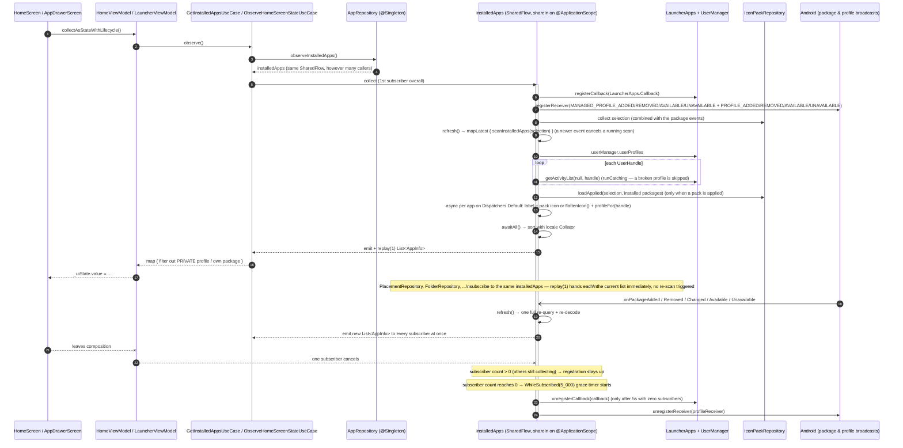
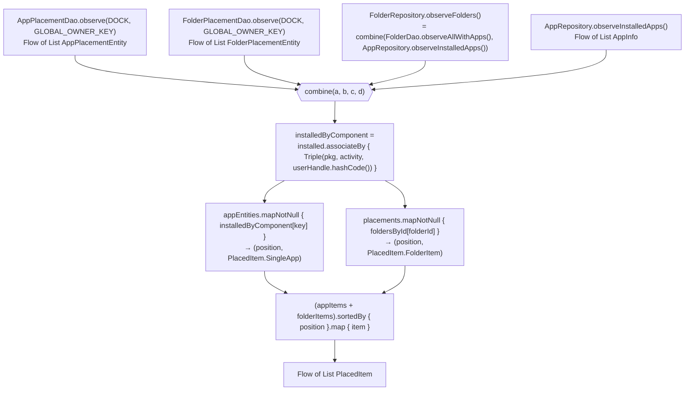
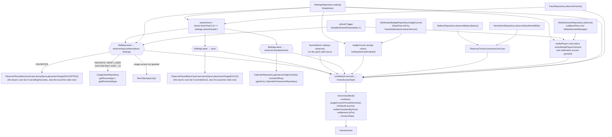
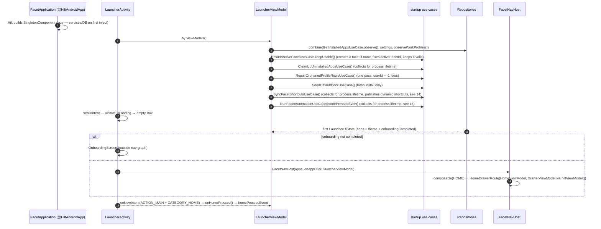

# 03 — Core Reactive & Data Flow

Four flows explain almost everything else in the app: the live installed-app list, how Room
placements are hydrated against it, the Home screen's state graph, and process startup.
Feature-level flows (placements, backup, widgets, profiles, drawer, facets/theme/badges/onboarding)
each have their own doc, `08`–`13`.

## 1. Installed apps: `LauncherApps` → `Flow<List<AppInfo>>`

There is **no Room cache** of installed apps. `AppRepository` re-queries `LauncherApps` on every
package or profile event, but the resulting flow (`installedApps`) is **shared** across every
caller via `shareIn(applicationScope, SharingStarted.WhileSubscribed(5_000), replay = 1)` — one
`LauncherApps.Callback`/`BroadcastReceiver` registration and one profile scan + icon decode per
event, no matter how many repositories are hydrating against it at once (previously ~7 while Home
was showing; this was finding F1, now fixed — see the `git blame` on `AppRepository.kt` for the
change). Each scan also reads an adaptive icon's themed monochrome layer into `AppInfo.monochromeIcon`, a small alpha-only bitmap (API 33+, null when the app ships none); the glyph and outline pictures built from it are not made here but by `StyledIconCache`, on demand and warmed in the background for all apps (see 13).

With an icon pack applied (`IconPackRepository.selection`, from `icon_pack_package`), the scan swaps in the
pack's icon (capped at `PACK_ICON_SIZE` = 192px) for every app the pack covers, by exact activity then by
package, and sets `AppInfo.iconFromPack` so `AppIcon` draws it unclipped. An app the pack misses gets its own
icon on the pack's `iconback`/`iconmask`/`iconupon` art under `MATCH_PACK` (also `iconFromPack`), or keeps its
own icon under `KEEP_DEFAULT` or when the pack ships no such art. Pack icons carry no `monochromeIcon`. The
pack is parsed once per pack version and installed-app set (`IconPackRepository.load`, only installed apps'
appfilter entries are kept), and a pack that is no longer installed is unapplied there. A pack's `<calendar>`
entries date an app's icon: the drawable is the entry's prefix plus today's day of the month (falling back to the
app's plain `<item>`, then its own icon), and a new day redraws only those apps (see §5, "Calendar icons").

Key properties of this flow:

| Property | Value | Consequence |
|---|---|---|
| Source of truth | `LauncherApps.getActivityList()` per `UserManager.userProfiles` handle | Work Profile / Private Space / OEM clone apps arrive in the same list, tagged by `AppInfo.profile` + `userHandle`. Each `AppInfo` also carries `firstInstallTime` (`LauncherActivityInfo.getFirstInstallTime()`, cross-profile safe) and a best-effort `lastUpdateTime` (`PackageManager.getPackageInfo(...).lastUpdateTime`, which only resolves the calling user's own packages — falls back to `firstInstallTime` for a Work Profile app) — feeds the app picker screens' "Installed Date"/"Last updated" sorts (see `SortAppsForPickerUseCase`). |
| Trigger | `LauncherApps.Callback` (5 package events) + 4 `ACTION_MANAGED_PROFILE_*` broadcasts + 4 generic `ACTION_PROFILE_*` broadcasts (the actions Android 15+ Private Space uses, added/removed/available/unavailable) + one initial `refresh()`, combined with `IconPackRepository.selection` | Installs, uninstalls, updates and any profile appearing/disappearing/pausing/resuming (Work Profile or Private Space) all propagate without a restart, and so does applying, clearing or changing an icon pack. Scans run through `mapLatest`, so a newer trigger cancels a scan still running. |
| Work per emission | One full re-list + parallel icon decode of every app, **shared** across every collector | O(apps) per event, but exactly once app-wide, not once per collector. |
| Sharing | `shareIn(@ApplicationScope, SharingStarted.WhileSubscribed(stopTimeoutMillis = 5_000), replay = 1)` | One `LauncherApps` registration for the whole app; survives brief gaps (a Home↔Drawer transition) without re-registering; torn down 5s after the last collector goes away. `replay = 1` gives every new collector (a freshly opened screen) the current list immediately. |
| Profile classification | `profileFor(handle)` via `getLauncherUserInfo().userType` (API 35+), `OTHER` below | Single source of truth reused by `WorkProfileRepository`, `PrivateSpaceRepository`, `AppWidgetRepository`. |
| Companion streams | `observeUninstalledPackages(): Flow<Pair<String, Int>>`, `observeProfileRemoved(): Flow<UserHandle>` | Drive `CleanUpUninstalledAppsUseCase`, which *deletes* placement rows (not just hides them); **not** shared — each is its own unshared `callbackFlow`, cheap enough (`CleanUpUninstalledAppsUseCase` is their only collector) that sharing wasn't worth the complexity. |
| Scope | `@ApplicationScope` `CoroutineScope(SupervisorJob() + Dispatchers.Default)`, provided `@Singleton` from `AppModule` | Lives for the process, like `AppRepository` itself. The constructor parameter defaults to the same expression so the ~90 test call sites that construct `AppRepository` directly keep compiling; a test that actually collects the live flow passes its own `backgroundScope` instead (see `AppRepositoryTest`) so the sharing coroutine is deterministically cancelled with the test rather than leaking a real background collector. |

## 2. Hydrating Room placements against the live list

`ObservePlacedItemsUseCase` joins the Room rows of any Dock or Favorites list (the raw entity flows `PlacementRepository` exposes) with the live app list in memory. `items(PlacementTarget.GlobalDock)` is representative:

Rules this encodes:

- A placement whose app is **not currently installed is silently dropped** from the emitted list
  (`mapNotNull`) but **kept in Room**. Backup export reads the raw rows, so it survives a
  temporary uninstall; a genuine uninstall broadcast deletes it via `CleanUpUninstalledAppsUseCase`.
- The join key is `(packageName, activityName, userId)` — the same triple that forms every unique
  index — so a personal and a work copy of the same app are distinct placements.
- A Room write re-runs only the join, using `combine`'s cached latest app list; it never re-queries
  `LauncherApps`.
- `PlacementRepository` serves all four lists' raw rows from the same two tables, `app_placements` and
  `folder_placements`, each through a `PlacementTarget(list, facetId)`: `DOCK` or `FAVORITES`, for the
  launcher-wide default (`facetId` null) or for one facet. The join above is identical for all of them.
- `itemsForFacets(list, ids)` / `appsForFacets(list, ids)` offer a batched read
  → `Flow<Map<Long, List<PlacedItem>>>` for the facet carousel previews, built the same way. Those
  previews, and the Appearance screens' preview, render the real `HomeScreen` scaled down
  (`ScaledHomeScreen`), built from the same `ResolvedFacetStyle` and `toHomeScreenState` as Home, so
  they show Home's layout in either orientation.

## 3. The Home screen state graph

`ObserveHomeScreenStateUseCase.invoke()` is the largest reactive composition in the app. It is
the one place that decides *which* Room tables feed Home, based on the active facet's override flags.

Notes:

- The `combine` arity limit (5 in `kotlinx.coroutines`) is worked around with `domain/FlowCombine.kt`
  (6- and 7-ary overloads) and by pairing unrelated flows (`dockAndFavoriteItems`, `badgeCountsAndAccessories`).
- `refreshTrigger` exists because Recents/Most-used and calendar events are **one-shot** reads
  (`flow { emit(...) }`), not live streams; `HomeViewModel` re-emits the trigger on resume. It also
  re-evaluates the notification-access grant that gates `mediaPlayer`, re-subscribing to
  `MediaSessionRepository.observe()` once access has been granted in system Settings.
- The facets in `F` already carry each facet's `clockStack` (hydrated in `FacetRepository` from `clock_stack_items`), so a
  stack change re-emits the facets and Home with it. `visibleClockItemByFacet` is in-memory only (the page last shown per facet, not
  saved across a restart) and `isPro` limits the shown pages (`ResolvedFacetStyle.limitedTo`). Whether a widget page is orphaned is not
  in the flow: Home asks `ClockWidgetHostController.isOrphaned` when it builds its state and again on each resume.
- `HomeViewModel` seeds `HomeUiState(isLoading = true)` and additionally clears `isLoading`
  after `LOADING_TIMEOUT_MS` so a slow first `LauncherApps` scan can't leave Home blank forever.
- `HomeUiState`'s resolved "look" properties (`activeAppRowPosition`, `activeAppRowPresentation`,
  `activeAppListVerticalAlignment`, `activeAppListLayout`, `activeAppListColumnAlignment`,
  `activeAppListGridColumns`, `activeAppListGridDisplayMode`, `activeDockDisplayMode`) aren't
  separate nodes in this graph — they're derived directly from `S`/`F` (already flowing into `OUT`)
  via each field's own `resolveSentinel`, not through `ObserveHomeScreenStateUseCase` at all. See
  [13-flow-facets-theme-notifications-onboarding.md](13-flow-facets-theme-notifications-onboarding.md)'s
  `LOOK` subgraph for the full list and each field's Settings row.

## 4. Process startup

## 5. Other reactive sources worth knowing

| Source | Mechanism | Consumer |
|---|---|---|
| Notification badges | `FacetNotificationListenerService` (`@AndroidEntryPoint`) pushes `setActiveNotifications()` into `NotificationBadgeRepository`'s `MutableStateFlow` | `ObserveHomeScreenStateUseCase`, `DrawerViewModel` |
| Media session | `MediaSessionRepository.observe()` — `callbackFlow` over `MediaSessionManager.OnActiveSessionsChangedListener` plus a `MediaController.Callback` per session (main-thread handler), gated on `NotificationBadgeRepository.mediaNotificationPackages` (a session only counts while its app has a media notification posted), cold: only subscribed while Home collects and the setting is on and access is granted | `ObserveHomeScreenStateUseCase` (`mediaPlayer`), transport calls via `HomeViewModel` |
| Battery | `callbackFlow` over `ACTION_BATTERY_CHANGED` sticky broadcast | `ObserveClockAccessoriesUseCase` |
| Headphones | `HeadphonesRepository.observeHeadphonesPluggedIn()` — `callbackFlow` over `AudioDeviceCallback` | `DeviceStateRepository` |
| Wi-Fi | `WifiRepository.observeWifiState(includeSsid)` — synchronous read of current networks, then `ConnectivityManager` network callbacks; the location-info flag is only set when `includeSsid` (a named-network rule) | `DeviceStateRepository` |
| Bluetooth connections | `BluetoothRepository.observeConnectedAddresses()` — ACL broadcasts + a one-time profile query; null until it answers | `DeviceStateRepository` |
| Device state | `DeviceStateRepository.deviceState` — `combine` of battery, headphones, Wi-Fi and Bluetooth, shared with `stateIn(WhileSubscribed)`; each source is subscribed only while an enabled rule reads it | `RefreshAutomationStateUseCase` (via `current()`), `RunFacetAutomationUseCase` |
| Pro entitlement | `EntitlementRepository.isPro` — a `StateFlow<Boolean>` fed by `PlayEntitlementRepository` (the cached value first, then `BillingRepository.queryPro()` at startup and every resume, with a debug-only `EntitlementOverride` applied on top, plus the `BillingRepository.updates` flow for purchases that finish while running). Everything else gets "everyone is Pro" from the base class (tests, previews) | `RunFacetAutomationUseCase` (a pass on change), `ObserveFacetAutomationUseCase`, `RuleEditorViewModel`; `RefreshAutomationStateUseCase` reads `.value` |
| Wake events | `WakeEventsRepository.observeWakeEvents()` — `callbackFlow` over `ACTION_SCREEN_ON`, `ACTION_USER_PRESENT`, `ACTION_TIME_CHANGED`, `ACTION_TIMEZONE_CHANGED` | `RunFacetAutomationUseCase` (see [15](15-flow-facet-automation.md)) |
| Next alarm | `callbackFlow` over `ACTION_NEXT_ALARM_CLOCK_CHANGED` + injected `Clock` | `ObserveClockAccessoriesUseCase` |
| Calendar icons (icon packs) | `AppRepository.observeDayOfMonth()` — `callbackFlow` over `ACTION_DATE_CHANGED`, `ACTION_TIME_CHANGED`, `ACTION_TIMEZONE_CHANGED`, plus `recheckDate()` (`LauncherActivity.onResume` → `LauncherViewModel.onResumed`, for a midnight passed asleep), read through the injected `Clock` in the current zone; subscribed only while the applied pack dates an installed app (`flatMapLatest` after each scan). A new day redraws just the dated apps' icons from the last scan, no re-list | `installedApps` (`03 §1`) |
| Widget host | `LauncherAppWidgetHost.providerChanges: SharedFlow<Int>` merged with a `refreshTrigger` in `ObserveHubStateUseCase` | `HubViewModel` |
| Work Profile state | `WorkProfileRepository.observeWorkProfiles()` — `callbackFlow` over profile broadcasts mapped through `UserManager.isQuietModeEnabled` | `LauncherViewModel`, `SettingsViewModel` |
| Private Space | `PrivateSpaceRepository.observePrivateSpaceState()` (sealed `PrivateSpaceState`) + `observePrivateSpaceApps()` (= `observeAppsForProfile(PRIVATE)`) | `PrivateSpaceViewModel`, `DrawerViewModel` |
| Wallpaper | `WallpaperRepository` via `WallpaperManager` | `FacetCarouselViewModel`, `AppearanceSettingsViewModel`, dock/home/app-drawer settings previews |
