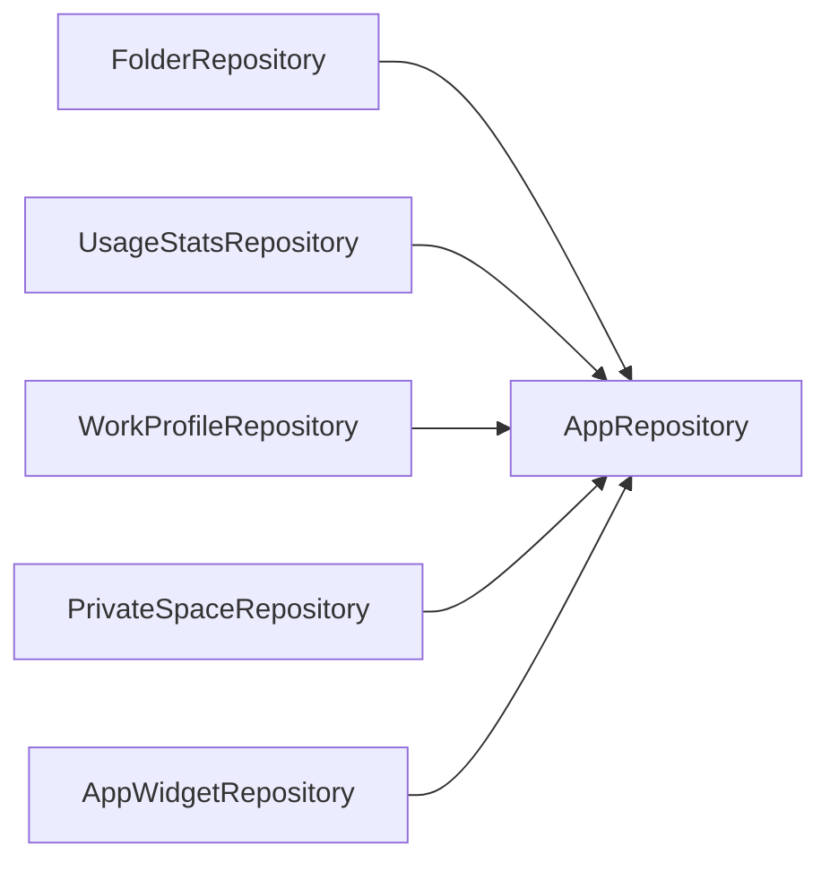

# 05 — Architect's Review: Findings & Recommendations

Overall verdict: the layering described in `CLAUDE.md` is real, not aspirational. ViewModels never
touch DAOs, composables never inject repositories, every repository is a `@Singleton` behind
constructor injection, and the reactive model is consistent (Room/DataStore `Flow` → `combine` →
`StateFlow` → `collectAsStateWithLifecycle`). The findings below are ordered by impact.

Findings are numbered by discovery order, not severity — a gap where a fixed finding was removed
(e.g. no F1 below: `observeInstalledApps()`'s missing `shareIn` was fixed) is expected, not an
error; see this doc's own rule in `CLAUDE.md`'s "Living architecture docs" section.

| # | Finding | Severity | Effort |
|---|---|---|---|
| F4 | `domain/` imports `android.*` in 5 files | Low–Medium | Small |
| F5 | `AppRepository` is still a fan-in for five repositories (`FolderRepository`, `UsageStatsRepository`, `WorkProfileRepository`, `PrivateSpaceRepository`, `AppWidgetRepository`) | Low (design) | Medium |
| F7 | `HomeViewModel` and `LauncherViewModel` collect for their whole lifetime (`launchIn(viewModelScope)`, not `stateIn(WhileSubscribed)`) | Low | Small |
| F8 | `ObserveHomeScreenStateUseCase` / `ObserveHubStateUseCase` hold mutable state while unscoped | Low | Trivial |
| F10 | Recents / Most-used / calendar are one-shot reads behind a manual `refreshTrigger` | Low (UX) | Medium |
| F12 | `DrawerViewModel` exposes ~8 separate `StateFlow`s instead of one `DrawerUiState` | Low (convention) | Small |

---

## F4 — `domain/` touching the Android framework (Low–Medium)

`CLAUDE.md`: "nothing here touches Android framework APIs directly". Five files do:

| File | Import | Assessment |
|---|---|---|
| `HubGridConstants.kt` | `android.content.Context` — `calculateHubCellWidth(context)` reads display metrics | Real violation; belongs in a `HubLayoutRepository` or in `ui/hub` (it is a layout concern) |
| `GroupAppsByLetterUseCase.kt` | `android.icu.text.AlphabeticIndex` | Pragmatic — ICU is the right tool; keep, but its test already needs Robolectric because of it |
| `ExportBackupUseCase.kt`, `ImportBackupUseCase.kt` | `android.net.Uri` as a parameter type | Value type only; acceptable. Could take a `String` and let `BackupRepository` parse |
| `ObserveAppNotificationsUseCase.kt` | `android.os.UserHandle` as a parameter type | Value type only (the same `UserHandle` `AppInfo` carries); acceptable |

## F5 — `AppRepository` fan-in (Low, design)

Dock/Favorites hydration used to be a second repository→repository edge: `PlacementRepository`
joined its rows against `AppRepository` and `FolderRepository`. That join now lives in
`ObservePlacedItemsUseCase` (`domain/`), and `PlacementRepository` exposes raw entity flows only,
so the join exists once and `data/` has one fewer dependency on `AppRepository`'s emission shape.
What remains is `FolderRepository`, which hydrates folder members against the live app list the
same way. It is the same shape, but it has no cross-repository fan-out beyond that one edge, and
`AppRepository.observeInstalledApps()` is shared (`shareIn`, see `03 §1`), so the runtime cost is
nil. Worth moving into a use case only if its emission shape starts to change often.

## F7 — Lifetime collection in two ViewModels (Low)

Most ViewModels expose `stateIn(viewModelScope, SharingStarted.WhileSubscribed(5_000), initial)`
(26 files), which stops upstream collection when nothing observes the screen. Two do not:
`HomeViewModel` and `LauncherViewModel` build their state with
`combine(...).onEach { _uiState.value = it }.launchIn(viewModelScope)`, so their upstream
`callbackFlow`s (LauncherApps, battery, alarm broadcasts) stay registered for the ViewModel's whole
lifetime. For the launcher's Home and the app-lifetime orchestrator that is arguably desired
(instant return, no re-subscribe on every resume), and `AppRepository.observeInstalledApps()`'s own
`shareIn` means a ViewModel that stopped collecting would not remove the shared `LauncherApps`
registration anyway. Worth revisiting only if Home's extra subscriptions (calendar, usage stats,
badges) ever show up in a profile while another screen is on top.

## F8 — Stateful "unscoped" use cases (Low)

`ObserveHomeScreenStateUseCase.refreshTrigger` and `ObserveHubStateUseCase.refreshTrigger` are
`MutableSharedFlow`s on classes Hilt instantiates fresh per injection. It works because each is
injected by exactly one ViewModel, and `refresh()` is called on the same instance — but a second
injector would get a different trigger and silently never refresh. Either annotate them
`@ViewModelScoped` (documents the assumption) or move the trigger into the ViewModel and pass it in.

## F10 — One-shot reads on Home (Low, UX)

Recents / Most-used (`UsageStatsRepository`) and today's calendar events (`CalendarRepository`)
are `flow { emit(...) }` one-shots re-run only when `HomeViewModel.refresh()` fires on
`ON_RESUME` or the active facet/settings change. Usage stats have no change callback, so polling
on resume is reasonable; calendar *does* have one (`ContentResolver.registerContentObserver` on
`CalendarContract.Events.CONTENT_URI`), so an event added while Home is visible won't appear until
the next resume. A `callbackFlow` in `CalendarRepository` would make it live without touching the
use case.

## F12 — `DrawerViewModel` flow sprawl (Low)

- `DrawerViewModel` exposes `badgeCounts`, `contactResults`, `settingsResults`,
  `showContactsPermissionPrompt`, `showContactsSettingPrompt`, … as separate `StateFlow`s and
  `observeAppNotifications(app)` for the composable to call. Every other screen has one
  `XUiState`; the drawer's composable ends up collecting 8 flows itself (`settings`, `privateSpaceState`, `badgeCounts`, `contactResults`, `settingsResults`, `showContactsPermissionPrompt`, `showContactsSettingPrompt`, `folders`). Folding them into a
  `DrawerUiState` would also make `AppDrawerScreenTest` setups smaller.

---

## What is working well (keep doing this)

- **No `@Binds`/interface indirection.** Concrete `@Singleton` repositories + hand-written fakes at
  the DAO/service seam keep the DI graph readable and tests fast.
- **Lenient converters + inline DataStore defaults.** Enum renames and new preferences never need a
  migration, and Room can never crash on a `NOT NULL` converter result.
- **Migration policy.** Explicit SQL migrations, exported schemas, `MigrationTestHelper` tests, and
  *no* destructive fallback on upgrade is exactly the right posture for an app holding user layout.
- **Profile identity via `userId` in every unique index**, with a one-time repair pass for legacy
  rows, is the correct model for Work Profile / Private Space and was clearly retrofitted carefully.
- **`resolveOverride` on `Facet`** keeps the "facet overrides global" rule in one expression
  instead of scattered `if (facet.overrideX)` checks.
- **Startup orchestration in one ViewModel** (`LauncherViewModel.init`) makes the app-lifetime
  side effects discoverable in a single place.
