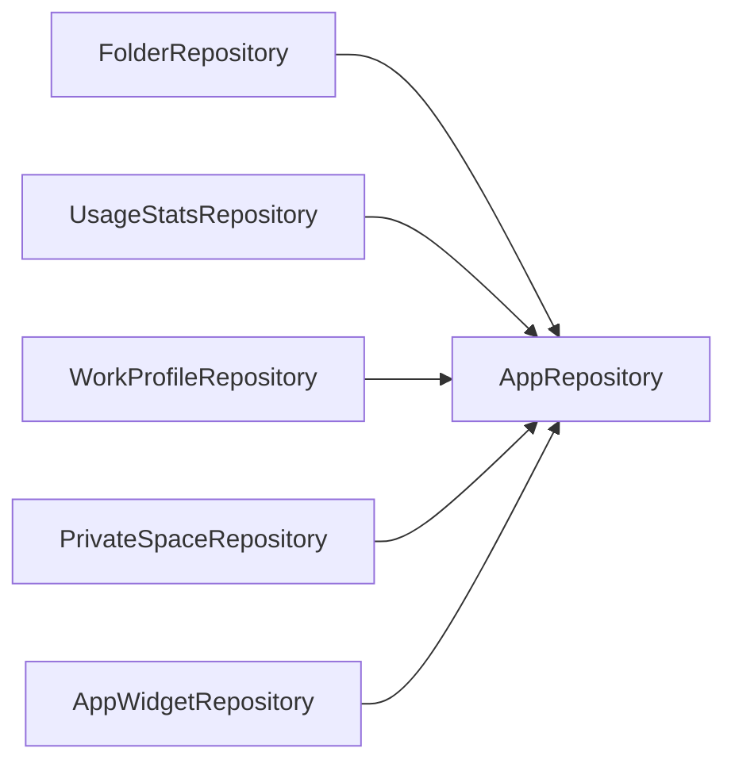

# 05 — Architect's Review: Findings & Recommendations

Overall verdict: the layering described in `CLAUDE.md` is real, not aspirational. ViewModels never
touch DAOs, composables never inject repositories, every repository is a `@Singleton` behind
constructor injection, and the reactive model is consistent (Room/DataStore `Flow` → `combine` →
`StateFlow` → `collectAsStateWithLifecycle`). The findings below are ordered by impact.

Findings are numbered by discovery order, not severity — a gap where a fixed finding was removed
(e.g. no F1 below: `observeInstalledApps()`'s missing `shareIn` was fixed) is expected, not an
error; see this doc's own rule in `CLAUDE.md`'s "Living architecture docs" section.

| # | Finding | Severity | Effort |
|---|---|---|---|
| F4 | `domain/` imports `android.*` in 5 files | Low–Medium | Small |
| F5 | `AppRepository` is still a fan-in for five repositories (`FolderRepository`, `UsageStatsRepository`, `WorkProfileRepository`, `PrivateSpaceRepository`, `AppWidgetRepository`) | Low (design) | Medium |
| F7 | `HomeViewModel` and `LauncherViewModel` collect for their whole lifetime (`launchIn(viewModelScope)`, not `stateIn(WhileSubscribed)`) | Low | Small |
| F10 | Recents / Most-used / calendar are one-shot reads behind a manual `refreshTrigger` | Low (UX) | Medium |
| F12 | `DrawerViewModel` exposes ~8 separate `StateFlow`s instead of one `DrawerUiState` | Low (convention) | Small |
| F15 | The drawer ranks, groups and filters its app list during composition, on the main thread | Medium (layering + performance) | Small–Medium |
| F16 | `SettingsRepository.settings` and `FacetRepository.observeFacets()` are cold and unshared | Medium (performance) | Small |
| F17 | Any settings write restarts Home's whole state graph, including the usage-stats and calendar reads | Medium (performance) | Small |
| F18 | Every package event re-lists and re-decodes every app's icon | Medium (performance) | Medium |
| F19 | `HomeBoundsReporting` reports measured clock bounds from a `SideEffect` | Low–Medium (correctness) | Small |
| F20 | Leftover code: unused facet-less scope, a disabled gesture, a dead setting, unused converters | Low (cleanup) | Small |
| F22 | Test gaps: three ViewModels and two DAOs no test touches | Low–Medium | Small |

---

## F4 — `domain/` touching the Android framework (Low–Medium)

`CLAUDE.md`: "nothing here touches Android framework APIs directly". Five files do:

| File | Import | Assessment |
|---|---|---|
| `HubGridConstants.kt` | `android.content.Context` — `calculateHubCellWidth(context)` reads display metrics | Real violation; belongs in a `HubLayoutRepository` or in `ui/hub` (it is a layout concern) |
| `GroupAppsByLetterUseCase.kt` | `android.icu.text.AlphabeticIndex` | Pragmatic — ICU is the right tool; keep, but its test already needs Robolectric because of it |
| `ExportBackupUseCase.kt`, `ImportBackupUseCase.kt` | `android.net.Uri` as a parameter type | Value type only; acceptable. Could take a `String` and let `BackupRepository` parse |
| `ObserveAppNotificationsUseCase.kt` | `android.os.UserHandle` as a parameter type | Value type only (the same `UserHandle` `AppInfo` carries); acceptable |

## F5 — `AppRepository` fan-in (Low, design)

Dock/Favorites hydration used to be a second repository→repository edge: `PlacementRepository`
joined its rows against `AppRepository` and `FolderRepository`. That join now lives in
`ObservePlacedItemsUseCase` (`domain/`), and `PlacementRepository` exposes raw entity flows only,
so the join exists once and `data/` has one fewer dependency on `AppRepository`'s emission shape.
What remains is `FolderRepository`, which hydrates folder members against the live app list the
same way. It is the same shape, but it has no cross-repository fan-out beyond that one edge, and
`AppRepository.observeInstalledApps()` is shared (`shareIn`, see `03 §1`), so the runtime cost is
nil. Worth moving into a use case only if its emission shape starts to change often.

## F7 — Lifetime collection in two ViewModels (Low)

Most ViewModels expose `stateIn(viewModelScope, SharingStarted.WhileSubscribed(5_000), initial)`
(37 files), which stops upstream collection when nothing observes the screen. Two do not:
`HomeViewModel` and `LauncherViewModel` build their state with
`combine(...).onEach { _uiState.value = it }.launchIn(viewModelScope)`, so their upstream
`callbackFlow`s (LauncherApps, battery, alarm broadcasts) stay registered for the ViewModel's whole
lifetime. For the launcher's Home and the app-lifetime orchestrator that is arguably desired
(instant return, no re-subscribe on every resume), and `AppRepository.observeInstalledApps()`'s own
`shareIn` means a ViewModel that stopped collecting would not remove the shared `LauncherApps`
registration anyway. Worth revisiting only if Home's extra subscriptions (calendar, usage stats,
badges) ever show up in a profile while another screen is on top.

## F10 — One-shot reads on Home (Low, UX)

Recents / Most-used (`UsageStatsRepository`) and today's calendar events (`CalendarRepository`)
are `flow { emit(...) }` one-shots re-run only when `HomeViewModel.refresh()` fires on
`ON_RESUME` or the active facet/settings change. Usage stats have no change callback, so polling
on resume is reasonable; calendar *does* have one (`ContentResolver.registerContentObserver` on
`CalendarContract.Events.CONTENT_URI`), so an event added while Home is visible won't appear until
the next resume. `CalendarRepository.observeCalendarChanges()` already is that `callbackFlow` (it drives
`EnsureCalendarColorsUseCase`); Home's events only need to be re-read when it emits.

## F12 — `DrawerViewModel` flow sprawl (Low)

- `DrawerViewModel` exposes `badgeCounts`, `contactResults`, `settingsResults`,
  `showContactsPermissionPrompt`, `showContactsSettingPrompt`, … as separate `StateFlow`s and
  `observeAppNotifications(app)` for the composable to call. Every other screen has one
  `XUiState`; the drawer's composable ends up collecting 8 flows itself (`settings`, `privateSpaceState`, `badgeCounts`, `contactResults`, `settingsResults`, `showContactsPermissionPrompt`, `showContactsSettingPrompt`, `folders`). Folding them into a
  `DrawerUiState` would also make `AppDrawerScreenTest` setups smaller.

## F15 — Drawer list work runs in composition (Medium)

`rememberDrawerBrowseModel` (`ui/drawer/DrawerBrowseModel.kt`) and `DrawerSearchSheet` call
`RankBySearchRelevanceUseCase`, `GroupAppsByLetterUseCase`, `RecentlyInstalledAppsUseCase` and
`RecentlyChangedAppsUseCase` inside `remember { }`, through the `DrawerListUseCases` bundle that
`DrawerViewModel` hands the composable. Two costs:

- **Layering.** A composable invokes `domain/` directly; the rule is that a ViewModel is the only
  thing a composable talks to. `PrivateSpaceViewModel` already does the same ranking in the
  ViewModel, so the two drawers disagree.
- **Main thread.** `GroupAppsByLetterUseCase` builds a new ICU `AlphabeticIndex` on every call and
  buckets every app, and the search filter and sort run on every keystroke, all on the main thread
  during composition, at the moment the drawer opens or the query changes.

Fix: compute `browseApps`, `groupedItems`, `recentlyInstalledApps` and `searchResults` in
`DrawerViewModel` from `apps`, `query`, the tab and the settings, on `@DefaultDispatcher`, and expose
them in the one `DrawerUiState` F12 asks for. Cache the `ImmutableIndex` per locale in the use case.

## F16 — The two most-collected flows are unshared (Medium, performance)

`SettingsRepository.settings` is `dataStore.data.map { … }`: a cold flow that rebuilds the whole
74-field `LauncherSettings` (about 40 `runCatching { valueOf }` enum parses) per collector, per
write. It is read from 66 places; with Home, the launcher shell and the drawer alive at once, a single
toggle runs that mapping a dozen or more times. `FacetRepository.observeFacets()` is the same shape
(26 call sites; each collector opens its own `facets` and `clock_stack_items` Room observers and
re-maps every facet). `AppRepository.installedApps` already shows the fix: one
`shareIn(applicationScope, WhileSubscribed(5_000), replay = 1)` in each repository, with
`distinctUntilChanged()` so a write that changes nothing emits nothing. Tests construct the
repositories directly, so the scope needs the same defaulted constructor parameter `AppRepository` uses.

## F17 — A settings write restarts Home's state graph (Medium, performance)

In `ObserveHomeScreenStateUseCase`, `activeFacet` is `combine(settings, facets) { … }` with no
`distinctUntilChanged()`, and it feeds five `flatMapLatest` branches; the calendar branch also
combines `settings` directly. So every DataStore write, whatever the key, cancels and restarts the
dock, favorites, grid-cell and app-list flows and re-runs both one-shots: the `UsageStatsManager`
query (Recents / Most used) and the calendar provider query. Because `HomeViewModel` collects for
its whole lifetime (F7), this happens while the user is in Settings: dragging the icon-size or font
slider re-queries usage stats and the calendar on each step. Fix: `distinctUntilChanged()` on
`activeFacet`, and key each branch on only what it reads (the placement target; `listContentMode` and
`appsToShowCount`; the resolved calendar config). In `FAVORITES` mode `appListItems` can reuse
`favoriteItems` rather than hydrating the same list twice. Sharing the sources (F16) removes the six
duplicate upstream collections as well.

## F18 — A package event rescans everything (Medium, performance)

`AppRepository.scan` runs on every `LauncherApps` callback and profile broadcast. Each run lists every
profile's activities, loads and flattens every icon into a new bitmap, reads the monochrome layer and
makes one `getPackageInfo` binder call per activity. Updating one app therefore re-decodes a few
hundred icons, and because the bitmaps are new objects every `AppInfo` compares unequal: every visible
row recomposes and `StyledIconCache` (keyed by the bitmap) recomputes each styled icon. A Play Store
batch update repeats this per app (`mapLatest` cancels the scan in flight, but the work already done is
thrown away). Options, cheapest first: debounce the trigger by a few hundred milliseconds; keep a
per-component cache keyed by `(component, user, lastUpdateTime, icon-pack selection)` so an unchanged
app keeps its `AppInfo` and bitmaps; or use the callback's `packageName` to rescan only that package.

## F19 — Clock bounds reported from a `SideEffect` (Low–Medium)

`HomeBoundsReporting` (`ui/home/HomeScreenEffects.kt`) reports the app list's bounds through
`snapshotFlow`, as `CLAUDE.md` requires, but still reports the clock box (`onBoundsChange`) and the
clock zone (`onClockZoneBoundsChange`) from a `SideEffect`. Those read `HomeScreenLayout`'s
`clockBoxSize` / `clockBoxOriginInRoot`, which `onGloballyPositioned` writes after layout, so the
effect reports the previous recomposition's values until something unrelated recomposes: the same bug
class the rule was written for. Move both into the existing `LaunchedEffect` + `snapshotFlow`.

## F20 — Leftover code (Low, cleanup)

- **A facet-less scope nobody opens.** `DOCK_SETTINGS`, `HOME_APPS_LIST_SETTINGS`, `DOCK_PICKER` and
  `FAVORITES_PICKER` still default `facetId` to `NO_ACTIVE_FACET_ID`, and `HomeAppsListSettingsViewModel`,
  `DockAppPickerViewModel` and `FavoritesPickerViewModel` carry a nullable `facetId` with a `?.let` on
  every write, but every caller passes a facet (the launcher-wide *Default …* pages were removed). Make
  the argument required and the id non-null. `ObserveQuickAddStateUseCase.forApp/forFolder` likewise still take two
  owner names and are always given the same one twice.
- **A disabled gesture.** `HomeViewModel.onEmptySpaceDoubleTap()` is an empty body around commented-out
  code, while `LockScreenController`, `FacetAccessibilityService`, the `doubleTapToLock` setting and its
  backup field are all still wired. Either gate it behind one flag or remove the comment block.
- **A dead setting.** `selected_calendar_ids` / `LauncherSettings.selectedCalendarIds` and its writer
  `SettingsRepository.setSelectedCalendarIds` have no reader or caller in production code (calendar selection moved
  into each clock's config); only a test and the backup DTO still mention them.
- **Launcher-wide keys only a restore writes.** `clock_alignment`, `clock_zone_height_dp`, the five `landscape_*`
  keys, `use_24_hour_time`, `show_all_day_events`, `weather_icon_style`, `dock_display_mode` and the app-list look keys
  are now written by `ImportBackupUseCase` alone (`02 §5.3`). The look and dock ones still seed a new facet; check
  whether the clock ones are read by anything but the old-version migrations, and retire those that are not.
- **Four unused Room converters.** `Converters` still converts `ClockTemplateId`, `ClockFontOption`,
  `ClockColorOption` and `FontWeightOption`, but no entity has a column of those types since the clock's settings
  became JSON on its stack page.
- **Owner-less placement rows.** `AppPlacementEntity` / `FolderPlacementEntity` keep a nullable `facetId`, the
  `GLOBAL_OWNER_KEY` fallback and KDoc about a launcher-wide list; 47→48 deleted every such row and
  `PlacementTarget.facetId` is non-null.
- **`AppearanceSettingsViewModel` leftovers.** It reads a `facetId` nav argument that none of its four routes
  declares (so its per-facet branch never runs) and keeps a `refreshNotificationAccess()` no screen calls.
- **Bespoke corner radii.** 56 `RoundedCornerShape(<n>.dp)` literals in 24 files against the "shape
  scale only" rule. 25 are in `ClockTemplates.kt` (clock artwork, a fair exception worth stating in
  `CLAUDE.md`); the rest (onboarding, Pro, Hub, pickers) should be checked against `MaterialTheme.shapes`.
- **Long comments.** `DatabaseModule`, `AppRepository` and `LauncherViewModel` still carry the
  multi-paragraph comments `CLAUDE.md` says to trim when touched.

## F22 — Test gaps (Low–Medium)

From `TEST_REGISTRY.md`'s last section (`06 §5`): no test references `AccessibilityAccessExplanationViewModel`,
`ClockAccessoriesViewModel` or `WeatherLocationViewModel` (the last holds the city search debounce and the
"No city selected" exit rules), and `ClockStackItemDao` and `WeatherDao` are only ever replaced by fakes, so their SQL
(`replace`, `clearClockBoxes`, ordering, the meta upsert) is unproven outside the migration test's schema check.
`HomeSizeStabilityTest` also uses a fixed `Thread.sleep(700)`, which the testing conventions rule out.

---

## What is working well (keep doing this)

- **No `@Binds`/interface indirection.** Concrete `@Singleton` repositories + hand-written fakes at
  the DAO/service seam keep the DI graph readable and tests fast.
- **Lenient converters + inline DataStore defaults.** Enum renames and new preferences never need a
  migration, and Room can never crash on a `NOT NULL` converter result.
- **Migration policy.** Explicit SQL migrations, exported schemas, `MigrationTestHelper` tests, and
  *no* destructive fallback on upgrade is exactly the right posture for an app holding user layout.
- **Profile identity via `userId` in every unique index**, with a one-time repair pass for legacy
  rows, is the correct model for Work Profile / Private Space and was clearly retrofitted carefully.
- **A facet owns its Home** (dock, favorites, content mode, look): the launcher-wide values only seed a facet
  at creation or on Reset to default (`ApplyFacetDefaultsUseCase`), so there is no override flag and no
  inheritance to resolve.
- **Startup orchestration in one ViewModel** (`LauncherViewModel.init`) makes the app-lifetime
  side effects discoverable in a single place.
