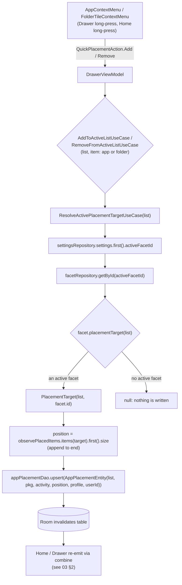
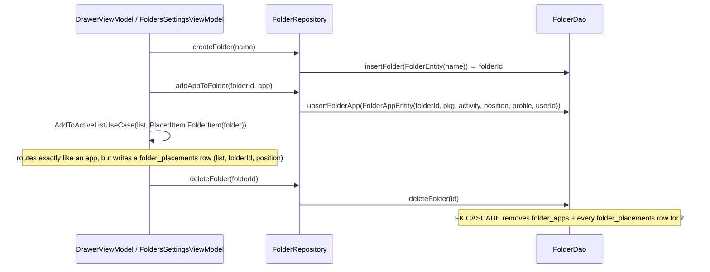
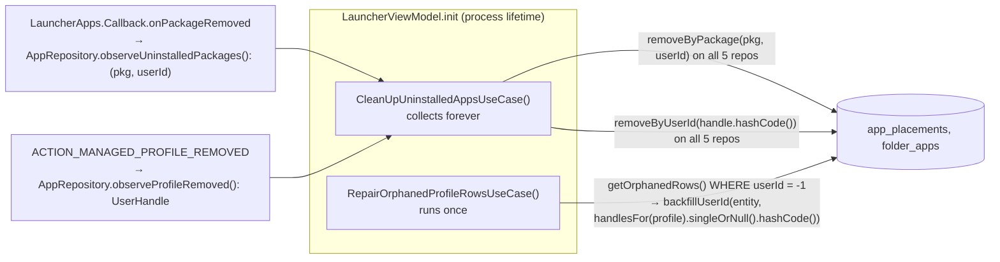

# 08 — Flow: Placements (Favorites, Dock, Folders) — add, remove, reorder, clean up

"Placement" is the app's word for *an app or folder pinned somewhere*: the Home app list
(favorites), the Home dock, or inside a folder. This flow covers every write to the
placement tables (`app_placements` and `folder_placements`, plus `folder_apps` for folder membership) and the three background processes that keep them consistent with the OS.

## 1. The routing rule — the active facet's own list

Every add/remove goes through a `domain/` use case that decides which list to write (`DOCK` or
`FAVORITES`) and whose it is: the **active facet's own** list (nothing is written when there is no active
facet; there is no launcher-wide list). The composable and ViewModel never know which rows were hit.

- Capacity is enforced *before* the use case, in `ObserveQuickAddStateUseCase`
  (`HomeViewModel`): an `Add` action is only offered when `items.size < max`
  (`AppListLimits.MAX_DOCK_APPS` for dock, `AppListLimits.MAX_FAVORITES` for favorites); a
  `Remove` when the item is already a member. The context menu renders exactly what that state says.
- `userId` on the new row is `app.userHandle.hashCode()` — the same value the unique index and the
  hydration join use, so a Work-profile copy of an app is a distinct placement.

## 2. Reorder (drag)

Reordering rewrites `position = index` for every item in the list (an `upsert` per item, which replaces the existing row on its unique key `(list, ownerKey, component)` or `(list, ownerKey, folderId)`), not a per-row position update:

| Surface (all use `ui/components/DragReorderState`) | ViewModel call | Repository | Mechanism |
|---|---|---|---|
| Dock settings (`DockSettingsScreen`) | `DockSettingsViewModel` → | `PlacementRepository.reorderItems(PlacementTarget(DOCK, facetId), items)` | `upsert` of every app and folder placement with `position = index` (`AppPlacementDao.upsert` / `FolderPlacementDao.upsert`); `replaceItems(target, items)` instead calls `deleteAllForOwner(list, facetId)` first. The Dock's *Copy from facet* calls `PlacementRepository.copyList(source, target)`, which deletes the target's rows and re-inserts the source's with the target's owner, cells included. The Dock's *Reset to default* clears the Dock and re-seeds it (`SeedFacetDefaultsUseCase`, `ApplyFacetDefaultsUseCase` scope `DOCK`) |
| Home app list settings (`HomeAppsListSettingsScreen`) | `HomeAppsListSettingsViewModel` → | `PlacementRepository.reorderItems(PlacementTarget(FAVORITES, facetId), items)` | same |
| Folder contents (`FolderDetailScreen`) | `FolderDetailViewModel` → | `FolderRepository.reorderFolderApps(folderId, apps)` | same |
| Onboarding (`OnboardingHomeSetupPage`) | `OnboardingViewModel.reorderDockApps / reorderFavorites` | `PlacementRepository.reorderItems` on the first (active) facet's own targets; `OnboardingViewModel.finish` then applies only the content mode and count (`ApplyFacetDefaultsUseCase`, scope `APPS_LIST`) | same |
| Home's single-column list and Dock (`PickUpReorderHost`, [12 §3](12-flow-drawer-search-and-app-actions.md)) | `DrawerViewModel.onReorderList` → `ReorderActiveListUseCase` | `PlacementRepository.reorderItems(resolveTarget(list), items)` (the active facet's own list) | same; list only in Favorites mode |
| An open folder on Home (`FolderContentsSheet`) | `DrawerViewModel.onReorderFolderApps` | `FolderRepository.reorderFolderApps(folderId, apps)` | same |
| Manage facets (`ManageFacetsScreen`) | `ManageFacetsViewModel.reorderFacets` | `FacetRepository.reorderFacets` | `update` per facet with new `position` |

Home reorders its single-column list (Favorites mode only) and the Dock in place: a long-press picks the cell up and a
drag moves it, saved once on drop (the first two rows above). Reordering from a settings screen still works. The grid
layouts are not draggable yet.

`app_placements` and `folder_placements` also hold an optional Home grid cell per orientation (`portraitRow/Column`, `landscapeRow/Column`, from the anchor edge, [02](02-persistence-room.md)). `PlacementRepository.saveGridCells` writes one orientation's cells and leaves `position` alone, so the list and the grid each keep their own arrangement (and landscape its own); `reorderItems` keeps the saved cells, and `observeGridCells` reads them back keyed by `PlacedItem.gridKey()`. Where a cell is null (a newly added item, or a saved cell that no longer fits the columns), `HomeGridPlacement.resolve` gives it the first free cell reading row by row from the anchor, in list order, so adding takes the nearest free cell and narrowing the columns moves items without losing their saved cell for when it widens again. Backups carry them ([09 §4](09-flow-backup-restore.md)).

Because `position` is rewritten for the whole list, gaps and duplicates can't accumulate; the
cost is N upserts per drag end (Room runs each as its own statement).

## 3. Folders

A folder is one row in `folders`; membership is `folder_apps`; *where it appears* is a
`folder_placements` row (its `list` and owning facet, or none for the global lists). Deleting the folder cascades
everywhere in SQLite. `FolderRepository.observeFolders()` hydrates members against the live app
list, so a folder whose apps are all uninstalled shows as empty, not missing.

## 4. Keeping placements honest — three background processes

| Process | Trigger | Effect | Why it exists |
|---|---|---|---|
| **Uninstall cleanup** | Per-package `onPackageRemoved` (not `onPackagesUnavailable` — a paused Work Profile must keep its rows) | Deletes the matching rows from `app_placements` (every list, global and per-facet: `deleteByPackage(list, global, pkg, userId)` for `DOCK` and `FAVORITES`, `global = true` and `false`) and from `folder_apps` for that `(pkg, userId)` | Hydration already *hides* missing apps; this makes the removal permanent so the slot frees up and backups don't carry ghosts |
| **Profile removal sweep** | `ACTION_MANAGED_PROFILE_REMOVED` with `EXTRA_USER` | `removeByUserId` for that exact handle only | Unenrolling a Work Profile doesn't reliably fire per-package events; scoped to the handle so a clone profile in the same `AppProfile` category survives |
| **Orphan repair** | Once, at startup | Rows written before schema v20 have `userId = -1`; resolved from their `profile` if exactly one live handle matches that category | Without it, pre-v20 rows never join against the live list and vanish from Home |
| **Facet dock seed** | When a facet is created (`ApplyFacetDefaultsUseCase.applyAll`), and on the Dock's "Reset to default" (`replace = true`) | `SeedFacetDefaultsUseCase` fills the facet's empty Dock with the OS-resolved browser/SMS/camera/mail/phone apps that are installed (at most `MAX_DOCK_APPS`); Favorites start empty | A fresh install and onboarding show a usable dock immediately, independent of the onboarding UI; each facet then owns its list |

## 5. Invariants this flow guarantees

1. A component is placed at most once per list, owner and profile (the unique index is `(list, ownerKey, packageName, activityName, userId)`).
2. `position` is dense `0..n-1` within a list (one `(list, owner)` pair) after any reorder.
3. A placement row never outlives a *confirmed* uninstall or profile removal; it does survive a
   *temporary* absence (paused profile, app being updated) and shows again when the app returns.
4. Every write is routed through a use case that consults the active facet; nothing in `ui/`
   chooses a table.
