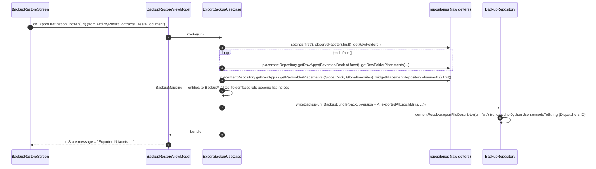
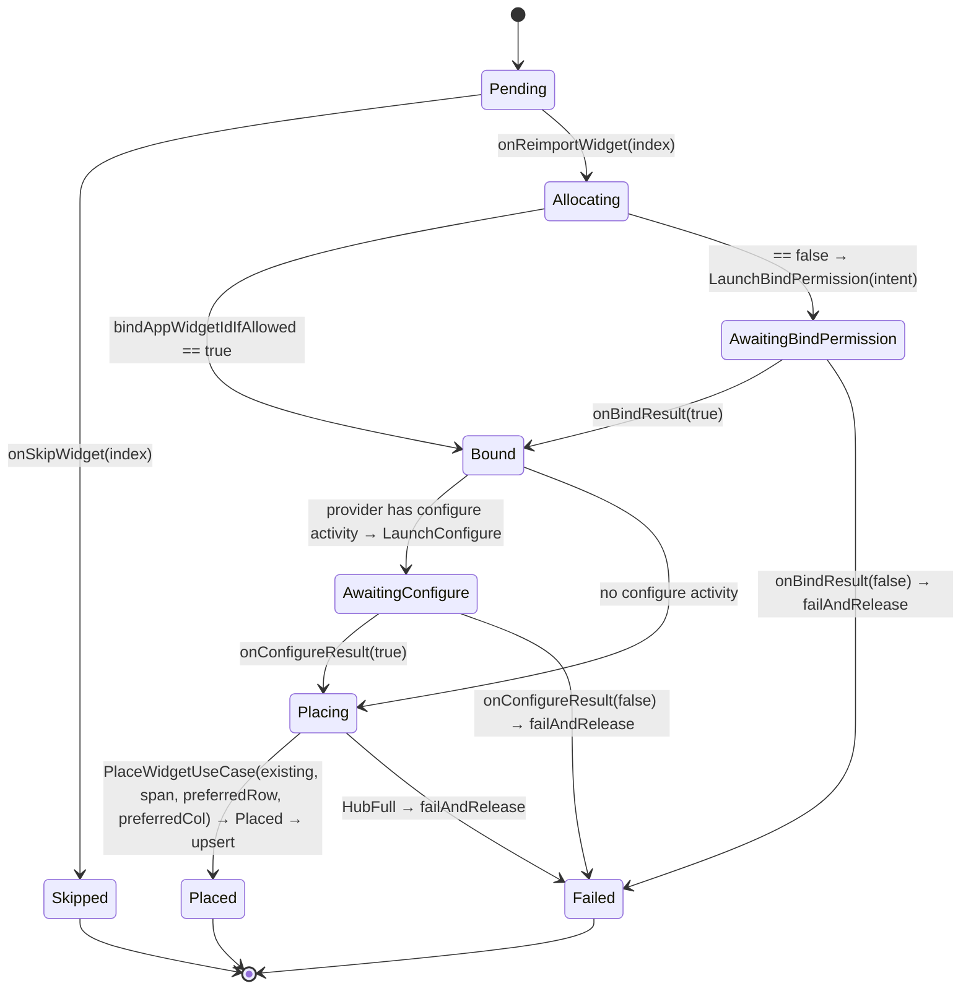

# 09 — Flow: Backup & Restore

Settings → Backup & Restore. Export writes one JSON file to a user-chosen location; import is a
**destructive full replace** (not a merge) followed by an interactive, one-widget-at-a-time
re-bind because widget ids cannot be restored.

## 1. Export



- **Raw, not hydrated.** Export reads `getRaw*()` (DAO `.first()`), so a placement whose app is
  currently uninstalled is still exported. Nothing is filtered against `LauncherApps`.
- **Ids are not exported.** Facets and folders are referenced by their index in the bundle's
  lists; `active_facet_id` becomes `activeFacetIndex`. Room ids are regenerated on import.
- What is *not* in the file: see [02 §6](02-persistence-room.md) (calendar selection/colors, the hosted
  clock stack's hosted widget pages (a restored facet starts with the launcher clock, then its native widget pages, see [20](20-flow-native-widgets.md) §5; the facet's `clockPlacementOwn` flag is exported, an old backup reading it as `overrideClock`), permission and coach-mark flags, `allow_landscape`). `BackupCoverageTest` enforces the list.

## 2. Import

```mermaid
sequenceDiagram
    autonumber
    participant S as BackupRestoreScreen
    participant VM as BackupRestoreViewModel
    participant UC as ImportBackupUseCase
    participant R as repositories
    S->>VM: onImportFileChosen(uri)   (OpenDocument) → confirm dialog ("replaces everything")
    VM->>UC: invoke(uri)
    UC->>R: backupRepository.readBackup(uri) → bundle?  (null → InvalidFile; trailing bytes after the closing brace are ignored)
    UC->>UC: backupVersion > CURRENT_BACKUP_VERSION → UnsupportedVersion
    UC->>R: applySettings(bundle.settings)  — 41 SettingsRepository setters
    UC->>R: folderRepository.deleteAllFolders(), then restoreFolder(...) per folder → index→newId map
    UC->>R: facetRepository.deleteAllFacets()   (FK CASCADE clears every per-facet placement)
    loop each BackupFacet
        UC->>R: restoreFacet(entity.copy(id = 0)) → newId
        UC->>R: placementRepository.restoreApp / restoreFolderPlacement (AppPlacementEntity / PlacementTarget with list + newId, folderIndex→newId)
    end
    UC->>R: placementRepository.deleteAll(GlobalDock), restoreApp × n, restoreFolderPlacement × n
    UC->>R: placementRepository.deleteAll(GlobalFavorites), restore × n
    UC->>R: repairOrphanedProfileRows()  (resolves every restored userId = -1)
    UC->>R: settingsRepository.setActiveFacetId(newIds[activeFacetIndex])
    UC-->>VM: ImportBackupResult.Success(counts, pendingWidgetPlacements = bundle.widgetPlacements)
    VM-->>S: uiState.pendingWidgets = [...]   (widget re-bind UI, §3)
```

- **Not transactional.** The use case's own doc says so: a failure mid-way leaves a partially
  restored database. The order (folders → facets → global dock → global favorites) is chosen so
  every FK target exists before its referrers.
- **`userId` on restored rows is repaired at the end of the import.** `BackupAppEntry` carries
  `profile` only, so `BackupMapping.toAppPlacementEntity(list, facetId)` builds rows with the entity
  default `userId = -1` and the `restore*` methods upsert them unchanged. Those rows would fail the
  hydration join (`userHandle.hashCode()` is `0` for the personal user, never `-1`), so
  `ImportBackupUseCase` injects `RepairOrphanedProfileRowsUseCase` and runs it once after the last
  restore — the same pass `LauncherViewModel.init` runs at startup — and restored apps show up
  immediately. `ImportBackupUseCaseTest` verifies the repair runs.
- **Placement tables after the F6 consolidation.** All restored app rows go to `app_placements` and
  folder rows to `folder_placements`, distinguished by `list` (`DOCK`/`FAVORITES`) and `facetId`
  (null for the launcher-wide lists). `deleteAllFolders` clears every folder placement through the
  folder FK cascade, `deleteAllFacets` clears every per-facet row through the facet FK cascade, and
  the global lists are wiped explicitly by `PlacementRepository.deleteAll(PlacementTarget.GlobalDock)` /
  `deleteAll(PlacementTarget.GlobalFavorites)` (`deleteAllForOwner(list, GLOBAL_OWNER_KEY)`).
- Result type: `ImportBackupResult.Success | InvalidFile | UnsupportedVersion(version)`.

Widgets Facet draws itself are not in the queue: `ImportBackupUseCase` restores them directly ([20](20-flow-native-widgets.md) §5), and `pendingWidgetPlacements` holds only hosted ones.

## 3. Widget re-bind after import

Widget ids are allocated by the system `AppWidgetHost` and are meaningless on another device (or
after a data clear), so `widgetPlacements` are never auto-restored. The screen lists each pending
widget and re-runs the same bind/configure state machine the Hub picker uses
([10-flow-hub-widgets.md](10-flow-hub-widgets.md) §2), with the backup's `row/col/colSpan/rowSpan`
as the *preferred* slot. Its `landscapeOrder` (the widget's place in the landscape Hub's flow, an optional field that older backups lack) is restored onto the new row too:



`failAndRelease` always calls `appWidgetRepository.deleteAppWidgetId(id)` so a failed bind never
leaks a host allocation.

## 4. Versioning contract

`CURRENT_BACKUP_VERSION = 6` (6: a facet always owns its dock, favorites, content mode and look, so `BackupFacet`'s `overrideApps` / `overridingFavorites` / `overrideDock` are legacy fields (nullable, read once, never written) and the `LAUNCHER_DEFAULT` marker of the look fields is resolved on import: `upgradedToCurrent` gives a facet that did not override a list or the content the launcher's dock, favorites (with their folder placements), content mode and count from the bundle, resolves each marked look field from `BackupSettings`, and lets a null landscape twin follow the launcher's landscape value only while its portrait value was inherited. The launcher-wide lists and settings are still exported, as the seed for new facets; 5: a facet carries its clock's own settings and box (`BackupFacet.clockConfig`, calendar ids left out, and `clockWidthDp`/`clockHeightDp` and the landscape pair), where 4 and older kept them on the facet and the launcher, which `upgradedToCurrent` folds into the clock's config on import; 4: a widget's setting and a facet's clock weather location are JSON, where 3 and older wrote tab-separated lines; `ImportBackupUseCase` runs an older bundle through `BackupBundle.upgradedToCurrent` (`BackupUpgrade.kt`) first, so the rest of the import only sees the current form). Each exported Favorites app and folder placement carries its grid cells (`BackupAppEntry.gridCells`, `BackupFolderPlacement.gridCells`, a `BackupGridCells` with the portrait and landscape row and column; absent for an item never moved on a grid, defaulted, no version bump), restored through `restoreApp` and `PlacementRepository.restoreFolderCells`. The Gestures switches (`swipeLeftEnabled`, `swipeRightEnabled`, `swipeDownEnabled`, `swapSwipeSides`) are defaulted `BackupSettings` fields with no version bump. Rules, as implemented: new fields get `@Serializable` defaults so
older files still parse (`folders` and the four `*FolderPlacements` lists default to empty); a
file whose `backupVersion` is *greater* than the current constant is refused with
`UnsupportedVersion`; the constant only bumps for a non-additive/breaking change — a purely
additive, defaulted, tolerant-reader field does **not** require a bump (established by
`fontScaleOption`, reused for `appListLayout`/`appListColumnAlignment`/`appListGridColumns`/
`appListGridDisplayMode`, `systemBarIconStyle`, `iconShape`, `iconPackPackage`/`iconPackFallback`/`forceIconShape`, `iconScalePercent`, and
`appListShrinkToFit` (settings and each facet) — see `BackupBundle.kt`'s own doc comment). `ExportBackupUseCaseTest` /
`ImportBackupUseCaseTest` round-trip the bundle and must be extended for every new field;
`BackupCoverageTest` fails until a new `Facet` or `LauncherSettings` field is exported or listed as left out.
Import replaces the landscape group and the clock divider height outright, so a restore clears values
the backup did not have. The icon pack is restored by package name as is: when that pack isn't
installed on this device, `IconPackRepository.loadApplied` clears it on the next icon scan and apps
show their own icons (the stored built-in style comes back).

The weather options are additive and defaulted (`WeatherBackupTest`): the clock accessory switches
(`showNextAlarm`, `showBatteryPercentage`, `showWeather`, and each facet's `clockShowAlarm`, `clockShowBattery`,
`clockShowWeather`, `clockWeatherIconStyle`, `clockWeatherLocation` in the widget-location encoding, `null` follows Weather settings), the four units, the icon style, the location mode, and the chosen city as four flat fields (`weatherCityName`,
`weatherCityLatitude`, `weatherCityLongitude`, `weatherCityTimezone`). A city is restored only when all four are present. The saved cities (`savedWeatherCities`, up to 10 of
`BackupWeatherCity`) are an additive list; an older file has none, and the chosen city still shows in the list.
The current location and the stored forecast (`weather_hours`, `weather_meta`) are never backed up.
