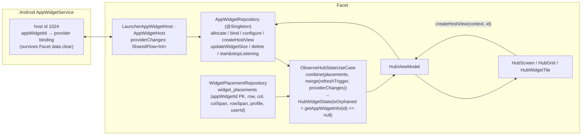
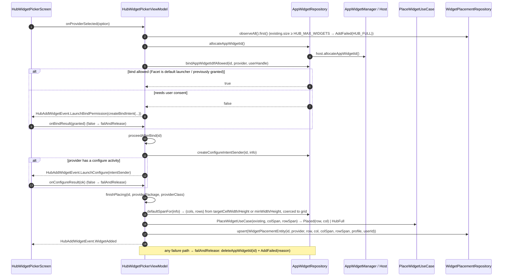
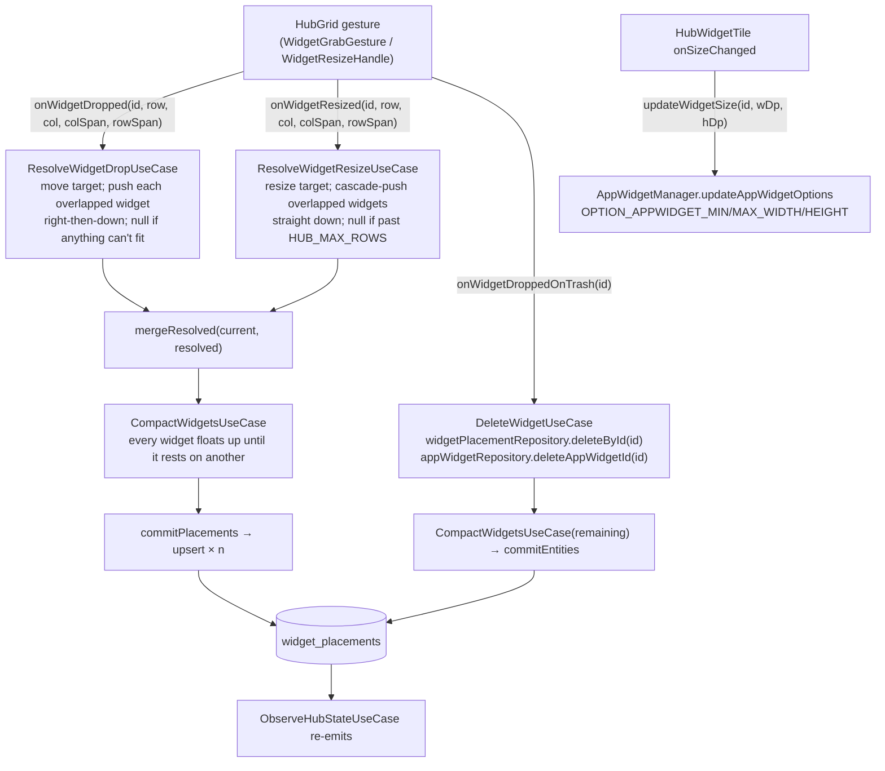
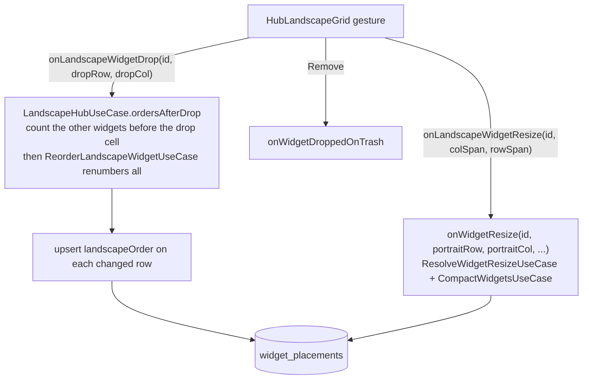

# 10 — Flow: Hub Widgets (host lifecycle, add, move, resize, delete, orphans)

The Hub is Facet's widget surface: a 5-column grid (`HUB_COLUMNS = 5`, `HUB_MAX_ROWS = 50`,
`HUB_MAX_WIDGETS = 20` in `domain/HubGridConstants.kt`) hosting real `AppWidgetHostView`s.
Two stores cooperate: the **system** `AppWidgetService` owns bindings (which `appWidgetId` maps to
which provider), Facet's Room `widget_placements` owns *where* each id sits.

## 1. Who owns what

- **Host listening** is tied to visibility, not process: `HomeHubOverlay` (in `HomeDrawerRoute`) calls
  `hubViewModel.onHubVisible()` → `host.startListening()` when the Hub opens (or a clock widget is on Home) and
  `onHubHidden()` → `stopListening()` in `onDispose`. Widgets don't receive updates while the Hub
  is closed.
- **Orphans**: a placement whose `appWidgetId` no longer has provider info (provider uninstalled,
  Work Profile removed, or bindings lost) is rendered as `OrphanedWidgetTile` with
  *Remove* (`DeleteWidgetUseCase`) / *Keep space* (`onKeepOrphanSpace` — no-op, the row stays).
  A hosted widget on Home's clock stack is orphaned the same way (`ClockWidgetHostController.isOrphaned`, re-checked on each
  Home resume); that page draws the same tile with *Remove* only (`ClockWidgetFacetController.remove` →
  `RemoveClockStackItemUseCase`), at its saved size or a placeholder one.
- Providers are enumerated per profile
  (`userManager.userProfiles.flatMap { getInstalledProvidersForProfile(it) }`), so Work Profile
  widgets appear in the picker tagged with their `AppProfile`; `widget_placements.profile/userId`
  record which profile a placed widget came from.

## 2. Add a widget (`HubWidgetPickerViewModel`)

`PlaceWidgetUseCase` is pure: it scans rows top-down, columns left-right for the first
rectangle that doesn't overlap an existing placement; with `preferredRow/Col` (backup restore) it
tries that slot first.

## 3. Move, resize, delete (`HubViewModel`)

- A drop or resize that can't be resolved (`null` from the use case) is silently rejected — the
  tile snaps back; nothing is written.
- Every successful mutation ends with `CompactWidgetsUseCase` so the grid never keeps a gap
  above a widget.
- `updateWidgetSize` tells the provider its real rendered size so responsive widgets
  (`targetCellWidth` aware) lay out correctly. The Home clock-widget tile pushes its committed
  size through the same call, from the view `update` receives (not a remembered reference).
- `createHostView`/`createPreviewHostView` set the host view's padding to 4dp
  (`WIDGET_HOST_PADDING_DP`), replacing the platform's 8dp default for Hub and Home alike. The
  size pushed to the provider is the outer box, so its content area is 8dp smaller each way.

## 4. Persistence & recovery matrix

| Event | System binding | `widget_placements` row | What the user sees |
|---|---|---|---|
| Add completes | created | created | tile |
| Add fails at bind/configure/placement | released (`deleteAppWidgetId`) | none | `AddFailed(reason)` snackbar |
| Delete (trash / orphan Remove) | released | deleted | gone |
| Provider app uninstalled | binding invalid | row kept | `OrphanedWidgetTile` (Remove / Keep space) |
| Work Profile removed | bindings gone | rows kept (`userId` still set) | orphan tiles |
| Facet data cleared / reinstalled | **kept** (host id 1024 is stable) | gone | nothing — the bindings leak until the system GCs them |
| Backup restore | new ids allocated per widget | re-created via the picker state machine | interactive re-bind list (see 09 §3) |

## 5. Landscape layout

In a landscape-layout window (see [17](17-flow-home-layout.md) §1) the Hub shows `HubLandscapeGrid`
instead of `HubGrid`. Same widgets, same sizes, a different arrangement:

- **Fixed cells.** Each cell is `HUB_LANDSCAPE_CELL_SIZE` (64dp, 4dp gaps), so a widget has the same size
  on any window, as the app grid's cells do. The grid has as many rows as fit the height
  (`hubLandscapeRows`, at least 2) and grows to the right, scrolling sideways.
- **Flow, not free placement.** Positions are not stored. `LandscapeHubUseCase.layout` orders the widgets
  (`OrderWidgetsForLandscapeUseCase`: those with a saved `landscapeOrder` first, lowest first, then the rest
  in portrait reading order) and packs them with `FlowPackWidgetsUseCase`: down each column, then across,
  each widget at the first free spot at or after the previous one, so the visual order always matches the
  list order. A widget taller than the rows is clamped to the rows on screen only.
- **`HubViewModel`** gets the row count from the screen (`onLandscapeRowsChange`) and exposes
  `HubUiState.landscapeWidgets`, empty until it has.

- **Move** is a reorder: the dragged widget goes to the place in the flow where its top-left corner lands
  (landing on another widget's cell puts it just before that widget). It writes only `landscapeOrder` and
  renumbers every widget, so portrait positions are untouched.
- **Resize** has a right and a bottom handle only (the top-left is where the flow put it). The size is shared
  with portrait, so it goes through portrait's own resolution, anchored on the widget's portrait cell, and may
  push portrait neighbours down. Portrait can therefore change from a landscape resize; landscape never
  changes portrait positions otherwise.
- **Add** (the picker) is unchanged and leaves `landscapeOrder` null, so a widget added later follows the
  ordered ones; before any landscape reorder it sits where portrait's reading order puts it.
- **Delete** renumbers nothing: the order is relative.
- **Backup:** `BackupWidgetPlacement.landscapeOrder` is optional (null for older files) and restored onto the
  re-added widget (see [09](09-flow-backup-restore.md) §3). No `CURRENT_BACKUP_VERSION` bump: it is additive.
