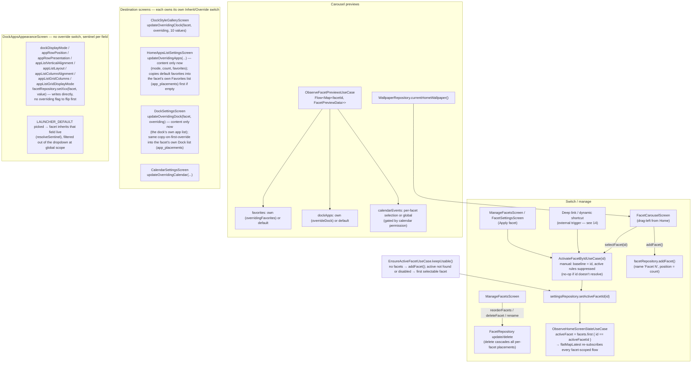
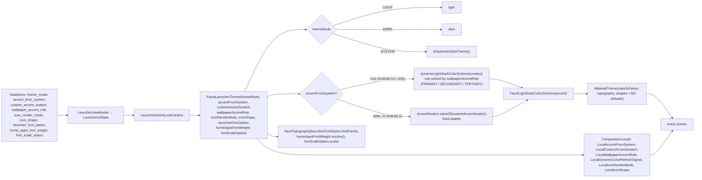
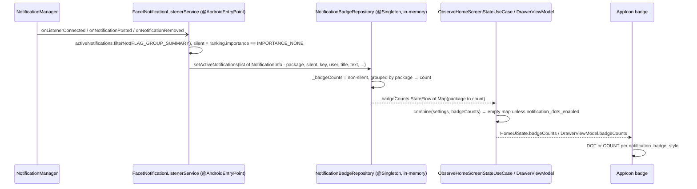
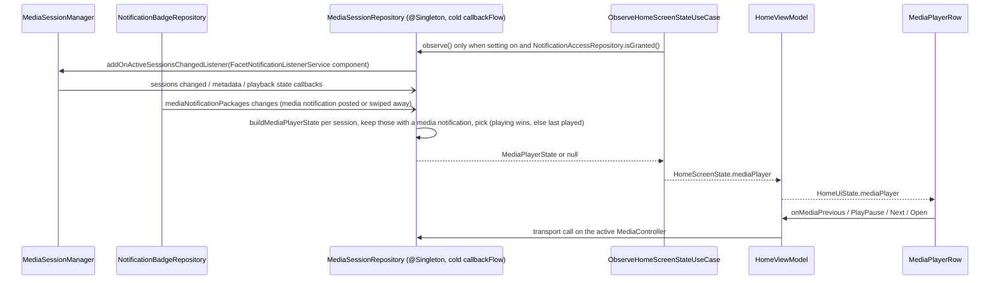
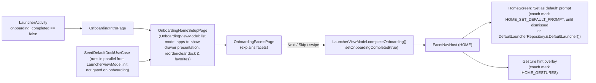

# 13 — Flows: Facets, Theme resolution, Notification badges, Onboarding

Four smaller flows that don't fit the earlier docs but are load-bearing for how Home looks.

## 1. Facets — create, switch, preview, override

A *facet* is a named Home configuration (`facets` row). Exactly one is active
(`active_facet_id` in DataStore). Each facet can inherit every setting from the global DataStore
defaults or override a whole block at a time.

- **The settings kit (`ui/components/`)** — `SettingsCard` is tonal (28dp, no shadow or border) on the
  dimmer `SurfaceContainer` page. By default it pads its content 16dp; with `fullBleedRows = true` it
  doesn't, and each row pads itself with `LocalSettingsRowInset` *after* `clickable`, so a pressed row's
  highlight spans the card and follows its rounded corners (`CardDivider` and `ClickableRow` read the
  same local). Every card of tappable rows uses it; dropdown and switch rows stay control-only in a
  default padded card by design. `SettingsIconBadge` is the 40dp leading icon, tinted from
  `SettingsSectionHue` (`theme/Color.kt`: Facets blue, Appearance violet, Apps and folders teal, System
  slate — fixed colours, independent of the accent); `SettingsSectionHeader` is the sentence-case
  title above a card. Buttons are `PrimaryButton`, `TonalButton`, `SurfaceButton` and
  `TextActionButton` (M3 `TextButton`), all pills. The same kit lays out `SettingsScreen`,
  `FacetSettingsScreen`, `FoldersSettingsScreen`, `BackupRestoreScreen`, `ClockAdjustSheet` and the
  carousel's Launcher settings row.
- **`FacetSettingsScreen` is a plain nav list** — a Rename row, an "Appearance" card (the
  Appearance row), then an "Apps and folders" card with Apps list / Dock rows, mirroring `SettingsScreen`'s own
  layout: tonal `SettingsCard`s (28dp, no shadow or border), a `SettingsIconBadge` on each row in
  the same hue as on Settings, inset dividers, no chevrons. It no longer hosts any Inherit/Override switch itself; each destination screen owns its
  own (`InheritOverrideCard`, `controlsEnabled = !isFacetScoped || isOverriding`) so the toggle
  sits on the same screen as the controls it gates, and `setOverriding*` calls now live in that
  destination's own ViewModel rather than `FacetSettingsViewModel`. The "Appearance" row is the one
  exception — it navigates to `AppearanceSettingsScreen` (dual-mode, `facetId?`), which has no
  switch of its own (see the `LOOK` subgraph above).
- **`AppearanceSettingsScreen` is a hub of short sections**, each a card of one or two rows that open their own screen — "Clock &
  calendar" (the Clock Style row, shown in both scopes — in facet scope it opens that facet's own
  `FacetClockStyleGalleryScreen`, and its subtitle and the preview clock resolve through
  `overrideClock` via `AppearanceSettingsUiState.clockSettings` — plus "Calendars to display", whose subtext is the
  selection summary, or "Needs calendar access" while `READ_CALENDAR` isn't granted, like the Notifications row below;
  `AppearanceSettingsViewModel` re-reads both grants on resume), "Dock & home" (one
  "Dock & Apps appearance" row → `DockAppsAppearanceScreen`, both scopes, route `dockAppsAppearance?facetId=`), and, global
  only, "Notifications" and "General" (one "Fonts, themes and icons" row → `FontsThemesIconsScreen`, route `fontsThemesIcons`).
  The two moved-out screens each show the same live `AppearancePreviewCard` above their controls and share
  `AppearanceSettingsViewModel` (a separate instance per back-stack entry). `DockAppsAppearanceScreen` holds the `LOOK`
  fields above, always shown; `FontsThemesIconsScreen` holds theme / system bar icons / accent / icon style and shape /
  launcher font / app label color / size / weight. Row titles on the dock screen:
  `dockDisplayMode` → "Show Dock apps as", `appRowPosition` → "Home Apps Alignment",
  `appRowPresentation` → "Show Home apps as", `appListVerticalAlignment` → "Home Apps list
  position". Within "Dock & home", `appListLayout` ("App list layout" — always visible) then gates
  three more rows, mutually exclusive per its value: `SINGLE_COLUMN` shows `appRowPosition`/
  `appRowPresentation` (the rows above, unchanged); `TWO_COLUMN` hides `appRowPosition`, shows
  `appListColumnAlignment` ("Column alignment" — both columns left-aligned, both right-aligned, or
  "left aligns to the edge, right aligns to the other edge") alongside `appRowPresentation`
  (unchanged, still applies to both columns); `GRID` hides both `appRowPosition` and
  `appRowPresentation`, shows `appListGridColumns` ("Grid columns" — 3/4/5/6, user-choosable) and
  `appListGridDisplayMode` ("Grid display" — icons or text, never both, shaped like
  `dockDisplayMode` but a wholly separate field). `appListVerticalAlignment` stays visible and
  applies uniformly across all three layouts. Its preview card (`AppearancePreviewCard`) is a thin wrapper over the shared `HomePreview`
  (`ui/home/HomePreview.kt`, fed by `HomePreviewState`) — the same composable `FacetCarouselScreen`'s
  `FacetPreviewPage` renders, scaled to a fraction of the real screen (`APPEARANCE_PREVIEW_CARD_SCALE`/
  `CAROUSEL_CARD_SCALE`, both `0.55f`) and density-scaled to match. `HomePreview` honors clock
  alignment, clock zone height (`clockZoneHeightDp`, same top-offset formula as `HomeScreen`) and
  clock scale, plus the app list's row/column alignment and `appListVerticalAlignment` (TOP puts the
  list one `HOME_CLOCK_MIN_GAP` below the clock, BOTTOM keeps it above the dock). Tags are
  parameterized (`appearance_preview_` / `facet_preview_`); a non-null `onClick` makes rows, grid
  tiles and dock icons tap-to-apply (carousel), null leaves it read-only (Appearance).
  The calendar preview lives here now too (via `ClockBlock`'s own bundled `CalendarEventsBlock`),
  not on `ClockStyleGalleryScreen` — that screen dropped its own calendar-preview block entirely
  (see chat history). The preview's `favorites`/`dockItems`/`calendarEvents` are this scope's real,
  live content, not sampled installed apps or fixed sample events: `AppearanceSettingsViewModel`
  observes `PlacementRepository` for the facet's own and the launcher-wide Favorites and Dock, resolved facet-or-global via `effectiveFavorites`/`effectiveDockItems`
  (`if (facet?.overrideApps == true) facetFavorites else globalFavorites`, same for dock) —
  identical to `HomeAppsListSettingsViewModel`/`DockSettingsViewModel`'s own resolution. Calendar
  events come from `CalendarRepository.getUpcomingEvents`, gated by `CalendarPermissionRepository
  .isGranted()` (empty when ungranted, never a sample fallback), with facet-or-global
  `showAllDayEvents`/`selectedCalendarIds` resolved the same way `ObserveHomeScreenStateUseCase`
  resolves them. The calendar indicator / item-count pair (`CalendarDisplayOptions`) resolves via `FacetEntity?.effectiveCalendarDisplay` (gated by `overrideCalendar`) into `HomeScreenState.calendarDisplay` / `FacetPreviewData.calendarDisplay` and is applied in `CalendarEventsBlock` after ended events are dropped. The clock uses its own real system-default `Clock`, not a fixed reference instant.
- **`FacetCarouselScreen`'s `FacetPreviewPage` renders the same `HomePreview`**, fed by
  `FacetCarouselViewModel`'s per-facet resolvers (`appListLayout(facetId)`/`appListColumnAlignment(facetId)`/
  `appListVerticalAlignment(facetId)`/`appListGridColumns(facetId)`/`appListGridDisplayMode(facetId)`).
  Its tiles are tappable (`onCardClick` applies the facet), unlike the read-only Appearance preview.
  The shared Grid branch uses fixed-slot columns, not `Arrangement.SpaceEvenly`, so an incomplete
  last row packs left like `HomeScreen`'s real `LazyVerticalGrid(GridCells.Fixed(n))`. The preview
  caps how many favorites it renders — `previewItemCap`/`PREVIEW_ROW_BUDGET` — a row budget ×
  items-per-row so `TWO_COLUMN`/`GRID` show proportionally more of the real list than
  `SINGLE_COLUMN`'s tighter cap without overflowing the card.
- **A third, smaller preview card: `HomeSurfacePreview`** (`ui/components/HomeSurfacePreview.kt`) heads
  `HomeAppsListSettingsScreen` and `DockSettingsScreen`. It is a short wallpaper band that shows
  *only* the surface that screen governs — the app list or the dock, never the clock — so it honors
  the app list's row position and presentation, layout, column alignment and grid options, and the dock
  display mode, but has no clock position or app-list Top/Bottom placement to honor. It is separate
  from `HomePreview` because it is not a scale model of the screen.
- **Switching is one DataStore write.** Everything downstream is reactive:
  `ObserveHomeScreenStateUseCase` recomputes `activeFacet` from `combine(settings, facets)` and
  `flatMapLatest` tears down the previous facet's Room subscriptions.
- **Turning an override on copies the inherited list** (`replaceItems(facetId, defaultItems)`)
  so the card never goes blank — the facet's own list (its `app_placements` / `folder_placements` rows for that `list` and `facetId`) becomes an independent copy from that moment.
- **Turning it off does not delete the facet's rows**; they're just ignored until the flag is set
  again (and are still exported by backup).
- `FacetCarouselViewModel` exposes 20 `xxx(facetId)` resolvers that apply `resolveOverride`/
  `resolveSentinel` per facet so each card renders with its own effective clock/apps/dock styling
  (dropped to 14 when calendar/appearance styling consolidation removed the four calendar-specific
  resolvers, then rose to 19 with the four `appListLayout`/`appListColumnAlignment`/
  `appListGridColumns`/`appListGridDisplayMode` resolvers the two-column/grid feature added, and to 20 with
  `appListVerticalAlignment(facetId)`, which the carousel preview needs to place the app list under the clock).

### 1a. Facet limits and the free plan

How many facets a user may have is `FacetLimits` (`data/model`): **3 free, 10 with Pro**. `AddFacetUseCase`
enforces it (the repository does not, since it knows nothing about entitlement), and the add row and the
carousel's add page show at the free limit with a Pro pill that opens the Facet Pro screen (`ui/pro`).

A user who loses Pro keeps every facet, but only the **first 3 in list order are selectable**
(`SelectableFacetsUseCase`); the rest are disabled until the count drops to 3 or Pro returns. Nothing is
deleted for them, and a disabled facet can still be deleted (the last remaining facet cannot). Reordering
chooses which three are usable. Disabled means:

| Where | Behaviour |
|---|---|
| Carousel and Manage facets | Dimmed with a lock; tapping opens the Facet Pro screen instead of applying or opening its settings. In Manage facets the overflow menu disables *Facet settings* and *Apply* but keeps *Delete*. |
| `ActivateFacetByIdUseCase` | A no-op for a disabled facet, which covers shortcuts and deep links. |
| `EnsureActiveFacetUseCase.keepUsable()` | Runs whenever the selectable set changes (an add, a delete, a reorder, a change of entitlement): if the active facet is missing or disabled, the first selectable facet takes over. |
| Facet shortcuts | Published only for selectable facets (`SyncFacetShortcutsUseCase`). |
| Facet automation | A rule aimed at a disabled facet is a no-op: `RefreshAutomationStateUseCase` passes only selectable ids as the evaluator's existing facets, so the existing "facet missing" fallback applies ([15](15-flow-facet-automation.md)). |

`EntitlementRepository.isPro` comes from Google Play ([16](16-flow-billing.md)). A debug or sideloaded build is Free unless the debug override forces Pro.

## 2. Theme resolution — from DataStore to `MaterialTheme`

- The Activity renders an empty `Box` until `LauncherUiState.isLoading` clears, precisely so the
  first frame is never painted with default theme values that then flip.
- `LocalDynamicColorRefreshSignal` is bumped when the wallpaper changes so Material You colours
  re-resolve without a restart.
- Android 11 (`minSdk 30`) has no Material You: `dynamicColorSupported` is false, `accentTonalExtremes()` uses the
  chosen `AccentSwatch` (default blue), Settings → Appearance shows only the preset swatches (no source tabs), and the
  onboarding backdrop blur (`setBackgroundBlurRadius`, Android 12+) is skipped.
- Clock/app-label colours are *not* the M3 scheme directly: `ClockColorOption`
  (`THEME` / `ACCENT_PRIMARY` / …) resolves through `ui/theme/ClockColors.kt` against the current
  scheme. Clock's own colour is per-facet (`facets.clockColorOption`); the app-label colour
  (`app_label_color_option`) is global only.
- `ClockTemplates.kt`'s `NegativePanelTemplate` fills its panel with the resolved clock colour
  itself, so its digits/meridiem/accessory row can't reuse that same colour as their own — they're
  knocked out via `ui/theme/Color.kt`'s `contentColorFor(panelBackground)`, which derives the
  on-panel content colour from the panel's own luminance rather than a fixed `Surface` read. This
  is what makes the panel and its content flip together across `THEME`/`THEME_INVERTED` (a fixed
  `Surface` read stayed legible for one and went low-contrast for the other, since `THEME_INVERTED`
  deliberately lands the panel on `Surface`'s own end of the scale).
- Per-facet Private Space screens use `PrivateSpaceTheme`, a fixed override of the scheme.
- `facetTypography`'s `fontScale` multiplies every role's `fontSize`/`lineHeight` app-wide except
  the clock (`FacetType.clock`, defined outside `facetTypography`); `fontWeight` only overrides
  `bodyLarge`/`bodyMedium`/`bodySmall` — not `title*`/`label*`/`headline*`/`display*`, so dialog
  titles (`ConfirmDialog`/`RenameDialog`), context menus, and onboarding copy keep Material's own
  per-role weight rather than flattening app-wide. Home's own app-list/Dock labels apply
  `homeAppsFontWeight` a second time via their own explicit `.copy(fontWeight = ...)` (unchanged
  from before this reached `facetTypography`) — redundant with the global value but harmless, and
  what lets a `titleMedium`-styled label pick up the weight that body-only roles don't reach.
- **The calendar events strip is a direct consumer of this same resolved output, not a separate
  theming path**: `CalendarEventsBlock` (rendered inside `ClockBlock`) takes `launcherFontOption`
  (this section's own `launcher_font_option`, via `.fontFamily`), `homeAppsFontWeight` (via
  `.resolve()`), and `appLabelColorOption` (via `.resolve()`) straight from the same three
  DataStore keys shown above, plus `clockAlignment` (Room, per-facet) for its position — it has no
  design fields or theming path of its own any more (see chat history: calendar/appearance styling
  consolidation, which removed `calendarFontOption`/`calendarColorOption`/`calendarFontWeight`/
  `calendarAlignment`).

### 2a. System bar icon color

Status bar and 3-button nav bar icon color is *not* part of `MaterialTheme` — it's a window flag
(`isAppearanceLightStatusBars` / `isAppearanceLightNavigationBars`, where "light" means **dark**
icons), set by `ProvideSystemBars` (`ui/theme/SystemBars.kt`) inside `FacetLauncherTheme`, in
`LauncherActivity`. The gesture pill adapts by itself, so the nav half only shows in 3-button mode.
Which color stays legible depends on what's *behind* the bars, so the pure rule
`useLightSystemBarIcons(style, backdrop, isDarkTheme)` takes a `SystemBarsBackdrop`:

| Backdrop | Declared by | Icons |
|---|---|---|
| `WALLPAPER` | `HomeDrawerRoute` (Home, Hub, carousel, Drawer) | the `system_bar_icon_style` setting: `MATCH_THEME` (default) follows the theme, `LIGHT`/`DARK` force it |
| `THEME_SURFACE` | the default; `HomeDrawerRoute` while a widget picker covers Home | always follow the theme (the setting is ignored — it could make icons invisible on an opaque screen) |
| `DARK_SURFACE` | `HomeDrawerRoute` while Private Space shows | always light — `PrivateSpaceTheme` is fixed-dark regardless of theme |
| `DARK_TOP` | `FacetProScreen` before purchase: a dark hero over a normal page | status bar icons always light; the navigation bar follows the theme (`useLightNavigationBarIcons`), since it sits over the page-coloured bottom bar |

A screen only declares its backdrop (`SystemBarsBackdropEffect`); leaving composition falls back to
`THEME_SURFACE`, so Settings and onboarding need no code. Bottom sheets are separate windows with
their own bar appearance: `ThemedModalBottomSheet` sets nav icons from the theme (the sheet surface
runs behind the nav bar) and keeps the status bar as Home has it (`LocalLightStatusBarIcons`).
The setting is global, in Appearance → General, and is in `BackupSettings` (defaulted).
`SystemBarsTest` covers the rule; `SystemBarsAppearanceTest` reads the real window flags.

## 3. Notification badges

- Access is user-granted in system Settings; `NotificationAccessRepository.isGranted()` is read
  live, and `NotificationAccessExplanationScreen` explains the permission before deep-linking.
- Nothing about notifications is persisted; the map is rebuilt on every listener callback and is
  empty until the service connects after process start.
- Badge counts are keyed by package only — a Work-profile app shares its badge with the personal
  copy. `NotificationInfo.userHandle` (`sbn.user`) is carried for the app menu below, but the badge
  count ignores it.

### Notifications in the app menu

The same snapshot also feeds the long-press sheet's notifications zone ([12 §3](12-flow-drawer-search-and-app-actions.md)).
`NotificationInfo` carries the listener `key`, `userHandle`, `title`, `text` (compact text preferred over
expanded, trimmed and cut to 300 characters by `notificationTitleAndText`), `postTime`, `isClearable`,
`isSecret`, `autoCancel` and the `contentIntent`. All of it is in memory only.

- `NotificationBadgeRepository.notificationsFor(pkg, handle)` lists, newest first, the notifications that are
  not silent, not media (Home's player row owns those), not `VISIBILITY_SECRET`, and have a title or
  text; group summaries are already dropped by the service. Persistent (non-clearable) notifications are
  listed too, so the sheet agrees with the icon badge, which counts them; they can be opened but not
  dismissed. It matches package **and** profile,
  so a Work copy of an app never shows the personal app's notifications.
- `ObserveAppNotificationsUseCase` gates the list on `show_notifications_in_app_menu` (default on) and
  notification access. `AppNotificationsState(notifications, needsAccess, enabled)`: `enabled = false` hides the
  zone (setting off); otherwise the zone shows, with `needsAccess` when access is missing and an empty list
  when there is nothing posted.
- Dismissing goes through `NotificationActionController`: the service attaches a
  `cancelNotifications` lambda in `onListenerConnected` and detaches it in `onListenerDisconnected` and
  `onDestroy`; `dismiss(keys)` returns false when detached. The snapshot updates through the service's
  own `onNotificationRemoved`. Opening sends `contentIntent` through `NotificationOpener`; the
  notification is then dismissed only if it asked for `autoCancel`, as the system shade would.
- Known gap: the service never clears the snapshot on `onListenerDisconnected`, so after access is
  revoked the list can show stale items until the process restarts. The use case reads access when the
  sheet opens, which hides it in practice.

### Media player row

The same notification-access grant also backs Home's media player row, opt-in via "Show media player in home screen"
(`show_media_player_on_home`, default off; `show_media_skip_buttons`, default on) on the same Notifications page.

- Only playing or paused sessions with a title show; stopped, errored and untitled ones map to `null`.
- A session also needs its app's `MediaStyle` notification to be posted (`FacetNotificationListenerService` marks these
  `NotificationInfo.isMedia`): many apps keep a paused session alive after the notification is swiped away, so the row
  disappears with the notification, and returns if the app posts it again.
- With several eligible sessions a playing one wins, otherwise the one that played most recently (`ActiveSessionPicker`),
  falling back to `getActiveSessions` order for sessions never seen playing.
- Turning the setting on without access stores it and routes through `NotificationAccessExplanationScreen`; the switch
  reads on only when the stored value and the real grant both hold, like the badges switch.
- Art comes from the session's bitmap, else a `content:`/`file:` art URI decoded off the main thread (no network).
- The page is reached from Appearance's global-only Notifications section, whose "Notifications and media" row carries a
  subtext that follows the page: "Dot badges"/"Count badges"/"Badges off", then "Media player on"/"off", joined by " · ".
  Without notification access it says "Needs notification access" instead, since both switches read off then.
  `AppearanceSettingsViewModel` holds the access flag and re-reads it on resume (`refreshNotificationAccess`).
- The progress line is always Material's `LinearWavyProgressIndicator`; its amplitude eases to 0 (a flat line) when
  playback stops and back up when it resumes. It only exists from Material3 1.5, so `app/build.gradle.kts` overrides the
  BOM's 1.4.0 with `1.5.0-beta01` (drop the override once a BOM pins a stable 1.5). No OS-version gating (minSdk 24).
- Progress is interpolated in the UI from the last reported position/time/speed; it is `null` (empty flat track) when the
  duration is unknown.

## 4. Onboarding & first run

- Onboarding is outside the nav graph (a top-level `when` branch in `LauncherActivity`), so Back
  can never pop into it and it never appears on the back stack.
- The dock the user sees on the setup page is already seeded — `SeedDefaultDockUseCase` runs at
  first launch regardless of onboarding, keyed on `defaults_seeded`.
- "Set as default launcher" is a system action (`DefaultLauncherRepository.requestDefaultLauncherIntent()`
  → `RoleManager` request); Facet only prompts when it is confirmed *not* to hold the role. `HomeUiState.isDefaultLauncher`
  is tri-state (`null` until the async `RoleManager` check resolves): an already-default device never shows the sheet —
  `HomeViewModel` marks `HOME_SET_DEFAULT_PROMPT` seen for it — and goes straight to the gesture hint, which itself waits
  for the check so the sheet can't flash up first. Not default: the sheet, then (after "Set as default" returns, or
  "Later") the hint immediately.
- The set-default prompt is a `ThemedModalBottomSheet` ([12 §4](12-flow-drawer-search-and-app-actions.md)): its content
  clears the nav bar via the sheet's own inset plus 24dp under the button, and scrim / swipe-down / Back / Home all count
  as "Later".
- `GestureHintOverlay` (coach mark `HOME_GESTURES`) shows four hints at proportional offsets, each on the side its
  gesture starts from: clock hold (top-left, under the default clock), Switch facets (right edge), Widgets (left edge),
  All your apps (bottom-right). Its "Got it" is a `SurfaceButton` with a 1.5dp `Muted` border and a soft shadow, because
  the button's fill is nearly the overlay's color (a 1.05–1.3:1 difference) — the border keeps ≥3:1 in both themes.
