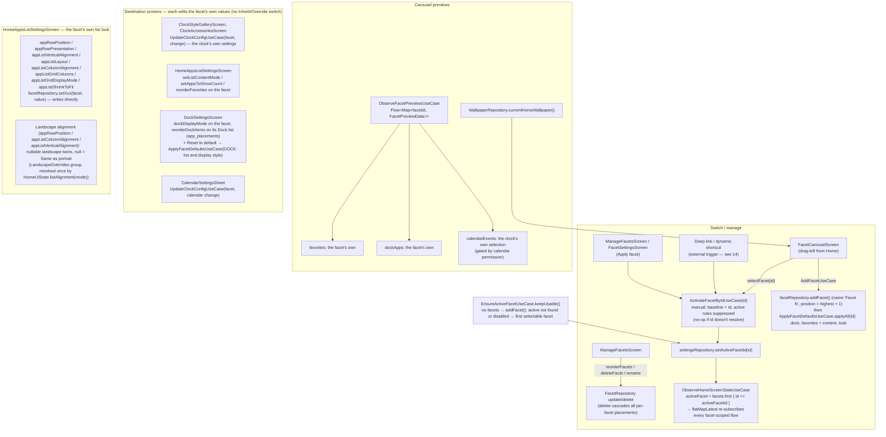
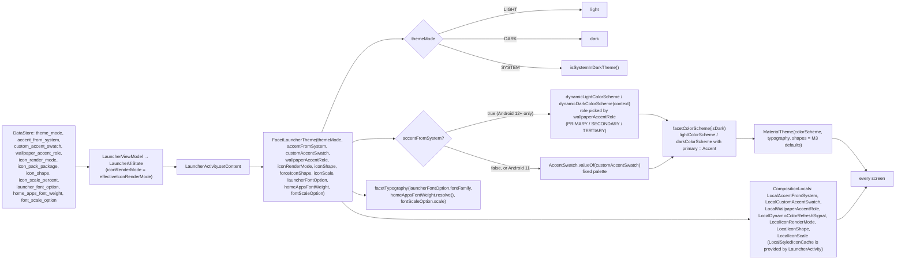
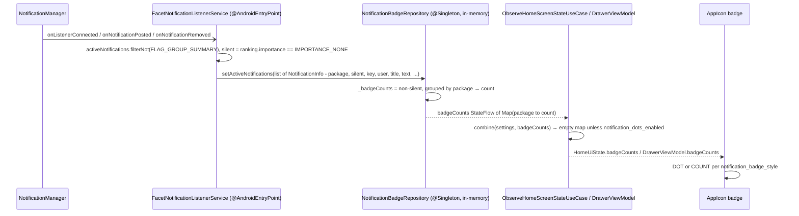
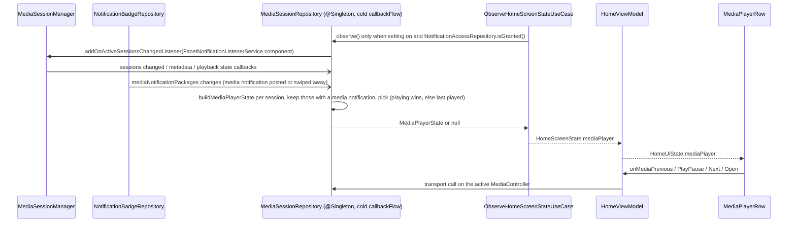

# 13 — Flows: Facets, Theme resolution, Notification badges, Onboarding

Four smaller flows that don't fit the earlier docs but are load-bearing for how Home looks.

## 1. Facets — create, switch, preview, reset

A *facet* is a named Home configuration (`facets` row). Exactly one is active
(`active_facet_id` in DataStore). A facet **owns** its dock, favorites, list content and look. The launcher-wide
values (the list content and look a new facet starts with, kept in the launcher settings with no screen of their own; a facet's own screens are *Dock Apps* and *Apps List*) are only a
seed: `ApplyFacetDefaultsUseCase` applies them to a facet when it is created, and the Dock's *Reset to default* re-seeds the Dock from the device's default apps. There is no launcher-wide Dock, Favorites or Apps list screen, and no *Copy to facets* from defaults. Each of a facet's Dock, Apps list and Widgets (stack) screens instead ends with a *Copy from facet* row (`CopyFromFacetCard`): a bottom sheet lists the other facets, picking one asks to confirm what is replaced, then the screen's content and settings are copied from it (see *Copy from facet* below). There is no launcher-wide Home setting with a control: *Allow landscape mode* is each facet's own switch (`Facet.allowLandscape`), on its Apps list screen.

- **The settings kit (`ui/components/`)** — `SettingsCard` is tonal (28dp, no shadow or border) on the
  dimmer `SurfaceContainer` page. By default it pads its content 16dp; with `fullBleedRows = true` it
  doesn't, and each row pads itself with `LocalSettingsRowInset` *after* `clickable`, so a pressed row's
  highlight spans the card and follows its rounded corners (`CardDivider` and `ClickableRow` read the
  same local). Every card of tappable rows uses it; dropdown and switch rows stay control-only in a
  default padded card by design. `SettingsIconBadge` is the 40dp leading icon, tinted from
  `SettingsSectionHue` (`theme/Color.kt`: Facets blue, Appearance violet, Apps and folders teal, System
  slate — fixed colours, independent of the accent); `SettingsSectionHeader` is the sentence-case
  title above a card. Buttons are `PrimaryButton`, `TonalButton`, `SurfaceButton` and
  `TextActionButton` (M3 `TextButton`), all pills. The same kit lays out `SettingsScreen`,
  `FacetSettingsScreen`, `FoldersSettingsScreen`, `BackupRestoreScreen`, `HomeSheets` and the
  carousel's Launcher settings row.
- **`FacetSettingsScreen` is a plain nav list** — a Rename row, a Home card (Widgets), then an "Apps and folders" card with
  Apps list / Dock rows, mirroring `SettingsScreen`'s own
  layout: tonal `SettingsCard`s (28dp, no shadow or border), a `SettingsIconBadge` on each row in
  the same hue as on Settings, inset dividers, no chevrons. There is no Inherit/Override switch anywhere: each of the two destination
  screens edits the facet's own values and, the Dock screen ends with a *Reset to default* row (`ResetToDefaultCard`, behind a `ConfirmDialog`
  that names what is lost) that reseeds the facet's dock from the device defaults (see the diagram above); the Apps list screen has none.
- **`AppearanceSettingsScreen` is a hub of short sections**, each a card of one or two rows that open their own screen. It has no clock or calendar rows: a clock's style, accessories and calendar settings are reached only from the clock's own sheet and the widget stack (a facet's settings has no Appearance row either; its Home section has no look screen of its own). It shows only "Look & Feel": the App Drawer and Notifications rows are on the main Settings screen's Customization card, below the Launcher appearance row that opens this screen (`SettingsViewModel` reads the notification access for the latter). (The Home list's look is not here: it is on the Apps list screen, `HomeAppsListSettingsScreen`, always for one facet), and, global
  only, the Look & Feel section (three rows: "Colors and Themes" → `ThemesAndColorsScreen` with a static "Themes, accent, status bar" subtitle, "Fonts" → `FontsScreen`, "Icons" → `IconsScreen`, the last two showing their current value).
  The two moved-out screens each show the same live `AppearancePreviewCard` above their controls and share
  `AppearanceSettingsViewModel` (a separate instance per back-stack entry). `HomeAppsListSettingsScreen` (`AppListLayoutRows` and `appListAlignmentItems` in `AppListLookItems.kt`, with `HomeAppsListSettingsViewModel`, always for one facet) holds the `LOOK`
  fields: the layout rows (list layout, presentation or grid rows, at the top of the list content card); below it, "Portrait alignment" and "Landscape alignment" under `SettingsSectionHeader`s. Each alignment card has the layout's horizontal row (row position, or column alignment for two columns, none for a grid) and the list position. Landscape's rows add a "Same as portrait" choice, stored as `null`; the preview is the screen's `HomeSurfacePreview`, portrait-shaped; three pages, each a Home preview plus only its own card(s), reached from the "General" rows: `ThemesAndColorsScreen` (route `themesAndColors`: launcher theme, status bar icons, accent), `FontsScreen` (route `fonts`: launcher font style, font color, size, weight, then a `FontPreviewRow` of sample text in
  Home's styles as the card's last row) and `IconsScreen` (route `icons`): a Home preview, four style cards (default, monochrome, glyph, outline) each showing a 2×2 sample of the user's own icons on `SurfaceContainer` in the chosen colour, a colour dropdown (accent, theme, theme inverted; monochrome has no inverted), a background dropdown (none, tile or reversed tile, glyph and outline only) and the shape picker. `IconStyle`, `IconColour` and `IconBackground` are views of `IconRenderMode`, whose existing stored values are unchanged; a tile (`GLYPH_TILE_*`, `OUTLINE_TILE_*`) fills the icon shape in the colour with the picture in the text tone that reads on it, and a reversed tile (`*_REVERSED_*`) swaps the two; theme inverted is `GLYPH_INVERTED`/`OUTLINE_INVERTED`, the same pictures in `InkInverted`, the opposite of the text colour, with no tile. Glyph and outline draw from the app's themed monochrome layer when it ships one (the outline is a 4 px rim at the 192 px mask size, with its opacities scaled so the 95th percentile is full), else from the plain icon by plate removal (a flat colour, else an edge-walled fill that follows gradients) or edge detection (on the glyph alone over mid grey, its rim kept inside the glyph at the same 4 px width and detail lines thinner, so the plate's own edge never shows; the whole icon's edges only where plate removal fails and they are not too busy for line art; the edge strengths are then scaled by one factor so the 95th percentile of the drawn pixels is fully opaque, which brings every icon's brightest lines to the same level and keeps its gradient), and draw the whole icon where neither works, its lightness anchored so the accent sits at the accent's own lightness among the icon's tones, such as art-heavy icons, see `IconStyler`.
  `dockDisplayMode` ("Show Dock apps as") is edited on the Dock screen (`DockSettingsScreen`, `DockSettingsViewModel.setDockDisplayMode`), above the apps card, and follows that screen's Reset to default (scope `DOCK`) and Copy from facet. Row titles on the look screen:
  `appRowPosition` → "Home Apps Alignment",
  `appRowPresentation` → "Show Home apps as", `appListVerticalAlignment` → "Home Apps list
  position". Within "Dock & home", `appListLayout` ("App list layout" — always visible) then gates
  three more rows, mutually exclusive per its value: `SINGLE_COLUMN` shows `appRowPosition`/
  `appRowPresentation` (the rows above, unchanged); `TWO_COLUMN` hides `appRowPosition`, shows
  `appListColumnAlignment` ("Column alignment" — both columns left-aligned, both right-aligned, or
  "left aligns to the edge, right aligns to the other edge") alongside `appRowPresentation`
  (unchanged, still applies to both columns); `GRID` hides both `appRowPosition` and
  `appRowPresentation`, shows `appListGridColumns` ("Grid columns" — 3/4/5/6, user-choosable) and
  `appListGridDisplayMode` ("Grid display" — icons or text, never both, shaped like
  `dockDisplayMode` but a wholly separate field). `appListVerticalAlignment` stays visible and
  applies uniformly across all three layouts. Its preview card (`AppearancePreviewCard`) is a thin wrapper over `ScaledHomeScreen`
  (`ui/home/ScaledHomeScreen.kt`) — the same composable `FacetCarouselScreen`'s `FacetPreviewPage`
  renders. It is the real `HomeScreen`, laid out at the window's own size and shrunk to the card
  (`APPEARANCE_PREVIEW_CARD_SCALE`/`CAROUSEL_CARD_SCALE`, both `0.55f` wide), so every component sits
  where Home puts it, in portrait and in landscape alike (a wide window such as an unfolded foldable
  previews the clock pane, apps pane and dock of the landscape layout). In the carousel `0.55f` is an upper
  bound: the dots and Launcher-settings row are measured first and the card shrinks, keeping the screen's
  aspect ratio, to fit the height left (floor `CAROUSEL_MIN_CARD_HEIGHT`), so tablets and foldables never
  push the settings row off screen; the neighbour peek is the width the fitted card leaves. In a window shorter
  than 480dp (a landscape phone) each page drops its gear/trash row below the card: Facet settings and Delete facet
  move behind a three-dot menu in the name row (`FacetPageMenu`), which leaves the card room to be its true size, and
  the Add facet card switches to a compact glyph-beside-title layout when it is too short for its subtitle. Its state comes from
  `ResolvedFacetStyle.toHomeScreenState(landscape, ...)`, the builder `HomeDrawerRoute` uses too, with
  no-op actions. A transparent layer above takes every tap: the carousel passes `onClick` (apply the
  facet), the Appearance card passes none and stays read-only without blocking the screen's scroll.
  Home's test tags go through `LocalHomeTagPrefix` (`homeTag(...)`), empty on Home itself and
  `appearance_preview_` / `facet_preview_` in a preview, so a preview's tags (for example
  `facet_preview_home_clock_block`, `facet_preview_home_app_icon_<pkg>`) never collide with the Home
  beneath the carousel. When "show media player on Home" is on, a paused sample player marks where the
  media row sits; the alarm and battery accessories are not shown.
  Home's content padding reads the raw system-bar insets (`asPaddingValues`) instead of consuming them,
  so a preview inside a screen that already applied insets still gets the same padding as Home.
  The calendar preview lives here now too (via `ClockBlock`'s own bundled `CalendarEventsBlock`),
  not on `ClockStyleGalleryScreen` — that screen dropped its own calendar-preview block entirely
  (see chat history). The preview's `favorites`/`dockItems`/`calendarEvents` are this scope's real,
  live content, not sampled installed apps or fixed sample events: `AppearanceSettingsViewModel`
  observes the active facet's Favorites and Dock through `ObserveActiveFacetItemsUseCase` (`favorites`/`dockItems`); its branch for a
  route-supplied `facetId` (through `ObservePlacedItemsUseCase`) is never taken, since none of its four routes declares that argument (F20 in `05`). Calendar
  events come from `CalendarRepository.getUpcomingEvents`, gated by `CalendarPermissionRepository
  .isGranted()` (empty when ungranted, never a sample fallback), with facet-or-global
  `showAllDay`/`calendarIds` of the clock's calendar settings resolved the same way `ObserveHomeScreenStateUseCase`
  resolves them. The calendar indicator / item-count pair (`CalendarDisplayOptions`) comes from the clock's own settings (through `resolveFacetStyle`) into `HomeScreenState.calendarDisplay` and is applied in `CalendarEventsBlock` after ended events are dropped. The clock uses its own real system-default `Clock`, not a fixed reference instant.
- **`FacetCarouselScreen`'s `FacetPreviewPage` renders `ScaledHomeScreen`**, fed by
  `FacetCarouselUiState.style(facetId)` and the facet's `FacetPreviewData` (its effective favorites, dock
  and calendar events). Its tiles are tappable (`onCardClick` applies the facet), unlike the read-only
  Appearance preview. Because it is the real screen, list layouts, the grid, folders and the dock behave
  as on Home with no preview-only code.
- **A third, smaller preview card: `HomeSurfacePreview`** (`ui/components/HomeSurfacePreview.kt`) heads
  `HomeAppsListSettingsScreen` and `DockSettingsScreen`. It is a short wallpaper band that shows
  *only* the surface that screen governs — the app list or the dock, never the clock — so it honors
  the app list's row position and presentation, layout, column alignment and grid options, and the dock
  display mode, but has no clock position or app-list Top/Bottom placement to honor. It is separate
  from `ScaledHomeScreen` because it is not a scale model of the screen.
- **Switching is one DataStore write.** Everything downstream is reactive:
  `ObserveHomeScreenStateUseCase` recomputes `activeFacet` from `combine(settings, facets)` and
  `flatMapLatest` tears down the previous facet's Room subscriptions.
- **Creating or resetting seeds, it does not link.** `ApplyFacetDefaultsUseCase` gives a new facet a Dock of the device's default apps
  (`SeedFacetDefaultsUseCase`, from `DefaultAppRepository`) and empty Favorites, and copies the launcher settings' look and Favorites
  content mode and count into it, so its lists (its `app_placements` / `folder_placements` rows for that `list` and `facetId`) are its own
  from that moment. The Dock's "Reset to default" re-seeds from the device defaults. Onboarding edits the first facet's own lists
  directly (`OnboardingViewModel`, and the pickers through `useFacet`); finishing applies only the content mode and count.
- **One resolver for everything a facet owns:** `domain/ResolvedFacetStyle.kt`'s
  `resolveFacetStyle(facet, settings)` returns the clock block, apps-list look, dock display mode,
  calendar display, the clock and list placement in each orientation (`clockPlacement`, `listAlignment`,
  with the landscape rules; the clock's is the facet's own once `clockPlacementOwn`, else the launcher's built-in fallback) and the facet's clock stack (`clockStack`: each page's kind, widget id, size and alignment per orientation). Home
  (`HomeUiState`) and every preview read it, so a preview cannot show anything Home would not:
  `FacetCarouselUiState`, `AppearanceSettingsUiState`, `CalendarSettingsUiState`, `FacetSettingsUiState`,
  `HomeAppsListUiState`, `DockSettingsUiState` and `ClockStyleGalleryUiState` all delegate to it. The
  last four hold the launcher's `LauncherSettings` as `settings` instead of a `globalX` field per
  value. `ResolvedFacetStyleTest` covers the own-value, landscape and widget rules, and
  `HomeScreenStateBuilderTest` checks that the state a preview is built from has the same placement as Home resolves for the same facet.
- **The widget stack screen** (`ClockStackScreen`, route `clockStack`, reached from the Home sheet's Widget stack row) lists the active facet's clock stack with a drag handle, Configure (the clock opens the facet's Appearance screen, a widget its own configure activity) and Remove on each row, an Add row, and the counter against the plan's limit. It hosts the clock widget picker itself for Add; the picker also offers the widgets Facet draws itself ([20](20-flow-native-widgets.md)), which list by name and have no Configure. Add opens a chooser (launcher clock or custom widget) while the clock is not in the stack, and goes straight to the picker when it is.
- **A hosted clock widget shows in previews.** The first page of the stack, when it is a widget, is part of the state (`HomeClockWidgetState`),
  so `HomeScreen` draws it through its normal `ClockWidgetTile`, with `createHostView` pointed at
  `ClockWidgetHostController.createPreviewHostView`: a non-live copy from a second, non-listening
  `AppWidgetHost` (`AppWidgetRepository.createPreviewHostView`). A host sends later updates to the newest
  view of an id, so a view from the main host would take them from the live one on Home. The saved size
  is used, else the provider's default, as on Home. The controller reaches previews through
  `LocalClockWidgetHost`; without it a preview draws the native clock.
- `FacetCarouselUiState.style(facetId)` is the single per-facet accessor; it replaced twenty `xxx(facetId)` resolvers.

### 1a. Facet limits and the free plan

How many facets a user may have is `FacetLimits` (`data/model`): **3 free, 10 with Pro**. `AddFacetUseCase`
enforces it (the repository does not, since it knows nothing about entitlement), and the add row and the
carousel's add page show at the free limit with a Pro pill that opens the Facet Pro screen (`ui/pro`).

A user who loses Pro keeps every facet, but only the **first 3 in list order are selectable**
(`SelectableFacetsUseCase`); the rest are disabled until the count drops to 3 or Pro returns. Nothing is
deleted for them, and a disabled facet can still be deleted (the last remaining facet cannot). Reordering
chooses which three are usable. Disabled means:

| Where | Behaviour |
|---|---|
| Carousel and Manage facets | Dimmed with a lock; tapping opens the Facet Pro screen instead of applying or opening its settings. In Manage facets the overflow menu disables *Facet settings* and *Apply* but keeps *Delete*. |
| `ActivateFacetByIdUseCase` | A no-op for a disabled facet, which covers shortcuts and deep links. |
| `EnsureActiveFacetUseCase.keepUsable()` | Runs whenever the selectable set changes (an add, a delete, a reorder, a change of entitlement): if the active facet is missing or disabled, the first selectable facet takes over. |
| Facet shortcuts | Published only for selectable facets (`SyncFacetShortcutsUseCase`). |
| Facet automation | A rule aimed at a disabled facet is a no-op: `RefreshAutomationStateUseCase` passes only selectable ids as the evaluator's existing facets, so the existing "facet missing" fallback applies ([15](15-flow-facet-automation.md)). |

`EntitlementRepository.isPro` comes from Google Play ([16](16-flow-billing.md)). A debug or sideloaded build is Free unless the debug override forces Pro.

### 1b. Clock accessories — alarm, battery, weather

The accessory row under the date has three items, each with its own switch. They are settings of each facet's clock (`ClockWidgetConfig.showAlarm/showBattery/showWeather`, with the weather picture
style `weatherIconStyle` and the weather place `weatherLocation`, `null` following Weather settings), stored on the clock's page in the clock stack
(`NativeWidgetConfig.clock`, [20](20-flow-native-widgets.md)) and resolved by `resolveFacetStyle` (`ResolvedFacetStyle.clock`). There is no
launcher-wide default and no override switch: a new facet's clock starts from the built-in defaults, and a facet that existed before
per-clock settings had the values it showed copied onto its clock in the release that introduced them (a clock with no stored settings shows the built-in defaults).
Every edit goes through `UpdateClockConfigUseCase(facetId, change)`. Settings → Clock style → *Clock accessories* (a row after the clock options; the
screen is `ClockAccessoriesScreen`, route `clockAccessories?facetId=`) edits them: card 1 alarm and battery, card 2 weather,
card 3 Icons (while weather is on), then, while weather is on, a *Location* card with the same picker as a Weather widget (`WeatherLocationPicker`): same as Weather settings, current location, or a saved city, then a *Weather settings* row back to the launcher-wide screen. Units and location themselves are not here: they are *Weather settings*, a row in Settings → System
(`UnitsAndLocationScreen`, route `unitsAndLocation`): the four units and the Location card, launcher-wide (`UnitsAndLocationViewModel`), so a
Weather widget can reach them whether or not the clock shows weather.

The Home sheet no longer has a *Clock & calendar settings* row or its facet scope badge: a clock's settings are always its own, reached from the clock's own sheet (a long-press on the clock or its calendar, [12](12-flow-drawer-search-and-app-actions.md) §4). A facet's settings screen has a *Home* section with *Widgets* (that facet's widget stack, `clockStack?facetId=`), above the *Apps and folders* section with *Apps List* (`HomeAppsListSettingsScreen`, `homeAppsListSettings?facetId=`) and *Dock Apps* (`DockSettingsScreen`, `dockSettings?facetId=`); the look of the dock and apps is edited on those two screens, and there is no separate appearance screen. Both edit the facet's own values and offer *Copy from facet* (`CopyFromFacetCard`); the Dock screen also ends with *Reset to default* (`ResetToDefaultCard`), and the Apps List screen carries the facet's *Allow landscape* switch. They are always opened for a facet: Settings has no launcher-wide *Default …* pages for them any more, so the launcher-wide values in `facet_settings` only seed a new or reset facet. (The routes' `facetId` argument still defaults to `NO_ACTIVE_FACET_ID` and the two ViewModels still tolerate a missing facet, although no caller navigates without one: finding F20 in `05`.)

The Home sheet has an *Adjust widget size & position* row (the same `widget_sheet_adjust_label` string as the widget sheet's, while the stack has a page) that enters adjust mode for the page showing, as the widget sheet's row does, and a *Switch facet* row (`home_sheet_switch_facet`) that opens the facet carousel (`HomeClockActions.onOpenFacetCarousel` → `swipe.facet.open()`); `FacetCarouselScreen(isOpen)` puts its pager back on the active facet whenever the overlay is closed, so it always opens there. On the Settings folder screen the header's 3-dot menu (`FolderDetailMenu`) offers Rename, Dock and Favorites add/remove and Delete; the Dock and Favorites rows carry a `FacetScopeBadge` (only with 2+ facets) because that screen is where the facet is not otherwise visible, fed by `ObserveFolderPlacementUseCase`. The app and folder long-press menus on Home and in the Drawer show no badge.

`HomeScreenStateBuilder` gates the items: the alarm and battery only when their switch is on, the weather
(`HomeWeatherState`, from `ObserveWeatherUseCase`) only when its switch is on and the forecast is not outdated.
`HomeSlots` turns that into a `ClockWeatherAccessory` (`rememberClockWeatherAccessory`: icon, "27°C", and the spoken text
"27°C, Light rain. Opens the weather details") and `ClockDisplay` hands it to every template through
`LocalClockWeather`; `ClockAccessoryRow` and the templates that lay their accessories out one by one
(`WeatherAccessoryContent`) draw it, and `hasAccessories` decides whether the row exists at all. The item's touch area is
smaller than 48 dp on purpose (a bigger one would shift the clock's rows); it is one merged TalkBack button. The style
gallery shows a sample ("21°") on each card while weather is on for that scope.

Tapping it sets `HomeOverlayState.showWeatherSheet` (`HomeRouteHooks.openWeather`) and asks `WeatherViewModel` for a
refresh; `HomeDrawerRoute` also calls `WeatherViewModel.onHomeResumed(weatherShown)` on `ON_RESUME`. `WeatherSheet` is a
`ThemedModalBottomSheet` (so it closes on Home press): a rain summary line, the place and temperature with the day's high
and low, the next-24-hours strip (condition, temperature, rain, wind), humidity, pressure and the other details, the days
ahead, and an "Updated" footer with the MET Norway credit and a refresh button. Its states (`WeatherNotice`) are
busy-try-later, offline, location permission needed, no city, and already up to date. Its place line opens Clock
accessories to choose another place. The About section of Settings carries the MET and GeoNames credit too.

Weather pictures come in two styles, chosen per clock (`ClockWidgetConfig.weatherIconStyle`, coloured unless changed; Clock accessories → Icons): monochrome,
drawn in code in the clock's accessory colour (`WeatherIcon`), or coloured, one bundled PNG per picture
(`res/drawable-nodpi/weather_color_*`, mapped by `coloredRes()`). The style applies to the accessory row and the sheet;
`HomeWeatherState.iconStyle` carries it, and `HomeDrawerRoute` hands the active facet's style to the sheet (`WeatherUiState.iconStyle`). The Clock accessories screen opens with
`ClockAccessoriesPreview`: the clock of that scope (template, font, colour) with a sample alarm, battery and
weather, following the switches and the icon style as they change. The Icons card also carries `WeatherIconsPreviewRow`:
all nine weather pictures in the selected style. The alarm, battery and weather icons carry the same
drop shadow as the accessory text (`homeIconShadow`: the glyph redrawn in the shadow tone over a ring of offsets).
`ScaledHomeScreen` (the Appearance card and the facet carousel cards) feeds Home a sample alarm, battery and weather
(`PreviewAccessorySamples.kt`) when the content has none, so the accessory row shows in those previews, still following the
facet's three switches.

## 2. Theme resolution — from DataStore to `MaterialTheme`

- The Activity renders an empty `Box` until `LauncherUiState.isLoading` clears, precisely so the
  first frame is never painted with default theme values that then flip.
- **Icon packs replace the icon style.** While `icon_pack_package` is set, `LauncherSettings.effectiveIconRenderMode`
  is `SYSTEM_DEFAULT`, so `LocalIconRenderMode` draws icons as they are; the stored `icon_render_mode` is untouched and
  comes back when the pack is cleared. The pack's icons come in through `AppInfo.icon` (`03 §1`), and `AppIcon` draws one
  with `iconFromPack` unclipped, ignoring `LocalIconShape`. Settings → Appearance → Icons lists the built-in styles and
  the installed packs side by side (`IconsViewModel` over `ObserveIconPickerUseCase`): a built-in card previews four apps
  (`SelectIconSamplesUseCase`: Home, then the device's default apps, then the drawer), a pack card shows only the pack's
  own app icon, so opening the screen reads no pack; tapping one applies it (a spinner while it's read) and the Home
  preview above shows it. Picking a built-in style clears the pack; with a pack applied the Colour and Background rows give way to
  the pack's coverage and "Apps the pack misses" (`icon_pack_fallback`), and a "Force icon shape" switch; Icon Shape and Icon size sit together in their own card above and always apply.
  "Get more" and "Find icon packs" open the Play Store's icon pack search (the web search where there is no Play Store).
- `LocalDynamicColorRefreshSignal` is bumped when the wallpaper changes so Material You colours
  re-resolve without a restart.
- Android 11 (`minSdk 30`) has no Material You: `dynamicColorSupported` is false, `accentTonalExtremes()` uses the
  chosen `AccentSwatch` (default blue), Settings → Appearance shows only the preset swatches (no source tabs), and the
  onboarding backdrop blur (`setBackgroundBlurRadius`, Android 12+) is skipped.
- Clock/app-label colours are *not* the M3 scheme directly: `ClockColorOption`
  (`THEME` / `ACCENT_PRIMARY` / …) resolves through `ui/theme/ClockColors.kt` against the current
  scheme. Clock's own colour is each clock's own (`ClockWidgetConfig.colorOption`, stored on its clock stack page); the app-label colour
  (`app_label_color_option`) is global only.
- `ClockTemplates.kt`'s `NegativePanelTemplate` fills its panel with the resolved clock colour
  itself, so its digits/meridiem/accessory row can't reuse that same colour as their own — they're
  knocked out via `ui/theme/Color.kt`'s `contentColorFor(panelBackground)`, which derives the
  on-panel content colour from the panel's own luminance rather than a fixed `Surface` read. This
  is what makes the panel and its content flip together across `THEME`/`THEME_INVERTED` (a fixed
  `Surface` read stayed legible for one and went low-contrast for the other, since `THEME_INVERTED`
  deliberately lands the panel on `Surface`'s own end of the scale).
- Private Space screens use `PrivateSpaceTheme`, a fixed dark override of the scheme.
- **Settings ignores the Font size and Font weight options.** `FacetLauncherTheme` provides two typographies as locals
  (`LocalLauncherTypography`, scaled and weighted, and `LocalUnscaledTypography`, same family at scale 1 and regular weight). `FacetNavHost`
  registers every destination except Home through `settingsComposable`, which wraps it in `UnscaledTypography`, so
  Settings text never changes size or weight. `ThemedModalBottomSheet` wraps its content in the same `UnscaledTypography`, so every
  bottom sheet is unscaled too. `FolderContentsSheet` is a dialog, not a `ThemedModalBottomSheet`, but it matches one: edge-to-edge
  window (`decorFitsSystemWindows = false`), scrim up to the status bar, surface behind the nav bar with its content clear of it,
  bar icon colours from `LocalLightStatusBarIcons`/theme, and the same `UnscaledTypography`. Its header mirrors the app sheet's: `FolderTileGlyph`, the name in `titleLarge`, an app count, a
  rename icon button (or the back chevron and "Add to folder" in `AddHere` mode) and a `CardDivider` below. It slides in from the bottom and out again (scrim fading) with the nav transition's timing; scrim tap, Back and Home press play the exit before calling `onDismissRequest`. Previews that show how Home will look (`ScaledHomeScreen`, `HomeSurfacePreview`, the
  calendar strip) re-wrap in `LauncherScaledTypography`, so they still follow both options. The system font scale is not
  touched.
- `facetTypography`'s `fontScale` multiplies every role's `fontSize`/`lineHeight` app-wide except
  the clock (`FacetType.clock`, defined outside `facetTypography`); `fontWeight` only overrides
  `bodyLarge`/`bodyMedium`/`bodySmall` — not `title*`/`label*`/`headline*`/`display*`, so dialog
  titles (`ConfirmDialog`/`RenameDialog`), context menus, and onboarding copy keep Material's own
  per-role weight rather than flattening app-wide. Home's own app-list/Dock labels apply
  `homeAppsFontWeight` a second time via their own explicit `.copy(fontWeight = ...)` (unchanged
  from before this reached `facetTypography`) — redundant with the global value but harmless, and
  what lets a `titleMedium`-styled label pick up the weight that body-only roles don't reach.
- **The calendar events strip is a direct consumer of this same resolved output, not a separate
  theming path**: `CalendarEventsBlock` (rendered inside `ClockBlock`) takes `launcherFontOption`
  (this section's own `launcher_font_option`, via `.fontFamily`), `homeAppsFontWeight` (via
  `.resolve()`), and `appLabelColorOption` (via `.resolve()`) straight from the same three
  DataStore keys shown above, plus `clockAlignment` (Room, per-facet) for its position — it has no
  design fields or theming path of its own.

### 2a. System bar icon color

Status bar and 3-button nav bar icon color is *not* part of `MaterialTheme` — it's a window flag
(`isAppearanceLightStatusBars` / `isAppearanceLightNavigationBars`, where "light" means **dark**
icons), set by `ProvideSystemBars` (`ui/theme/SystemBars.kt`) inside `FacetLauncherTheme`, in
`LauncherActivity`. The gesture pill adapts by itself, so the nav half only shows in 3-button mode.
Which color stays legible depends on what's *behind* the bars, so the pure rule
`useLightSystemBarIcons(style, backdrop, isDarkTheme)` takes a `SystemBarsBackdrop`:

| Backdrop | Declared by | Icons |
|---|---|---|
| `WALLPAPER` | `HomeDrawerRoute` (Home, Hub, carousel, Drawer) | the `system_bar_icon_style` setting: `MATCH_THEME` (default) follows the theme, `LIGHT`/`DARK` force it |
| `THEME_SURFACE` | the default; `HomeDrawerRoute` while a widget picker covers Home | always follow the theme (the setting is ignored — it could make icons invisible on an opaque screen) |
| `DARK_SURFACE` | `HomeDrawerRoute` while Private Space shows | always light — `PrivateSpaceTheme` is fixed-dark regardless of theme |
| `DARK_TOP` | `FacetProScreen` before purchase: a dark hero over a normal page | status bar icons always light; the navigation bar follows the theme (`useLightNavigationBarIcons`), since it sits over the page-coloured bottom bar |

A screen only declares its backdrop (`SystemBarsBackdropEffect`); leaving composition falls back to
`THEME_SURFACE`, so Settings and onboarding need no code. Bottom sheets are separate windows with
their own bar appearance: `ThemedModalBottomSheet` sets nav icons from the theme (the sheet surface
runs behind the nav bar) and keeps the status bar as Home has it (`LocalLightStatusBarIcons`).
The setting is global, in Appearance → Look & Feel → Colors and Themes, and is in `BackupSettings` (defaulted).

**Hide status bar** (`hide_status_bar`, same screen, device-local and not backed up): `ProvideSystemBars` hides
`statusBars()` on the activity window with `BEHAVIOR_SHOW_TRANSIENT_BARS_BY_SWIPE` while the backdrop is `WALLPAPER`
(Home, Hub, Drawer) and shows it on every other backdrop; `isStatusBarHidden` is the pure rule. It re-applies on
resume and window focus, and sheet/dialog windows follow `LocalStatusBarHidden` (`MatchStatusBarVisibility`,
`SheetDialogWindow`), since a separate window would otherwise bring the bar back. Home, Hub and Drawer pad with
`launcherSystemBarInsets()`, which with the setting on drops the status bar from the top inset and keeps only the display
cutout, so the bar overlays the content and nothing moves when it shows. Edge-to-edge is only enforced from Android 15, so `LauncherActivity` calls `setDecorFitsSystemWindows(false)` and the
v29 theme sets `windowLayoutInDisplayCutoutMode=shortEdges`; without them API 30–34 resizes the window, or on a phone
with a cutout pushes it below the cutout, whenever the bar hides or shows. An edge swipe gets the system's own transient
bar. A Home swipe-down that clears the shade threshold calls `SystemBarsState.revealStatusBar()` first: with the bar
hidden (and the system not already showing it) it shows the bar for `STATUS_BAR_REVEAL_MILLIS` (3 s, then hides again)
and consumes the swipe; with the bar showing it expands the notification shade as before.
`SystemBarsTest` covers the rule; `SystemBarsAppearanceTest` reads the real window flags.

## 3. Notification badges

- Access is user-granted in system Settings; `NotificationAccessRepository.isGranted()` is read
  live, and `NotificationAccessExplanationScreen` explains the permission before deep-linking.
- Nothing about notifications is persisted; the map is rebuilt on every listener callback and is
  empty until the service connects after process start.
- On Home's app list, `AppRow` places the badge outside the alignment: in Center the icon and label are centred in
  the row and the badge sits just past them (`CenteredWithBadge`), so a badge never shifts them. Left and Right keep
  the badge trailing and leading the label.
- Badge counts are keyed by package only — a Work-profile app shares its badge with the personal
  copy. `NotificationInfo.userHandle` (`sbn.user`) is carried for the app menu below, but the badge
  count ignores it.

### Notifications in the app menu

The same snapshot also feeds the long-press sheet's notifications zone ([12 §3](12-flow-drawer-search-and-app-actions.md)).
`NotificationInfo` carries the listener `key`, `userHandle`, `title`, `text` (compact text preferred over
expanded, trimmed and cut to 300 characters by `notificationTitleAndText`), `postTime`, `isClearable`,
`isSecret`, `autoCancel` and the `contentIntent`. All of it is in memory only.

- `NotificationBadgeRepository.notificationsFor(pkg, handle)` lists, newest first, the notifications that are
  not silent, not media (Home's player row owns those), not `VISIBILITY_SECRET`, and have a title or
  text; group summaries are already dropped by the service. Persistent (non-clearable) notifications are
  listed too, so the sheet agrees with the icon badge, which counts them; they can be opened but not
  dismissed. It matches package **and** profile,
  so a Work copy of an app never shows the personal app's notifications.
- `ObserveAppNotificationsUseCase` gates the list on `show_notifications_in_app_menu` (default on) and
  notification access. `AppNotificationsState(notifications, needsAccess, enabled)`: `enabled = false` hides the
  zone (setting off); otherwise the zone shows, with `needsAccess` when access is missing and an empty list
  when there is nothing posted.
- Dismissing goes through `NotificationActionController`: the service attaches a
  `cancelNotifications` lambda in `onListenerConnected` and detaches it in `onListenerDisconnected` and
  `onDestroy`; `dismiss(keys)` returns false when detached. The snapshot updates through the service's
  own `onNotificationRemoved`. Opening sends `contentIntent` through `NotificationOpener`; the
  notification is then dismissed only if it asked for `autoCancel`, as the system shade would.
- Known gap: the service never clears the snapshot on `onListenerDisconnected`, so after access is
  revoked the list can show stale items until the process restarts. The use case reads access when the
  sheet opens, which hides it in practice.

### Media player row

The same notification-access grant also backs Home's media player row, opt-in via "Show media player in home screen"
(`show_media_player_on_home`, default off; `show_media_skip_buttons`, default on) on the same Notifications page.

- Only playing or paused sessions with a title show; stopped, errored and untitled ones map to `null`.
- A session also needs its app's `MediaStyle` notification to be posted (`FacetNotificationListenerService` marks these
  `NotificationInfo.isMedia`): many apps keep a paused session alive after the notification is swiped away, so the row
  disappears with the notification, and returns if the app posts it again.
- With several eligible sessions a playing one wins, otherwise the one that played most recently (`ActiveSessionPicker`),
  falling back to `getActiveSessions` order for sessions never seen playing.
- Turning the setting on without access stores it and routes through `NotificationAccessExplanationScreen`; the switch
  reads on only when the stored value and the real grant both hold, like the badges switch.
- Art comes from the session's bitmap, else a `content:`/`file:` art URI decoded off the main thread (no network).
- The page is reached from the main Settings screen's Customization card, whose "Notifications and media" row carries a
  subtext that follows the page: "Dot badges"/"Count badges"/"Badges off", then "Media player on"/"off", joined by " · ".
  Without notification access it says "Needs notification access" instead, since both switches read off then.
  `SettingsViewModel` holds the access flag and `SettingsScreen` re-reads it on resume (`refreshNotificationAccess`); `AppearanceSettingsViewModel` still has a method of the same name that no screen calls any more.
- The progress line is always Material's `LinearWavyProgressIndicator`; its amplitude eases to 0 (a flat line) when
  playback stops and back up when it resumes. It only exists from Material3 1.5, so `app/build.gradle.kts` overrides the
  BOM's 1.4.0 with `1.5.0-beta01` (drop the override once a BOM pins a stable 1.5). No OS-version gating (minSdk 30).
- Progress is interpolated in the UI from the last reported position/time/speed; it is `null` (empty flat track) when the
  duration is unknown.

## 4. Onboarding & first run

```mermaid
flowchart LR
    START["LauncherActivity\nonboarding_completed == false"] --> INTRO["OnboardingIntroPage"]
    INTRO --> FACETS["OnboardingFacetsPage\n(explains facets)"]
    FACETS --> SETUP["OnboardingHomeSetupPage\n(OnboardingViewModel: list mode, apps-to-show,\nreorder/clear dock & favorites)"]
    SETUP --> DRAWER["OnboardingDrawerSetupPage\n(drawer presentation, search bar position, contacts/settings search, folders in drawer,\nAppDrawerSettingsPreview)"]
    DRAWER --> NOTIF["OnboardingNotificationsPage\n(NotificationSettingsViewModel: badges on/off, badge style,\nHome media player; access note)"]
    NOTIF -- "Continue / Skip / swipe" --> FIN["LauncherViewModel.completeOnboarding()\n→ setOnboardingCompleted(true)"]
    FIN --> HOME["FacetNavHost (HOME)"]
    HOME --> PROMPT["HomeScreen: 'Set as default' prompt\n(coach mark HOME_SET_DEFAULT_PROMPT, until dismissed\nor DefaultLauncherRepository.isDefaultLauncher())"]
    HOME --> GEST["Gesture hint overlay\n(coach mark HOME_GESTURES)"]
    SEED["SeedFacetDefaultsUseCase (seeds the first facet's Dock when it is created\nat launch, not gated on onboarding)"] --> SETUP
```

- The gate is `LauncherUiState.onboardingCompleted: Boolean?`, fed by its own settings collector (not the apps/work-profile
  `combine`): `null` shows the blank frame, only `false` shows onboarding, and the 3s loading timeout resolves `null` to `true`.
- The setup page's App drawer card mirrors the top of `AppDrawerSettingsScreen`. Turning on "Search contacts" launches
  the `READ_CONTACTS` request from `OnboardingScreen` and persists only on grant, so onboarding asks for nothing unless that switch is flipped.
- The last step, `OnboardingNotificationsPage`, reuses Settings' `NotificationSettingsViewModel`, `NotificationPreview` and the
  `BadgeSettingsCard`/`MediaPlayerSettingsCard` (their in-app-menu and skip-buttons rows are omitted by passing a null callback). Its
  body text is the disclosure for notification listener access. Turning badges or the media player on without access persists the
  setting and opens `ACTION_NOTIFICATION_LISTENER_SETTINGS` directly (no `NotificationAccessExplanationScreen` — there is no nav
  stack here); the VM re-checks the grant on resume, and the switches show on only while access is held. Skipping asks for nothing.
- Onboarding is outside the nav graph (a top-level `when` branch in `LauncherActivity`), so Back
  can never pop into it and it never appears on the back stack.
- The dock the user sees on the setup page is already seeded — the first facet is created at launch with the
  device's default apps in its Dock (`SeedFacetDefaultsUseCase`), regardless of onboarding. The setup page and the
  pickers it opens edit that facet's lists (`OnboardingUiState.facetId`).
- "Set as default launcher" is a system action (`DefaultLauncherRepository.requestDefaultLauncherIntent()`
  → `RoleManager` request); Facet only prompts when it is confirmed *not* to hold the role. `HomeUiState.isDefaultLauncher`
  is tri-state (`null` until the async `RoleManager` check resolves): an already-default device never shows the sheet —
  `HomeViewModel` marks `HOME_SET_DEFAULT_PROMPT` seen for it — and goes straight to the gesture hint, which itself waits
  for the check so the sheet can't flash up first. Not default: the sheet, then (after "Set as default" returns, or
  "Later") the hint immediately.
- The set-default prompt is a `ThemedModalBottomSheet` ([12 §4](12-flow-drawer-search-and-app-actions.md)): its content
  clears the nav bar via the sheet's own inset plus 24dp under the button, and scrim / swipe-down / Back / Home all count
  as "Later".
- **What's new pill** (`WhatsNewPill`, hosted by `WhatsNewPillHost` in `HomeDrawerRoute`). After an update, the first resting Home
  drops a small pill in from the top, under the status bar, over Home (it moves nothing): "Updated to 0.1.32 · See what's new".
  `WhatsNewPillViewModel.version` is the running version when onboarding is done, `assets/whats_new/<version>.md` exists and
  the coach-mark id `WHATS_NEW_<version>` is not in `coachMarksSeen` (`whatsNewSeenId`). A fresh install never qualifies:
  `SettingsRepository.setOnboardingCompleted(true)` adds the running version's id, and opening What's new
  (`WhatsNewViewModel`, from the About card in Settings or from the pill) adds it too. The pill waits for `HomeUiState.firstRunPromptsDone`
  (set-default step and gesture hint behind the user) and a Home at rest, marks the version seen as it appears, and
  leaves after 8 seconds, when swiped up, or when tapped (which opens What's new). A debug build's Settings (bottom, under
  the Pro switch) has a *What's new pill* row that clears the running version's seen mark, to see the pill again without an update
  (`SettingsRepository.clearCoachMarkSeen`; the row lives in `app/src/debug`).
- `GestureHintOverlay` (coach mark `HOME_GESTURES`) shows four hints at proportional offsets, each on the side its
  gesture starts from: clock hold (top-left, under the default clock), Switch facets (right edge), Widgets (left edge),
  All your apps (bottom-right). Its "Got it" is a `SurfaceButton` with a 1.5dp `Muted` border and a soft shadow, because
  the button's fill is nearly the overlay's color (a 1.05–1.3:1 difference) — the border keeps ≥3:1 in both themes.

## Copy from facet

The Dock, Apps list and Widgets screens each end with a *Copy from facet* row. `CopyFromFacetCard` (`ui/components`) opens a `ThemedModalBottomSheet` of the other facets, then a `ConfirmDialog` naming the chosen facet; it replaces what the screen owns and never touches another screen's data.

| Screen | What is replaced | Where |
|---|---|---|
| Dock | the Dock list (apps, folder placements, grid cells) and the display style | `CopyFacetSettingsUseCase.copyDock` → `PlacementRepository.copyList`, `FacetRepository.copyDockSettings` |
| Apps list | the Favorites list (with grid cells), content mode and count, the list look (layout, presentation, row position, alignments, grid, shrink to fit), the landscape twins and *Allow landscape* | `CopyFacetSettingsUseCase.copyAppsList` → `PlacementRepository.copyList`, `FacetRepository.copyAppsListSettings` |
| Widgets (stack) | the clock's placement (alignment and zone height, both orientations) and every stack page with its size, alignment and settings | `CopyFacetWidgetsUseCase`, driven by `ClockStackViewModel.copyFromFacet` |

A folder placement points at the same folder, so a copy shares folders, and uninstalled apps are copied as rows and drop out at display as usual. A facet never copies from itself.

**Hosted widgets.** A page Facet draws itself (the clock, weather, agenda, now playing) is copied as a row. A hosted widget cannot share its host id, so `ClockStackViewModel` re-adds it: it allocates a new id, binds it to the source's provider and profile (`bindAppWidgetIdIfAllowed`, else the system's bind-permission screen), launches the provider's configure activity when it declares one, then stores the page under the new id with the source's size and alignment. The widget's own settings live in its provider, keyed by id, so they are re-chosen in that configure screen; they are not cloned. A widget whose provider is gone, whose permission or setup is cancelled, or that is past the plan's stack limit (one page on Free) is skipped and counted in a toast. The target's stack is cleared first and its host ids released, so a cancelled copy leaves the pages copied so far.
