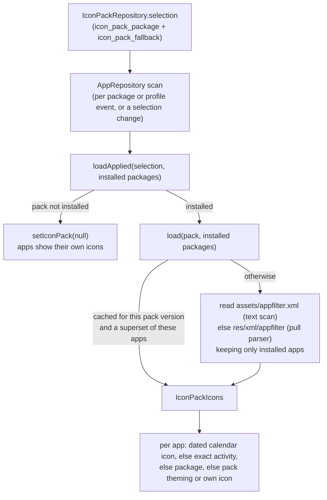

# 19 — Icon packs

Third-party icon packs (packs made for Nova, ADW, Apex, GO and the like), applied launcher-wide from Settings →
Appearance → Icons. Free, not Pro. One pack at a time, for the whole launcher; while one is applied it stands in for
the built-in icon style.

## 1. Finding packs

`IconPackRepository.getInstalledPacks()` (`data/iconpack/`) queries `PackageManager` for every action in
`ICON_PACK_ACTIONS` (each has a matching `<queries>` entry in the manifest, or the query comes back empty on API 30+),
keeps one entry per package, drops this launcher, and sorts by label. Each `IconPackInfo` carries the pack app's own
launcher icon, which is all the Icons screen's "External" cards show: no pack is parsed to open the screen.

## 2. Reading a pack

- `AppFilter.parse` has two readers that must agree (`AppFilterTest` runs every case through both): a text scan for
  the raw asset, used first because Android's pull parser took about nine seconds over Arcticons' 50,000 entries on a
  debug build, and the pull parser for a compiled XML resource. Both skip comments and malformed entries, tolerate a
  doubled brace in a component, and keep only packages that are installed, so a parsed pack holds a few hundred
  entries, not tens of thousands.
- Lookup (`AppFilter.drawableFor`): the exact `package/activity`, then the first entry for the package. A
  `<calendar component prefix>` entry dates the app: `prefix` + today's day of the month, falling back to its plain
  entry when that day's drawable is missing.
- Drawables are rendered at most `PACK_ICON_SIZE` (256px) square, enough for the largest icon (44dp at 120% on a 4x
  screen). An app the pack misses gets its own icon on the pack's `iconback`/`iconmask`/`iconupon`/`scale` art under
  `IconPackFallback.MATCH_PACK` (when the pack ships any), else its own icon (`KEEP_DEFAULT`, or no art).
- Up to four parsed packs are cached (`MAX_LOADED_PACKS`), keyed by the pack's `lastUpdateTime` and the installed set.

## 3. Drawing

`AppRepository` puts the pack icon in `AppInfo.icon` and sets `AppInfo.iconFromPack`, which `AppIcon` draws unclipped
(the pack's shape wins over Icon shape). While a pack is applied `LauncherSettings.effectiveIconRenderMode` is
`SYSTEM_DEFAULT`, so no built-in style tints the pack's icons; `icon_render_mode` is kept and comes back when the pack is
cleared. Pack icons carry no `monochromeIcon`. See [03 §1](03-reactive-data-flow.md) for the scan.

Calendar icons stay current without a rescan: after each scan, `AppRepository.withCurrentDate` subscribes to
`observeDayOfMonth()` (date, time and time-zone broadcasts, plus `recheckDate()` when Home resumes) only while the pack
dates an installed app, and a new day redraws just those apps from the last scan ([03 §5](03-reactive-data-flow.md)).

## 4. The Icons screen

`IconsViewModel` over `ObserveIconPickerUseCase`: Built-in cards preview four apps (`SelectIconSamplesUseCase`: Home's
apps, then the device's default apps, then the drawer) with their own icons (`AppRepository.withOwnIcon`); External
cards show each pack's app icon. Tapping a pack applies it; its card shows a spinner until the applied pack is read for
its coverage ("Covers N of M apps"). With a pack applied: Open pack, "Apps the pack misses" (Match pack / Keep default),
the Colour and Background rows hidden, Icon shape greyed out under Match pack. Picking a built-in card clears the pack.
"Get more" and "Find icon packs" open the Play Store's icon pack search, or the web search without the Play Store.

## 5. Persistence and backup

`icon_pack_package` (absent: built-in styles) and `icon_pack_fallback` in DataStore ([02 §5](02-persistence-room.md)),
both in `BackupSettings`. A restored pack that isn't installed is cleared on the next scan ([09 §4](09-flow-backup-restore.md)).
