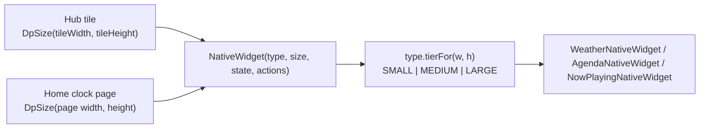

# 20 — Flow: widgets Facet draws itself (Hub and Home stack)

A *native widget* is a widget the app draws in Compose, as opposed to an `AppWidgetHost` widget from an installed
app (see [10](10-flow-hub-widgets.md)). There are three, `NativeWidgetType`: `WEATHER`, `AGENDA`, `NOW_PLAYING`.
They sit in the same two places hosted widgets do and behave the same way there: the Hub grid and Home's clock stack.

## 1. Storage

| Where | Row | How a native widget differs |
|---|---|---|
| Hub | `widget_placements` | `nativeWidgetType` set, `appWidgetId` a **negative** id of our own (`WidgetPlacementRepository.nextNativeId`: one below the lowest stored, so it never meets a host-issued id), provider names empty |
| Home stack | `clock_stack_items` | `kind = NATIVE_WIDGET`, `nativeWidgetType` set, `appWidgetId` null |

`FacetDatabase` v38 adds both nullable columns (`Migrations.MIGRATION_37_38`). Everything that moves, resizes,
compacts, orders (landscape) or removes a placement works on the row, so it needed no change; the places that assumed
"has an `appWidgetId` means a provider" were changed: `ObserveHubStateUseCase` never calls `getAppWidgetInfo` for a
native row (no orphan state), `DeleteWidgetUseCase` releases no host id for a negative id.

## 2. One layout contract

`NativeWidget` takes only a type and a dp box, so a size gives the same widget on either surface. The tier comes from
`domain/NativeWidgetSizing.kt` (`tierFor`, pure and unit-tested). Its thresholds are tuned to the sizes Hub cells make
(about 72dp per cell and 4dp gaps on a 411dp phone) but are plain dp, which is what Home hands in. The same file holds each
type's minimum and default span (`minSpan`, `defaultSpan`) and their dp equivalents (`minSizeDp`, `defaultSizeDp`).
Structure changes only at a tier boundary and cross-fades (`Crossfade`); within a tier, counts (hours, days, events)
follow the room.

| Type | Small | Medium | Large | Min span | Default span |
|---|---|---|---|---|---|
| Weather | icon, temperature | + condition, high/low, place | + hourly strip, then day rows as height allows | 1×1 | 2×2 |
| Agenda | as many one-line events as fit (time then title, 4dp above and below), no headings | an "Agenda" heading, then a scrolling list of up to 20 events under a heading per day (Today, Tomorrow, then dates), each with its room under the title | larger rows | 2×1 | 3×2 |
| Now playing | cover with play/pause | cover, title, artist, transport (wide) or stacked (square) | + progress line, large cover | 1×1 | 4×1 |

The agenda's room line is `CalendarEvent.location` (`EVENT_LOCATION`, read with the other instance columns, no new permission),
shortened by `roomLabel`: a Workspace room such as `BLR-Innovate-2-Marie Curie (4)` shows as `Marie Curie (4)`; a plain
location is left as typed. Small never shows it, and a row with a room counts as taller when working out how many fit.

The widget draws its own backing (`Surface` at 60%, `MaterialTheme.shapes.large`) so it reads over the wallpaper like a
hosted tile, and insets its content by 8dp.

## 3. Data

No new repository. A widget reads `NativeWidgetState` (`ui/nativewidget/NativeWidgetState.kt`): the full `WeatherUiState`
(forecast, resolved units, icon style), Home's `HomeCalendarState` and `HomeMediaState`. `toHomeScreenState` builds it
(`HomeScreenState.nativeWidgets`), so Home, the facet carousel and every Appearance preview see the same widgets Home would;
`HomeDrawerRoute` passes the same value to `HubScreen` as a `NativeWidgetEnvironment` (state plus actions: open the weather
sheet, open an event, the media buttons). Tapping a widget does what the equivalent Home element does.

Weather: `HomeDrawerRoute` keeps the forecast fresh while the clock's weather accessory is on **or** a weather widget is on a
Home page (`HomeUiState.showsNativeWeather`) **or** on the Hub (`HubViewModel.hasNativeWeather`). It goes through the same
refresh gate and location rules as the accessory ([18](18-flow-weather.md)); nothing is requested while none of the three is on.

### 3a. Per-widget settings (Hub and Home)

A Weather or Agenda widget can be set to its own calendars or location instead of the launcher-wide setting, wherever it is placed: on
the Hub (`widget_placements.nativeWidgetConfig`) or as a Home clock page (`clock_stack_items.nativeWidgetConfig`). Both go through one
path, keyed by `NativeWidgetRef` (`Hub(appWidgetId)` or `Home(itemId)`):

- `NativeWidgetConfig` (one tab-separated line per field) stores it: Agenda's chosen calendar ids and all-day choice (the sheet shows the
  launcher's Calendar options, starting from the launcher's current values, with no follow switch), Weather's current location or a saved
  city. A `null` field follows the launcher; Now Playing has none. `SetNativeWidgetConfigUseCase` writes either store and
  `ObserveNativeWidgetSettingsUseCase` reads it back.
- `ObserveNativeWidgetOverridesUseCase` turns every widget with a setting (Hub placements and the active facet's Home pages) into a
  `NativeWidgetOverride` (its events, or its `WeatherState`) through `NativeWidgetOverrideResolver`, re-derived every five minutes.
  `NativeWidgetAccessViewModel` exposes the map; `HomeDrawerRoute` puts it in `NativeWidgetState.overrides`, and `NativeWidget` reads
  its own entry by its `ref`.
- An Agenda's calendar list also offers the Work Profile's calendars, read through Android's cross-profile (enterprise) calendar API
  (`CalendarRepository.getWorkCalendars`, `ENTERPRISE_CONTENT_URI`): they work only when the work admin allows this app
  (`setCrossProfileCalendarPackages`) and the user has turned on showing work events, and Android hides their names, so each is listed as
  "Work calendar" (numbered when there are several) with an id prefixed `work:`. Android also blocks their account and every other identifying column
  (checked against the enterprise provider: only `_id`, colour and `visible` come through), so `CalendarInfo.sampleTitles` carries up to three distinct event
  titles from the next 14 days and `calendarSubtitle` shows "Work · Client call, Team lunch, ..." under the title. They are never ticked by default. The launcher's own Appearance > Calendars to display lists them too (`CalendarRepository.getSelectableCalendars`), so the default clock's events can include a ticked work calendar; one rule, `Set<String>?.selectsCalendar`, decides what a selection includes everywhere (no selection = every personal calendar, never a work one).
- Forecasts are shared by place: `WidgetWeatherRepository` holds one in-memory forecast per place behind the same `WeatherRefreshPolicy`
  gate, so widgets on one city make one request, and a place equal to the launcher-wide one reads the launcher's own stored forecast and
  makes none. "Current location" while the launcher already follows the position is the launcher's forecast too.
- A **medium or large Agenda** (`isConfigurable`) has a 3-dot button at its top right; a **Weather** widget opens its own weather sheet when
  tapped (`NativeWidgetActions.onOpenWeather(ref)`, which shows that widget's forecast), with a 3-dot button to the right of the rain
  summary. Both call `onConfigure(ref)`, and `HomeDrawerRoute` opens `NativeWidgetConfigSheet(ref)` (`HomeOverlayState.configureRef`).
- On adding a Weather or Agenda widget (one that has settings at its default size), from the Hub picker or to a Home page, the picker emits
  `HubAddWidgetEvent.NativeWidgetAdded(ref)` (`Hub(id)` or `Home(itemId)`, the latter from `AddClockStackItemUseCase`'s `AddedPage`) and the
  route, or the widget stack screen when the add started there, opens the sheet for it.
- Backup: a Weather widget's own location travels (`BackupWidgetPlacement.nativeWidgetConfig`, `BackupNativeStackPage.nativeWidgetConfig`);
  an Agenda widget's calendar ids are left out, since they belong to the device (its all-day choice travels). Replacing a Home page resets its setting.

### 3b. Missing permissions

An Agenda widget without `READ_CALENDAR`, and a Weather widget for the current position without location, show "Calendar access is off" /
"Location access is off" with an **Allow** button in place of their empty text. `NativeWidgetAccessViewModel` reads both permissions (re-read
on resume, since neither has a grant-change callback) and `HomeDrawerRoute` puts the result in `NativeWidgetState.access` for Home pages and the
Hub; Allow runs the runtime request (`READ_CALENDAR`, `ACCESS_COARSE_LOCATION`). A Hub widget set to its own location asks for location only when
its own setting is the current position (`NativeWidgetOverride.locationMissing`). If Android no longer shows the dialog, the button does nothing
visible; the Permissions screen in Settings still works.

## 4. Adding, replacing, removing

- **Pickers.** Both `HubWidgetPickerContent` screens list a "Facet widgets" section (`NativeWidgetPickerSection`, each type
  drawn at its default size with sample data) above the installed apps' widgets.
- **Hub.** `HubWidgetPickerViewModel.onNativeWidgetSelect` places it at `defaultSpan` through `PlaceWidgetUseCase` with
  `nextNativeId()`; there is no bind or configure step. The 20-widget cap still applies.
- **Home stack.** `ClockWidgetPickerViewModel.onNativeWidgetSelect` goes through `AddClockStackItemUseCase.addNativeWidget` or
  `ReplaceClockStackItemUseCase.withNativeWidget`, so the plan's stack limit applies exactly as for hosted pages.
  `ClockStackRepository.replaceWithNativeWidget` clears the page's size (the old size fits the old page) and hands back any host id to release.
- **Resize and move.** Hub: the usual handles, floored at `minSpan` (`resizedSpan(…, minSpan)`). Home: adjust mode, with
  `HomeClockWidgetState.minWidthDp/minHeightDp` from `minSizeDp`. A native page's state carries a negative `appWidgetId` derived from
  its item id, so the existing "this page is a widget" logic (size, alignment, no calendar block) applies; only the leaf
  (`ClockBlock`) branches on `nativeType`, drawing `NativeWidget` instead of `ClockWidgetTile`. A long press anywhere on the page opens the clock menu: the widgets have no long-press action, so `longPressFallback` (`LongPressFallback.kt`) runs Home's. It watches before the children, which would otherwise consume the touch with their own tap handlers, and takes the rest of the touch once it fires so the tap does not also run.
  Tapping a Work Profile event opens the work Calendar app (`openWorkCalendarApp` in `HomeScreenActionsBuilder.kt`, via `LauncherApps.startMainActivity` for the default calendar package in the work profile): its event id means nothing to the personal app. It opens the app, not the event.
- **Remove.** Hub trash and the stack screen's Remove. `ClockStackScreen` labels the row with the widget's name and offers no Configure.

## 5. Backup

Additive, no `CURRENT_BACKUP_VERSION` bump. `BackupWidgetPlacement.nativeWidgetType` and `BackupFacet.nativeStackPages`
carry the types with their sizes and alignments. Import writes the native Hub placements straight back
(`deleteAllNative()` first, then new negative ids) instead of putting them in the re-add queue, and appends the native
pages after a restored facet's launcher clock (`ClockStackRepository.restoreNativeWidgets`, up to the stack limit).
A Weather widget's own location (`BackupWidgetPlacement.nativeWidgetConfig`) travels too; an Agenda widget's calendar ids are left out, since they belong to the device (its all-day choice travels). An unknown type from a newer backup is skipped. Hosted widgets are unchanged.

## 6. Tests

`NativeWidgetSizingTest` (tiers at Hub spans and Home sizes), `ClockStackRepositoryTest`, `WidgetPlacementRepositoryTest`,
`ObserveHubStateUseCaseTest`, `DeleteWidgetUseCaseTest`, `AddClockStackItemUseCaseTest`, `ReplaceClockStackItemUseCaseTest`,
`HubWidgetPickerViewModelTest`, `ClockWidgetPickerViewModelTest`, `HomeScreenStateBuilderTest`, `ImportBackupUseCaseTest`,
`BackupCoverageTest`, `FacetDatabaseMigrationTest.migration37To38…`, and the Compose tests in `ui/nativewidget/`.
