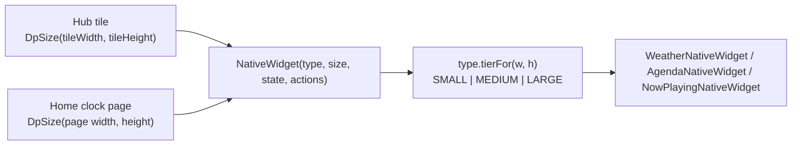

# 20 — Flow: widgets Facet draws itself (Hub and Home stack)

A *native widget* is a widget the app draws in Compose, as opposed to an `AppWidgetHost` widget from an installed
app (see [10](10-flow-hub-widgets.md)). There are three, `NativeWidgetType`: `WEATHER`, `AGENDA`, `NOW_PLAYING`.
They sit in the same two places hosted widgets do and behave the same way there: the Hub grid and Home's clock stack.

## 1. Storage

| Where | Row | How a native widget differs |
|---|---|---|
| Hub | `widget_placements` | `nativeWidgetType` set, `appWidgetId` a **negative** id of our own (`WidgetPlacementRepository.nextNativeId`: one below the lowest stored, so it never meets a host-issued id), provider names empty |
| Home stack | `clock_stack_items` | `kind = NATIVE_WIDGET`, `nativeWidgetType` set, `appWidgetId` null |

`FacetDatabase` v38 adds both nullable columns (`Migrations.MIGRATION_37_38`). Everything that moves, resizes,
compacts, orders (landscape) or removes a placement works on the row, so it needed no change; the places that assumed
"has an `appWidgetId` means a provider" were changed: `ObserveHubStateUseCase` never calls `getAppWidgetInfo` for a
native row (no orphan state), `DeleteWidgetUseCase` releases no host id for a negative id.

## 2. One layout contract

`NativeWidget` takes only a type and a dp box, so a size gives the same widget on either surface. The tier comes from
`domain/NativeWidgetSizing.kt` (`tierFor`, pure and unit-tested). Its thresholds are tuned to the sizes Hub cells make
(about 72dp per cell and 4dp gaps on a 411dp phone) but are plain dp, which is what Home hands in. The same file holds each
type's minimum and default span (`minSpan`, `defaultSpan`) and their dp equivalents (`minSizeDp`, `defaultSizeDp`).
Structure changes only at a tier boundary and cross-fades (`Crossfade`); within a tier, counts (hours, days, events)
follow the room.

| Type | Small | Medium | Large | Min span | Default span |
|---|---|---|---|---|---|
| Weather | icon, temperature | + condition, high/low, place | + hourly strip, then day rows as height allows | 1×1 | 2×2 |
| Agenda | as many one-line events as fit (time then title, 4dp above and below), no headings | an "Agenda" heading, then a scrolling list of up to 20 events under a heading per day (Today, Tomorrow, then dates), each with its room under the title | larger rows | 2×1 | 3×2 |
| Now playing | cover with play/pause | cover, title, artist, transport (wide) or stacked (square) | + progress line, large cover | 1×1 | 4×1 |

The agenda's room line is `CalendarEvent.location` (`EVENT_LOCATION`, read with the other instance columns, no new permission),
shortened by `roomLabel`: a Workspace room such as `BLR-Innovate-2-Marie Curie (4)` shows as `Marie Curie (4)`; a plain
location is left as typed. Small never shows it, and a row with a room counts as taller when working out how many fit.

The widget draws its own backing (`Surface` at 60%, `MaterialTheme.shapes.large`) so it reads over the wallpaper like a
hosted tile, and insets its content by 8dp.

## 3. Data

No new repository. A widget reads `NativeWidgetState` (`ui/nativewidget/NativeWidgetState.kt`): the full `WeatherUiState`
(forecast, resolved units, icon style), Home's `HomeCalendarState` and `HomeMediaState`. `toHomeScreenState` builds it
(`HomeScreenState.nativeWidgets`), so Home, the facet carousel and every Appearance preview see the same widgets Home would;
`HomeDrawerRoute` passes the same value to `HubScreen` as a `NativeWidgetEnvironment` (state plus actions: open the weather
sheet, open an event, the media buttons). Tapping a widget does what the equivalent Home element does.

Weather: `HomeDrawerRoute` keeps the forecast fresh while the clock's weather accessory is on **or** a weather widget is on a
Home page (`HomeUiState.showsNativeWeather`) **or** on the Hub (`HubViewModel.hasNativeWeather`). It goes through the same
refresh gate and location rules as the accessory ([18](18-flow-weather.md)); nothing is requested while none of the three is on.

## 4. Adding, replacing, removing

- **Pickers.** Both `HubWidgetPickerContent` screens list a "Facet widgets" section (`NativeWidgetPickerSection`, each type
  drawn at its default size with sample data) above the installed apps' widgets.
- **Hub.** `HubWidgetPickerViewModel.onNativeWidgetSelect` places it at `defaultSpan` through `PlaceWidgetUseCase` with
  `nextNativeId()`; there is no bind or configure step. The 20-widget cap still applies.
- **Home stack.** `ClockWidgetPickerViewModel.onNativeWidgetSelect` goes through `AddClockStackItemUseCase.addNativeWidget` or
  `ReplaceClockStackItemUseCase.withNativeWidget`, so the plan's stack limit applies exactly as for hosted pages.
  `ClockStackRepository.replaceWithNativeWidget` clears the page's size (the old size fits the old page) and hands back any host id to release.
- **Resize and move.** Hub: the usual handles, floored at `minSpan` (`resizedSpan(…, minSpan)`). Home: adjust mode, with
  `HomeClockWidgetState.minWidthDp/minHeightDp` from `minSizeDp`. A native page's state carries a negative `appWidgetId` derived from
  its item id, so the existing "this page is a widget" logic (size, alignment, no calendar block) applies; only the leaf
  (`ClockBlock`) branches on `nativeType`, drawing `NativeWidget` instead of `ClockWidgetTile`. A long press anywhere on the page opens the clock menu: the widgets have no long-press action, so `longPressFallback` (`LongPressFallback.kt`) runs Home's. It watches before the children, which would otherwise consume the touch with their own tap handlers, and takes the rest of the touch once it fires so the tap does not also run.
- **Remove.** Hub trash and the stack screen's Remove. `ClockStackScreen` labels the row with the widget's name and offers no Configure.

## 5. Backup

Additive, no `CURRENT_BACKUP_VERSION` bump. `BackupWidgetPlacement.nativeWidgetType` and `BackupFacet.nativeStackPages`
carry the types with their sizes and alignments. Import writes the native Hub placements straight back
(`deleteAllNative()` first, then new negative ids) instead of putting them in the re-add queue, and appends the native
pages after a restored facet's launcher clock (`ClockStackRepository.restoreNativeWidgets`, up to the stack limit).
An unknown type from a newer backup is skipped. Hosted widgets are unchanged.

## 6. Tests

`NativeWidgetSizingTest` (tiers at Hub spans and Home sizes), `ClockStackRepositoryTest`, `WidgetPlacementRepositoryTest`,
`ObserveHubStateUseCaseTest`, `DeleteWidgetUseCaseTest`, `AddClockStackItemUseCaseTest`, `ReplaceClockStackItemUseCaseTest`,
`HubWidgetPickerViewModelTest`, `ClockWidgetPickerViewModelTest`, `HomeScreenStateBuilderTest`, `ImportBackupUseCaseTest`,
`BackupCoverageTest`, `FacetDatabaseMigrationTest.migration37To38…`, and the Compose tests in `ui/nativewidget/`.
