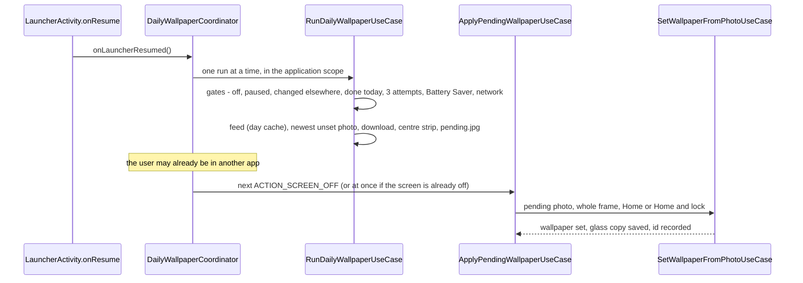

# 21 — Wallpaper copy and real glass

Android does not let a launcher read the system wallpaper (`WallpaperManager.peekDrawable()` throws `READ_EXTERNAL_STORAGE denied` on API 30 and 36, with Facet
as the default home or not). So the glass panels ([13](13-flow-facets-theme-notifications-onboarding.md), *Glass panels*) are plain tints by default. If the user
gives Facet an image, Facet keeps a **copy** of it, draws it behind the app, and the panels sample it for a real blur (API 31+) and, for the clear styles, a
lens (API 33+).

## Parts

| Piece | Where | Role |
|---|---|---|
| `WallpaperCopyRepository` | `data/` | Owns the glass copies: one PNG per screen size, `wallpaper_copy_<w>x<h>.png` (the display's natural size, so a phone is one screen and a foldable's inner and outer displays are two; `filesDir`, not in backups), and the screens it has seen, `wallpaper_screens.txt`. `copy` is the copy for the screen showing now, following folds through a `DisplayManager` listener (`currentScreen`), with the closest-shaped other copy standing in for a screen without one; each copy records the system wallpaper id it was stored under (`wallpaper_copy_ids.txt`), so every screen is judged on its own: `copyIsCurrent` says whether `copy` matches the wallpaper now (a current copy is preferred over an out-of-date one, and `recheck()` re-reads the id on resume), and a capture on one screen never clears another screen's out-of-date notice; `screens` lists every screen seen (the one showing included) and whether it has a copy that matches the wallpaper now; `dismissedPrompts` and `dismissPrompt` remember, in `wallpaper_dismissed.txt`, the suggestions the user said no to; `maybeFoldable` is true when `SensorManager` lists a hinge-angle sensor (the feature flag is not used: an old emulator image sets it on a phone). Reads once, renames a pre-per-screen `wallpaper_copy.png` to its own screen, saves through a temp file, removes all copies (the screens seen stay). Decodes a picked photo with `ImageDecoder`, sets the system wallpaper with `WallpaperManager.setBitmap`, and reports the screen size (portrait) and the system wallpaper id. |
| `SetWallpaperFromPhotoUseCase` | `domain/` | Crops the framed part to the largest known screen's size, sets it as the system wallpaper (Home, or Home and lock), stores it as that screen's copy and a centred part of it (`coverRegion`) as each smaller screen's, records the id. Stores nothing unless the system accepted the wallpaper. |
| `RemoveWallpaperCopyUseCase` | `domain/` | Deletes the copy and the recorded id. The system wallpaper stays. |
| `WallpaperBackdropViewModel` | `ui/launcher/` | The stored copy as a `StateFlow<Bitmap?>`, loaded as the app starts. |
| `WallpaperBackdropHost` + `LocalWallpaperBackdrop` | `ui/components/WallpaperBackdrop.kt` | Around `FacetNavHost` in `LauncherActivity`. Records the copy into the Backdrop library's layer (through `rememberLayerBackdrop`'s `onDraw`, on an empty box) without drawing it, so the system wallpaper is always what shows, and provides it to the panels. A screenshot copy never stands in for the wallpaper. |
| `Modifier.glassBackground(..., sampleWallpaper)` | `ui/components/GlassBackground.kt` | With a backdrop, a panel is drawn through `drawBackdrop` (blur, brightness and saturation per style, plus the tint and edge); without one it is the plain tint. The dock, apps list rows and grid tiles, calendar block, media row and native widgets opt in; icon backgrounds and the settings previews keep the tint. |
| `clearGlassLens` | `ui/components/ClearGlassLens.kt` | A copy of the library's rounded-rectangle lens shader (Apache-2.0, Kyant) with the depth pull as a strength. Used by every glass style, though under the heavy blur of the frost styles little is visible. |
| `WallpaperScreen` / `WallpaperViewModel` | `ui/settings/` | Settings → Change wallpaper (route `wallpaper`). |
| `ObserveWallpaperScreensUseCase` | `domain/` | `screenNeedingCopy()` is the screen showing now when it has no copy matching the wallpaper while another has (or had) one and the user has not said no to it; `WallpaperCopyPillViewModel` feeds it to `WallpaperCopyPillHost`, a pill over Home (only while some glass is on, per `ObserveGlassInUseUseCase`; after the What's new pill, once per screen per launch) that opens the wallpaper page. The screens known, the largest first, and what to suggest about them: *MissingCopy* when a screen has no copy of its own but another does (not for a screen the user said no to), or *FoldableUnseen* when only one screen is known but the phone has a hinge sensor. Shown as a card on the wallpaper screen (*Not now* remembers it per screen); the fit step takes the screens from it too. |
| `WallpaperFit` | `ui/settings/` | The fit step's pan and zoom maths (`FitGeometry`, `WallpaperFit`), pure and tested. |

## The screen

*Change wallpaper* opens `WallpaperScreen`, which shows the copy (or a stand-in for the system wallpaper) and a status line, then two equal choices:

1. **Choose an image for Facet.** The gallery app, through `GetContent("image/*")` (no permission; a chooser when several apps answer) → the **fit step**: the photo in a window shaped like the largest known screen (the current window when only one is known, and for a screenshot of the current wallpaper), with the other screens outlined and the rest dimmed (`OtherScreenOutlines`, from `ScreenSize.coverRegion`), drag to move, pinch to zoom
   (1× to 5× of the zoom that just covers the screen), double-tap to reset, and a choice of *Home screen* or *Home and lock
   screen* → *Set wallpaper*. The result is cropped to the screen size, set as the system wallpaper, stored as the copy and its system id recorded.
2. **Set a system wallpaper.** `ACTION_SET_WALLPAPER`, as before. Glass stays a tint.

With a copy, the screen also offers *Remove the copy*. When the screen resumes it re-reads the system wallpaper id; if it differs from the recorded one the copy is
**stale** (the wallpaper was changed elsewhere), and the screen says so.

## What decides whether glass is real

`WallpaperBackdropHost` provides a backdrop only when all of these hold: a copy exists, the device is on API 31 or later (below that `RenderEffect` blur does not
exist and the unblurred copy would show inside the panel), and the window is turned the way the copy is (a phone's copy is portrait; a foldable's inner display has a landscape one). Otherwise panels draw their tint and the
system wallpaper shows through as before.

| API | Behaviour |
|---|---|
| 30 | Plain tint panels. |
| 31–32 | Blur, brightness and saturation; the lens does nothing, so Clear glass and Dark glass are sharp tinted panels and the other styles lose only the edge bend. |
| 33+ | Everything, including the lens. |

## Prompts

- **First use.** `GlassBackgroundRow` (all five background pickers: dock, apps list, calendar, media row, native widgets) applies the chosen style and, for any style but Off, shows a sheet when `GlassBackgroundPromptViewModel.needsCopy` (no usable copy, not dismissed): *Choose an image* (opens the wallpaper screen) or a remembered *Not now* (`wallpaper_prompt_dismissed`). The state reaches the rows through `LocalGlassBackgroundPrompt`, provided by `FacetNavHost`; without it (previews, tests) there is no prompt.
- **After Android's picker.** *Set a system wallpaper* records the wallpaper id first. Coming back with a different id and no matching copy, `WallpaperViewModel` shows an offer card (*Capture my wallpaper* / *Not now*, the same remembered flag). Facet cannot read the new wallpaper, so the offer opens the capture flow, which takes one frame of it.

- **Use my current wallpaper.** A link on the wallpaper screen (shown with no copy or a stale one) opens a dialog: *Capture my wallpaper* opens `WallpaperCaptureScreen` (route `wallpaperCapture`) and *I have an image already* opens the gallery. The capture screen has no background of its own, so the window's wallpaper shows through, and it hides the system bars and keeps the status bar hidden through `HideStatusBarEffect` (`SystemBarsState.statusBarForcedHidden`), since `ProvideSystemBars` re-applies the bar on every resume and window focus and would undo a hide made after Android's dialog. `WallpaperCaptureViewModel` holds its phase: *Prompt* (a short note, *Capture wallpaper*, *Take a screenshot instead*, *Return*), *Capturing* (nothing drawn), *Failed* (*Try again*, which asks again, plus the manual route and *Return*) and *Manual*. *Capture wallpaper* clears the card, then opens Android's consent dialog (`MediaProjectionManager.createScreenCaptureIntent`, the whole screen on Android 14 and up). On agreeing, `ScreenCaptureRepository.capture` starts `ScreenCaptureService`, a foreground service of type `mediaProjection` (Android 14 needs it running before the projection exists), which waits 0.7 s for the dialog to go, then up to 1.5 s for the capture screen to report both bars hidden (`barsHidden`, read from the window's insets), keeps the newest frame from an `ImageReader`, and stops; if the bars never hid, it paints the status and navigation bar strips (heights from the window insets) with the rows next to them mirrored, so Android's capture chip does not reach the copy; the user is asked every time and nothing runs in the background. `CaptureWallpaperUseCase` stores the whole frame as the copy through `UseScreenshotAsWallpaperCopyUseCase` (no fit step, since the frame is the screen), refuses a landscape frame, and the screen shows a *Wallpaper captured* toast and returns. Declining, a failure or no frame within 10 s shows *Failed*. The manual route is the old flow: its card has three numbered steps (key actions in bold, including tapping Power + Volume down and not holding them) and stays until *Take screenshot* is tapped (no timer), which clears it so the screenshot is clean; a tap on the empty screen brings it back; *Choose screenshot* (shown only here) pops back to the wallpaper screen and sets `wallpaper_pick_screenshot` on its saved state, which opens the picker and the fit step, and *Back* returns to the prompt. `UseScreenshotAsWallpaperCopyUseCase` stores the framed part and records the current system id. The system wallpaper is not set.

## Previews

`WallpaperRepository.currentHomeWallpaper()`, the one source of every preview's background (facet carousel cards, the Appearance, dock, list, drawer and notification previews), returns the saved copy first when it still matches the system wallpaper, then falls back to what Android lets it read. The settings previews read it when they open; the facet carousel, which stays alive behind Home, follows `WallpaperRepository.homeWallpaper`, which reads it again whenever Facet stores a new copy, so a wallpaper set from Daily photos or your own image shows on its cards.

## Screens that dim the wallpaper

Glass samples the raw wallpaper copy. The Hub draws the theme surface at 60% over the wallpaper, so it provides that colour as `LocalBackdropTint` and a glass panel on it (the native widgets) draws the tint over what it blurs before its own fill, which matches what the Hub shows. The Drawer has its own overlay and no glass panels of this kind. A screen with a different dim needs the same local.

## Real glass on icons

An icon's glass background samples the copy only inside live Home (`LocalIconGlassSamplesWallpaper`, provided in `HomeDrawerRoute`); the drawer, settings, previews and pickers keep the tint.

## Daily photos

*Set a wallpaper with Facet* is one flow: its row on the wallpaper screen opens `DailyPhotosScreen`, a grid of a week's photos under a *Bing* and a *Spotlight* tab (Peapix feeds, seven photos each however many are asked for), and at the foot of the grid *Choose your own image* opens the picker (`GetContent`), as the row used to. Picking a photo, from either, replaces the screen with the fit step (`WallpaperScreen` drops the list when a photo is being framed, so Back from the fit step lands on the wallpaper screen). Tapping a daily photo downloads its original (usually above 1080p; the 640 px thumbnails are only for the grid), `WallpaperViewModel.onPickedBitmap(photo, credit)` hands it to the same fit step and set-and-store path as a chosen image, and the feed's copyright text is shown exactly as given as a small footer on the photo while it is framed (`WallpaperUiState.credit`; never part of the saved crop). The other two ways, the screenshot and Android's own picker, are separate rows on the wallpaper screen as before.

- **Caching:** `DailyPhotoCache` keeps each feed's JSON (keyed by source and, for Bing, the device country) and its thumbnails under the app's cache folder for the rest of the calendar day it was fetched on, so reopening the screen costs nothing. The first open of a new day fetches again; if that fails, the last cache is shown with a note. An original is never cached.
- **Network:** this is the app's second network use (after weather). Only the opened tab is fetched, never in the background (the daily wallpaper's run, below, starts only when Facet is opened); addresses must be https on `peapix.com` hosts (`isAllowedImageUrl`). The site's privacy policy and the Play data safety answers cover it.
- **Progress:** setting a wallpaper (or storing a copy, or reading a large photo, or downloading a daily photo) takes a few seconds, so `BlockingProgressOverlay` covers the screen with a spinner and a message (*Setting your wallpaper…*, *Saving…*, *Opening the photo…*, *Downloading the photo…*) and takes every touch and the Back button until it is done.
- **Fit step gestures:** the pan and zoom handler keeps the latest frame in a holder updated by every event (`LatestFit`) and is not keyed on the frame, because touch events can arrive faster than recompositions and a stale frame lost all but the last of them.

## Daily wallpaper

A switch at the top of the Daily photos screen sets a new Bing or Spotlight photo as the wallpaper once a day. It runs only after the user opens Facet: nothing is scheduled and nothing happens while Facet is unused. It is a Pro feature (see [16 §4](16-flow-billing.md#4-when-pro-is-lost)): without Pro the switch opens Facet Pro, and a run or apply does nothing while the settings stay saved.

- **Trigger.** `LauncherViewModel.onResumed` → `DailyWallpaperCoordinator.onLauncherResumed()` on every resume; after the day's work is done (`checkedDay` is today) a resume costs one DataStore read. Turning the switch on, choosing another source, turning Wi-Fi only off and *Resume* also start a run.
- **Network.** `DeviceConditionsRepository.network()` at that moment. Wi-Fi only (the default) needs an unmetered network; with it off, any network but roaming. The turn-on sheet offers *Use mobile data once* when the phone is on mobile data. At most 3 network attempts a day, counted in `facet_daily_wallpaper`.
- **Which photo.** Bing: the newest by date, unless it is the one already set (then nothing is new today). Spotlight has no dates: the first photo not among the last 30 set. A run that finds a photo already prepared does nothing more.
- **Crop.** No fit step. `portraitCentreCrop` takes the centre of the photo in the screen's shape (full height for a landscape photo) and refuses it when that part would have to be enlarged more than 1.35 times to fill the screen's width; the run then tries the next newest, up to 3. Only that part is decoded (`WallpaperCopyRepository.decodeRegion`, `BitmapRegionDecoder`, sampled down while still screen-sized), so a 4K photo is never decoded whole.
- **No disruption.** No progress UI, no notification; network and decoding off the main thread; the run lives in `@ApplicationScope`, so leaving Home or switching apps doesn't cancel it. The wallpaper changes only at screen-off, so neither Home's swap nor another app restarting for the new wallpaper colours is seen.
- **Glass.** The change goes through `SetWallpaperFromPhotoUseCase`, so the copy is the same image and its id is recorded; Home's glass follows through `WallpaperCopyRepository.copy` as for any change.
- **Changed elsewhere.** The ids right after each change are recorded (`systemId`, and `lockId` with the lock screen included). A different id at a later run or apply pauses the change (*Paused*, with *Resume*). An interrupted change of its own (`applying` still set) is finished, not taken for the user's.
- **Manual picks.** In the fit step, a Bing or Spotlight photo keeps the change on and counts as today's; the user's own image turns it off, and the fit step says so first (`NoteManualWallpaperUseCase`). Android's own picker counts as a change elsewhere.
- **Refused.** If Android refuses the wallpaper, the change turns itself off and the status line says why.
- **Status line.** `dailyWallpaperStatus(state)`: paused, ready (set at the next screen-off), a problem (waiting for Wi-Fi, no connection, Battery Saver, photos unreachable, download failed, too small, refused), or the photo last set with its credit and time. The grid marks the tile of the photo set.
- **Storage.** Settings and progress in `facet_daily_wallpaper` (02 §5.8, not in backups); the prepared photo in `cacheDir/daily_photos/pending.jpg` until it is set. Originals are never kept.

## Not built yet

- Icon glass on API 33+ uses the lens only when the icon shape is corner-based; other shapes get blur and fill only.
- A stale copy (system wallpaper changed since it was stored) is not drawn: `WallpaperBackdropViewModel` re-reads the system id on every resume and exposes no copy, so glass is the tint until the user picks again.

## Tests

`WallpaperCopyRepositoryTest`, `SetWallpaperFromPhotoUseCaseTest`, `WallpaperViewModelTest`, `WallpaperBackdropViewModelTest`, `GlassBackgroundPromptViewModelTest`, `UseScreenshotAsWallpaperCopyUseCaseTest`, `WallpaperFitTest` (JVM);
`DailyPhotosViewModelTest`, `DailyPhotoRepositoryTest`, `PeapixFeedTest`, `DailyWallpaperRepositoryTest`, `RunDailyWallpaperUseCaseTest`, `ApplyPendingWallpaperUseCaseTest`, `NoteManualWallpaperUseCaseTest`, `DailyWallpaperCoordinatorTest`, `PortraitCentreCropTest`, `DailyWallpaperStatusTest` (JVM); `DailyPhotosScreenTest`, `WallpaperScreenTest`, `WallpaperCaptureScreenTest`, `GlassBackgroundRowTest`, `WallpaperBackdropHostTest` (emulator). `ImageDecoder` and the blur and lens effects are not covered on the JVM; they were checked on the API 36 emulator.
