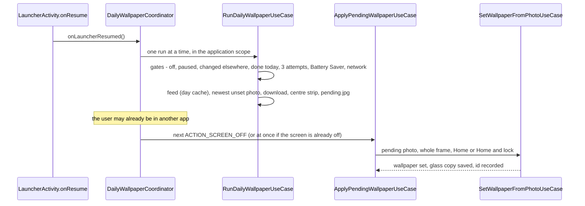

# 21 — Wallpaper copy and real glass

Android does not let a launcher read the system wallpaper (`WallpaperManager.peekDrawable()` throws `READ_EXTERNAL_STORAGE denied` on API 30 and 36, with Facet
as the default home or not). So the glass panels ([13](13-flow-facets-theme-notifications-onboarding.md), *Glass panels*) are plain tints by default. If the user
gives Facet an image, Facet keeps a **copy** of it, draws it behind the app, and the panels sample it for a real blur (API 31+) and, for the clear styles, a
lens (API 33+).

## Parts

| Piece | Where | Role |
|---|---|---|
| `WallpaperCopyRepository` | `data/` | Owns the glass copies: one JPEG (quality 95, a fraction of a lossless PNG's encoding time and size; the copies are only ever blurred or sampled) per view, `wallpaper_copy_<w>x<h>.jpg`, with a PNG from an earlier version still read until that view is saved again: a screen's pixel size in one orientation, since the system crops the wallpaper differently in each, so a phone has a portrait copy and a landscape one and a foldable's inner and outer displays have their own (`filesDir`, not in backups), and the screens it has seen in their natural size, `wallpaper_screens.txt`. `copy` is the copy for exactly the view showing now (`windowSize()`), following folds and rotation through a `DisplayManager` listener (`currentScreen`); a view without one has none, so its panels draw their tint, and a copy is never borrowed from another view; each copy records the system wallpaper id it was stored under (`wallpaper_copy_ids.txt`), so every screen is judged on its own: `copyIsCurrent` says whether `copy` matches the wallpaper now (`recheck()` re-reads the id on resume), and a capture on one view never clears another's out-of-date notice; `hasCopyAnywhere` says whether any view has a copy; `screens` lists every view of every screen seen (the one showing included, each screen's own orientation before its turned one, each carrying its natural `screen`) and whether it has a copy that matches the wallpaper now; `knownScreens()` and `targetScreen()` give the screens in their natural size; `dismissedPrompts` and `dismissPrompt` remember, in `wallpaper_dismissed.txt`, the suggestions the user said no to; `maybeFoldable` is true when `SensorManager` lists a hinge-angle sensor (the feature flag is not used: an old emulator image sets it on a phone). A screen first seen at a different size but the same shape (within 1%) is the same screen at another resolution (the display size was changed): `noteSeen` forgets the old size, deleting its copies in both orientations, their ids and the suggestions the user dismissed for them. `isLiveWallpaper()` is `WallpaperManager.wallpaperInfo != null`. Keeps the picked image as `wallpaper_original.bin` with `wallpaper_original_framing.txt` (`saveOriginal(bytes | uri, framing, systemId)`: a picked file is streamed to storage, never held in memory; `original()` returns the file, `originalSystemId()` reads only the id, `deleteOriginal()`, `decodeFile`). Reads once, renames a pre-per-screen `wallpaper_copy.png` to its own screen, saves through a temp file, removes all copies (the screens seen stay). Decodes a picked photo with `ImageDecoder`, sets the system wallpaper with `WallpaperManager.setBitmap`, and reports the screen's natural size, the window's size and the system wallpaper id. |
| `SetWallpaperFromPhotoUseCase` | `domain/` | Sets `wallpaperRegion` of the framed photo as the system wallpaper (Home, or Home and lock): the framing widened evenly around its centre along its shorter side as far as the photo allows, up to a square of its longer side (the nearer edge stops both sides, so the framing stays at the centre; a landscape framing is widened upwards and downwards instead). The wallpaper's longer side is as long as the longest screen side, the other in proportion (`wallpaperSize`). It records the wallpaper's size, the system id and whether it was framed in landscape (`WallpaperCopyRepository.recordWallpaperShape`, `wallpaper_shape.txt`), from which `wallpaperOffsetX()` works out the offset to give the engine: in the orientation it was framed in, the offset that shows the middle of the wallpaper (`wallpaperOffsetX` in `WallpaperOffset.kt`: 0.5 before Android 14; from 14 the system pans a window along a range of about one screen width starting at the wallpaper's left edge, so the middle of a square is at about 0.66), and 0.5 in the other orientation or for a wallpaper Facet did not set. It stores, for every view of every known screen, what that view shows of it (`Bitmap.copyFor`: the centred cover crop; no system zoom is modelled), in both orientations, and records the id. With the picked file it also keeps the original, untouched, with the framing as fractions of the photo and the id (`WallpaperCopyRepository.saveOriginal`). Stores nothing unless the system accepted the wallpaper. Returns `SetWallpaperResult(set, originalKept)`: the wallpaper and copies stand even when the original could not be kept, and the wallpaper page then says a new screen will need a capture. A picked file is passed as `KeptOriginal.Picked(uri)` (streamed), a downloaded one as `KeptOriginal.Bytes`. It then stores the copy of the view showing now and returns; every other view of every known screen, in both orientations, gets its copy in the background (the application scope), all at the same time, each only while the system wallpaper is still this one, so a change made meanwhile never gets a stale copy. Until the last one is stored `WallpaperCopyRepository.isFinishingCopies` is true, and `ObserveWallpaperScreensUseCase` suggests nothing (no card, no pill) for a view still waiting. |
| `FillMissingWallpaperCopiesUseCase` | `domain/` | Builds the views that have no copy (a screen first seen later, an orientation never stored) from the kept original and framing, with the same region rule; only while the original's recorded id is still the system wallpaper's, so a wallpaper changed elsewhere is never drawn from an old photo (and that original is then deleted, since it can never be the wallpaper again), and only when an original exists (a captured wallpaper has to be captured again). `WallpaperBackdropViewModel` runs it when the view showing changes and on resume. |
| `RemoveWallpaperCopyUseCase` | `domain/` | Deletes the copy and the recorded id. The system wallpaper stays. |
| `WallpaperBackdropViewModel` | `ui/launcher/` | The stored copy as a `StateFlow<Bitmap?>`, loaded as the app starts. |
| `WallpaperBackdropHost` + `LocalWallpaperBackdrop` | `ui/components/WallpaperBackdrop.kt` | Around `FacetNavHost` in `LauncherActivity`. Records the copy into the Backdrop library's layer (through `rememberLayerBackdrop`'s `onDraw`, on an empty box) without drawing it, so the system wallpaper is always what shows, and provides it to the panels. A screenshot copy never stands in for the wallpaper. |
| `Modifier.glassBackground(..., sampleWallpaper)` | `ui/components/GlassBackground.kt` | With a backdrop, a panel is drawn through `drawBackdrop` (blur, brightness and saturation per style, plus the tint and edge); without one it is the plain tint. The dock, apps list rows and grid tiles, calendar block, media row and native widgets opt in; icon backgrounds and the settings previews keep the tint. |
| `clearGlassLens` | `ui/components/ClearGlassLens.kt` | A copy of the library's rounded-rectangle lens shader (Apache-2.0, Kyant) with the depth pull as a strength. Used by every glass style, though under the heavy blur of the frost styles little is visible. |
| `WallpaperScreen` / `WallpaperViewModel` | `ui/settings/` | Settings → Change wallpaper (route `wallpaper`). |
| `ObserveWallpaperScreensUseCase` | `domain/` | `copyNeed()` is the view showing now (a screen in its current orientation) when it has no copy matching the wallpaper while another view has (or had) one and the user has not said no to it, with whether the same screen's other orientation has a current copy and the system wallpaper id it is for; `WallpaperCopyPillViewModel` feeds it to `WallpaperCopyPillHost`, a pill over Home (only while some glass is on, per `ObserveGlassInUseUseCase`; after the What's new pill, once per view per system wallpaper per launch, so a changed wallpaper is offered again, never while a capture is being made (`ScreenCaptureRepository.capturing`, true from the go-ahead until `CaptureWallpaperUseCase` has stored the frames), and on screen for 5 s; "Capture wallpaper for glass effects", the same words for every view) that opens the capture screen directly, not the wallpaper page. The screens known (natural size), the largest first, and what to suggest about their views: *MissingCopy* when a view has no copy of its own but another does (not for a view the user said no to; `otherOrientation` when every missing view belongs to a screen whose other orientation has one), or *FoldableUnseen* when only one screen is known but the phone has a hinge sensor. Shown as a card on the wallpaper screen (*Not now* remembers it per view); the fit step takes the screens from it too. |
| `WallpaperFit` | `ui/settings/` | The fit step's pan and zoom maths (`FitGeometry`, `WallpaperFit`), pure and tested. |

## The screen

*Change wallpaper* opens `WallpaperScreen`, which shows the copy (or a stand-in for the system wallpaper) in the window's shape, so an unfolded or turned screen gets a wide preview, and a status line, then two equal choices:

1. **Choose an image for Facet.** The gallery app, through `GetContent("image/*")` (no permission; a chooser when several apps answer) → the **fit step**: the photo in a window shaped like the largest known screen (the current window when only one is known, and for a screenshot of the current wallpaper), with the other screens outlined and the rest dimmed (`OtherScreenOutlines`, from `ScreenSize.coverRegion`), drag to move, pinch to zoom
   (1× to 5× of the zoom that just covers the screen), double-tap to reset, and a choice of *Home screen* or *Home and lock
   screen* → *Set wallpaper*. The photo file is read as it is (`WallpaperCopyRepository.readBytes`) and kept as the original; the result is set as the system wallpaper through `SetWallpaperFromPhotoUseCase` (the widened framing, see its row), every view's copy is stored and the system id recorded. *Remove the copy* deletes the original too. A daily photo tapped in the grid keeps its downloaded file too (`PickedDailyPhoto.original`); a screenshot of the current wallpaper keeps none.
2. **Set a system wallpaper.** `ACTION_SET_WALLPAPER`, as before. Glass stays a tint.

With a copy, the screen also offers *Remove the copy*. When the screen resumes it re-reads the system wallpaper id; if it differs from the recorded one the copy is
**stale** (the wallpaper was changed elsewhere), and the screen says so.

## What decides whether glass is real

`WallpaperBackdropHost` provides a backdrop only when all of these hold: a copy exists, the device is on API 31 or later (below that `RenderEffect` blur does not
exist and the unblurred copy would show inside the panel), and the window is turned the way the copy is (a phone's copy is portrait; a foldable's inner display has a landscape one). Otherwise panels draw their tint and the
system wallpaper shows through as before.

| API | Behaviour |
|---|---|
| 30 | Plain tint panels. |
| 31–32 | Blur, brightness and saturation; the lens does nothing, so Clear glass and Dark glass are sharp tinted panels and the other styles lose only the edge bend. |
| 33+ | Everything, including the lens. |

## Prompts

- **First use.** `GlassBackgroundRow` (all five background pickers: dock, apps list, calendar, media row, native widgets) applies the chosen style and, for any style but Off, shows a sheet when `GlassBackgroundPromptViewModel.needsCopy` (no usable copy, not dismissed): *Choose an image* (opens the wallpaper screen) or a remembered *Not now* (`wallpaper_prompt_dismissed`). The state reaches the rows through `LocalGlassBackgroundPrompt`, provided by `FacetNavHost`; without it (previews, tests) there is no prompt.
- **After Android's picker.** *Set a system wallpaper* records the wallpaper id first. Coming back with a different id and no matching copy, `WallpaperViewModel` shows an offer card (*Capture my wallpaper* / *Not now*, the same remembered flag). Facet cannot read the new wallpaper, so the offer opens the capture flow, which takes one frame of it.

- **Use my current wallpaper.** A row on the wallpaper screen (*Capture my current wallpaper*, shown with no copy or a stale one) opens `WallpaperCaptureScreen` (route `wallpaperCapture`) directly, as Home's pill does; the explanation is on that screen, so Android's dialog follows a single Facet step. A second row, *Upload a screenshot*, opens the gallery for someone with an image already (the capture screen's manual route reaches it too). The capture screen has no background of its own, so the window's wallpaper shows through, and it hides the system bars and keeps the status bar hidden through `HideStatusBarEffect` (`SystemBarsState.statusBarForcedHidden`), since `ProvideSystemBars` re-applies the bar on every resume and window focus and would undo a hide made after Android's dialog. `WallpaperCaptureViewModel` holds its phase: *Prompt* (a short note, *Capture wallpaper*, *Take a screenshot instead*, *Return*), *Capturing* (nothing drawn), *Failed* (*Try again*, which asks again, plus the manual route and *Return*) and *Manual*. *Capture wallpaper* clears the card, then opens Android's consent dialog (`MediaProjectionManager.createScreenCaptureIntent`, the whole screen on Android 14 and up). On agreeing, `ScreenCaptureRepository.capture` starts `ScreenCaptureService`, a foreground service of type `mediaProjection` (Android 14 needs it running before the projection exists), which waits 0.7 s for the dialog to go, then up to 1.5 s for the capture screen to report both bars hidden (`barsHidden`, read from the window's insets), keeps the newest frame from an `ImageReader`, then, because `capture` is given `rotateTo`, turns the screen to the other orientation (the capture screen sets `requestedOrientation` and waits for the configuration to change, which works with rotation locked), resizes the same `VirtualDisplay` to the new size over a fresh `ImageReader`, waits for the bars and a frame again, and stops, so one approval covers both orientations (`CapturedFrames(current, turned)`; if the turn or the second frame fails only the first is kept, and the other orientation's card stays); the screen turns back and settles before it leaves, and `RestoreOrientationEffect` puts Home's orientation back whatever happens; if the bars never hid, it paints the status and navigation bar strips (heights from the window insets) with the rows next to them mirrored, so Android's capture chip does not reach the copy; the user is asked every time and nothing runs in the background. `CaptureWallpaperUseCase` stores each whole frame as that view's copy through `UseScreenshotAsWallpaperCopyUseCase` (no fit step, since the frame is the screen; the view is the window size read before the capture, and its turned size for the second frame), refuses a frame not in the orientation it was meant for (a phone turned sideways is captured as its landscape view), and the screen shows a *Wallpaper captured* toast and returns. Declining, a failure or no frame within 10 s shows *Failed*. The manual route is the old flow: its card has three numbered steps (key actions in bold, including tapping Power + Volume down and not holding them) and stays until *Take screenshot* is tapped (no timer), which clears it so the screenshot is clean; a tap on the empty screen brings it back; *Choose screenshot* (shown only here) pops back to the wallpaper screen (opened from Home's pill there is none behind it, so it goes there first) and sets `wallpaper_pick_screenshot` on its saved state, which opens the picker and the fit step, and *Back* returns to the prompt. `UseScreenshotAsWallpaperCopyUseCase` stores the framed part and records the current system id. The system wallpaper is not set.

## Previews

`WallpaperRepository.currentHomeWallpaper()`, the one source of every preview's background (facet carousel cards, the Appearance, dock, list, drawer and notification previews), returns the saved copy first when it still matches the system wallpaper, then falls back to what Android lets it read. The settings previews read it when they open; the facet carousel, which stays alive behind Home, follows `WallpaperRepository.homeWallpaper`, which reads it again whenever Facet stores a new copy, so a wallpaper set from Daily photos or your own image shows on its cards.

## Screens that dim the wallpaper

Glass samples the raw wallpaper copy. The Hub draws the theme surface at 60% over the wallpaper, so it provides that colour as `LocalBackdropTint` and a glass panel on it (the native widgets) draws the tint over what it blurs before its own fill, which matches what the Hub shows. A screen with a different dim needs the same local.

## Frosted backing for the drawer, hub and carousel

`FrostSurface` (`ui/components/FrostSurface.kt`) backs the app drawer, the widget hub and the facet carousel. With nothing to set: while a wallpaper copy is being drawn (`LocalWallpaperBackdrop` is provided, under the rules above) it is a full-screen `GlassPanel` over that copy, `DARK_FROST` in a dark theme and `FROST` in a light one, so the theme's own text and icon colours contrast with it; otherwise it is the theme tint it always was (the drawer at a fixed 70%, the hub and carousel at 60%), and Home shows through. Because it is a `GlassPanel`, glass on top of it (a widget's glass, a glass icon where icons sample the copy) blurs the copy and the frost together, so it sits on the frost's surface; it provides `LocalBackdropTint` as `null`, because the frost is the dim now and the hub's old tint must not be added again. Inside it `LocalIconGlassSamplesWallpaper` is on, so an app icon with a glass background blurs the copy and the frost together instead of drawing a plain tint over it; only icons whose glass style is on pay for a blur. The carousel's cards are opaque, so the frost shows only around them. The drawer's opacity slider and its stored setting were removed.

## Real glass on icons

An icon's glass background samples the copy only inside live Home (`LocalIconGlassSamplesWallpaper`, provided in `HomeDrawerRoute`); the drawer, settings, previews and pickers keep the tint.

## Daily photos

*Set a wallpaper with Facet* is one flow: its row on the wallpaper screen opens `DailyPhotosScreen`, a grid of a week's photos under a *Bing* and a *Spotlight* tab (both from Microsoft, for the phone's own country with no allow list, `US` when it has none, and with titles in the phone's language: Bing's seven days of photos with dates; Spotlight about a dozen random photos with no dates, whose only image is a 4K landscape, so its thumbnail is the same file, downsampled when decoded. Spotlight refuses a language it does not know, so `fetchSpotlight` falls back to English for the country, then to the US, and a feed that still gives nothing is asked once more with a common browser User-Agent; a Spotlight photo with no title takes the first line of its hover text, else its description), and at the foot of the grid *Choose your own image* opens the picker (`GetContent`), as the row used to. Picking a photo, from either, replaces the screen with the fit step (`WallpaperScreen` drops the list when a photo is being framed, so Back from the fit step lands on the wallpaper screen). Tapping a daily photo downloads its original (kept in the cache folder for as long as its feed still lists the photo, so opening it again makes no request) (usually above 1080p; the 640 px thumbnails are only for the grid), `WallpaperViewModel.onPickedBitmap(photo, credit)` hands it to the same fit step and set-and-store path as a chosen image, and the feed's copyright text is shown exactly as given as a small footer on the photo while it is framed (`WallpaperUiState.credit`; never part of the saved crop). The other two ways, the screenshot and Android's own picker, are separate rows on the wallpaper screen as before.

- **Caching:** `DailyPhotoCache` keeps each feed's JSON (keyed by source and, for Bing, the device country) and its thumbnails under the app's cache folder for the rest of the calendar day it was fetched on, so reopening the screen costs nothing. The first open of a new day fetches again; if that fails, the last cache is shown with a note. An original is never cached.
- **Network:** this is the app's second network use (after weather). Only the opened tab is fetched, never in the background (the daily wallpaper's run, below, starts only when Facet is opened); addresses must be https on `www.bing.com` or Microsoft's Spotlight image host (`isAllowedImageUrl`). The site's privacy policy and the Play data safety answers cover it.
- **Progress:** setting a wallpaper (or storing a copy, or reading a large photo, or downloading a daily photo) takes a few seconds, so `BlockingProgressOverlay` covers the screen with a spinner and a message (*Setting your wallpaper…*, *Saving…*, *Opening the photo…*, *Downloading the photo…*) and takes every touch and the Back button until it is done.
- **Fit step gestures:** the pan and zoom handler keeps the latest frame in a holder updated by every event (`LatestFit`) and is not keyed on the frame, because touch events can arrive faster than recompositions and a stale frame lost all but the last of them.

## Daily wallpaper

A switch at the top of the Daily photos screen sets a new Bing or Spotlight photo as the wallpaper once a day. It runs only after the user opens Facet: nothing is scheduled and nothing happens while Facet is unused. It is a Pro feature (see [16 §4](16-flow-billing.md#4-when-pro-is-lost)): without Pro the switch opens Facet Pro, and a run or apply does nothing while the settings stay saved.

- **Trigger.** `LauncherViewModel.onResumed` → `DailyWallpaperCoordinator.onLauncherResumed()` on every resume; after the day's work is done (`checkedDay` is today) a resume costs one DataStore read. Turning the switch on, choosing another source, turning Wi-Fi only off and *Resume* also start a run.
- **Network.** `DeviceConditionsRepository.network()` at that moment. Wi-Fi only (the default) needs an unmetered network; with it off, any network but roaming. The turn-on sheet offers *Use mobile data once* when the phone is on mobile data. At most 3 network attempts a day, counted in `facet_daily_wallpaper`.
- **Which photo.** Bing: the newest by date, unless it is the one already set (then nothing is new today). Spotlight has no dates: the first photo not among the last 30 set. A run that finds a photo already prepared does nothing more.
- **Crop.** No fit step. `portraitCentreCrop` takes the centre of the photo in the screen's shape (full height for a landscape photo) and refuses it when that part would have to be enlarged more than 1.25 times to fill the screen's width; the run then tries the next newest, up to 3. `wallpaperRegion` then widens that strip as far as the photo has room, up to a square of its height, and only that part is decoded (`WallpaperCopyRepository.decodeRegion`, `BitmapRegionDecoder`, sampled down while still as large as the screen's longest side), so a 4K photo is never decoded whole. The downloaded file and the strip's place in it (fractions) are kept next to the pending photo (`DailyWallpaperRepository.savePendingOriginal`, in app storage so Android's cache clearing cannot take it, deleted with the pending photo).
- **No disruption.** No progress UI, no notification; network and decoding off the main thread; the run lives in `@ApplicationScope`, so leaving Home or switching apps doesn't cancel it. The wallpaper changes only at screen-off, so neither Home's swap nor another app restarting for the new wallpaper colours is seen.
- **Glass.** The change goes through `SetWallpaperFromPhotoUseCase` (`ApplyPendingWallpaperUseCase` passes the centre strip of a square as the framing, and the kept file with its framing as the original), so every view's copy is cut from the same image, its id is recorded and the original is kept; Home's glass follows through `WallpaperCopyRepository.copy` as for any change.
- **Changed elsewhere.** The ids right after each change are recorded (`systemId`, and `lockId` with the lock screen included). A different id at a later run or apply pauses the change (*Paused*, with *Resume*). An interrupted change of its own (`applying` still set) is finished, not taken for the user's.
- **Manual picks.** In the fit step, a Bing or Spotlight photo keeps the change on and counts as today's; the user's own image turns it off, and the fit step says so first (`NoteManualWallpaperUseCase`). Android's own picker counts as a change elsewhere.
- **Refused.** If Android refuses the wallpaper, the change turns itself off and the status line says why.
- **Status line.** `dailyWallpaperStatus(state)`: paused, ready (set at the next screen-off), a problem (waiting for Wi-Fi, no connection, Battery Saver, photos unreachable, download failed, too small, refused), or the photo last set with its credit and time. The grid marks the tile of the photo set.
- **Storage.** Settings and progress in `facet_daily_wallpaper` (02 §5.8, not in backups); the prepared photo in `cacheDir/daily_photos/pending.jpg` until it is set. Originals are never kept.

## Not built yet

- Icon glass on API 33+ uses the lens only when the icon shape is corner-based; other shapes get blur and fill only.
- A stale copy (system wallpaper changed since it was stored) is not drawn: `WallpaperBackdropViewModel` re-reads the system id on every resume and exposes no copy, so glass is the tint until the user picks again.

## Tests

`WallpaperCopyRepositoryTest`, `SetWallpaperFromPhotoUseCaseTest`, `WallpaperViewModelTest`, `WallpaperBackdropViewModelTest`, `GlassBackgroundPromptViewModelTest`, `UseScreenshotAsWallpaperCopyUseCaseTest`, `WallpaperFitTest` (JVM);
`DailyPhotosViewModelTest`, `DailyPhotoRepositoryTest`, `DailyPhotoFeedsTest`, `BingFeedTest`, `SpotlightFeedTest`, `DailyWallpaperRepositoryTest`, `RunDailyWallpaperUseCaseTest`, `ApplyPendingWallpaperUseCaseTest`, `NoteManualWallpaperUseCaseTest`, `DailyWallpaperCoordinatorTest`, `PortraitCentreCropTest`, `DailyWallpaperStatusTest` (JVM); `DailyPhotosScreenTest`, `WallpaperScreenTest`, `WallpaperCaptureScreenTest`, `GlassBackgroundRowTest`, `WallpaperBackdropHostTest` (emulator). `ImageDecoder` and the blur and lens effects are not covered on the JVM; they were checked on the API 36 emulator.

## What the framing screen shows

The fit step shows what the screen will show: the window starts at the part that just covers the photo (zoom 1) and *Set wallpaper* passes the window itself (`WallpaperFit.visible`). No zoom the system may add is modelled, since it varies by device. A daily photo set on a schedule has no framing step: it gets the centre strip in the screen's shape, which is exactly where the fit step starts (full height), so the same photo opened from the grid and not moved looks the same (`WallpaperFitTest`).

## Known limits

- **Dark-mode dimming.** Android has no public API for how much it darkens a wallpaper. Measured on an API 36 emulator the pixels were identical in light and dark under the stock launcher, so a computed copy is not darkened; a captured frame contains whatever dimming the system applied when it was taken.
- **Live and video wallpapers.** A copy is one still frame (the wallpaper page says so while a live wallpaper is set), and Facet cannot compute anything from the original.
- **First sight of a new screen.** With a kept original its copies are built when the screen first shows (a decode of the photo, a short tint first); without one it needs a capture.
- **Backups.** Copies and the original stay on the phone, so a restored phone starts without them and asks again.
- **Centring is Facet's to ask for, and Android versions differ.** Home doesn't scroll, and a launcher that sets no offset gets the wallpaper's left edge in portrait. `LauncherActivity` calls `setWallpaperOffsets(wallpaperOffsetX(), 0.5)` on resume, on window focus, on a configuration change and a few times after every wallpaper change (the system forgets the offset while it reloads). Measured: on API 30 an offset of 0.5 centres any wallpaper; on API 36 the same offset leaves a square at about 43% (a 16:9 wallpaper at 24%), because the pan range is about one screen width from the left, so Facet works the offset out (`WallpaperOffset.kt`; the constants come from a square and a 16:9 wallpaper on one emulator, so versions 14 to 35 and other manufacturers are unverified). A crop hint does not help: the system then keeps only the hinted region, so the other orientation shows nothing extra.
- **Manufacturer crops.** The centred cover crop is what stock Android did on an emulator and a Pixel Fold, where the system also zoomed about 1.1×; not every device zooms before applying a wallpaper, so Facet models no zoom (the glass copy is blurred, which hides the small misalignment); other manufacturers may crop a rotated wallpaper differently.
