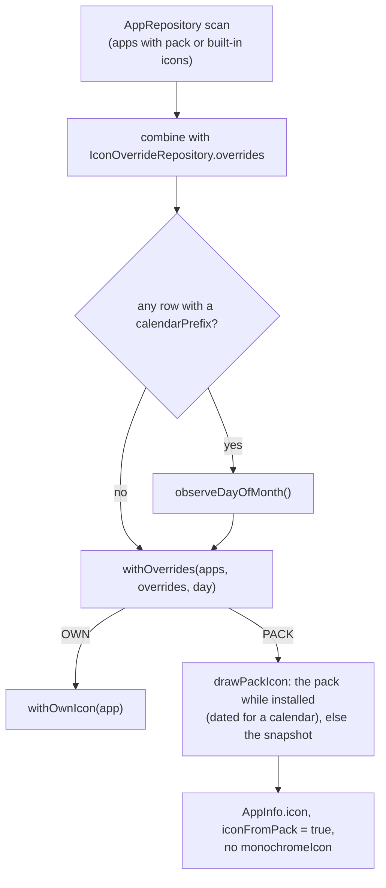

# 22 — Custom app icons

One app's icon, changed from its long-press menu: the app's own icon, its entry in any installed icon pack, or any
icon a pack offers. Free, not Pro. Launcher-wide, not per facet. Icon packs themselves are [19](19-flow-icon-packs.md).

## 1. Storage

`icon_overrides` (Room, [02](02-persistence-room.md)) holds one row per app, keyed like `app_placements`:
`packageName`, `activityName`, `userId`, plus `profile` for a restored row, `source` (`PACK` or `OWN`), `packPackage`,
`drawableName`, `calendarPrefix`, `snapshotFile` and `updatedAt`. `IconOverrideRepository` is the only reader and
writer. A pack icon keeps a PNG snapshot in `filesDir/icon_overrides/`, taken when it is picked (at most
`PACK_ICON_SIZE`), so the icon survives the pack being uninstalled; replacing or resetting a row deletes its file.

`List<IconOverride>.matchApps(apps)` pairs rows with installed apps: the exact key, then a restored row
(`UNRESOLVED_USER_ID`) by package, activity and profile, then, for an app with one launcher activity, a row for the
same package whose activity was renamed.

## 2. Drawing

The overlay runs after the scan in `AppRepository` ([03 §1](03-reactive-data-flow.md)), so changing one icon redraws
the list from the last scan without rescanning. `drawPackIcon` caches up to 64 bitmaps, keyed by the row's
`updatedAt`, the drawable and the pack's `lastUpdateTime`. A custom icon is drawn as picked: being `iconFromPack`, no
built-in style (Monochrome, Glyph, Outline) recolours it, and only `force_icon_shape` clips it. With no pack and no
snapshot the app shows its default icon.

## 3. Changing an icon

`AppContextMenu`'s header icon carries a pencil while `LocalAppIconEditor` is provided (Home, Dock, drawer, folders
and search, through `FacetNavHost`'s HOME route; previews and tests without one keep the plain header). Tapping the
icon opens the Change icon page; tapping the name still opens the app. The pages are `AppMenuPage`s inside the same
sheet, so Home press and Back behave as for the menu ([12 §4](12-flow-drawer-search-and-app-actions.md)).

- **Change icon** (`ChangeIconPage`): a preview with where the icon comes from, then "App's own" and the app's entry
  in every installed pack (`ObserveAppIconChoicesUseCase`, read once per open through
  `IconPackRepository.matchFor`, outside the applied pack's cache), the current one ringed. Then one Browse row per
  pack, "Find icon packs" with none, and "Reset to default" while the app has a custom icon. Choices are read only
  once the pencil is tapped.
- **Browse** (`BrowsePackPage`): search and category chips over `IconPackRepository.catalog` (the pack's
  `drawable.xml` asset, else its `res/xml/drawable`, else every drawable its `appfilter.xml` names, cached per pack
  version), the app's own match first as "Best match", in a five-column grid.

Picking an icon (`ChangeAppIconUseCase`) stores the row and its snapshot (a calendar entry with no plain drawable
snapshots the 1st's) and returns to the menu's main page, whose header shows the new icon.

## 4. Resetting

Settings → Appearance → Icons shows a "Custom icons" row while at least one installed app has one. It opens
`CustomIconsScreen` (`ObserveCustomIconsUseCase`): each app with where its icon comes from and Reset, and Reset all
behind a confirmation. It only resets; changing an icon is the app menu's job.

## 5. Cleanup and backup

`CleanUpUninstalledAppsUseCase` drops an uninstalled app's rows and a removed profile's rows with their files.
`BackupBundle.iconOverrides` carries each row with its snapshot as base64 PNG (`IconOverrideBackupUseCase`). A restore
replaces every row: a profile missing on this device stays `UNRESOLVED_USER_ID` and matches by profile, and a row for
an app that isn't installed yet is kept until it is ([09](09-flow-backup-restore.md)).
