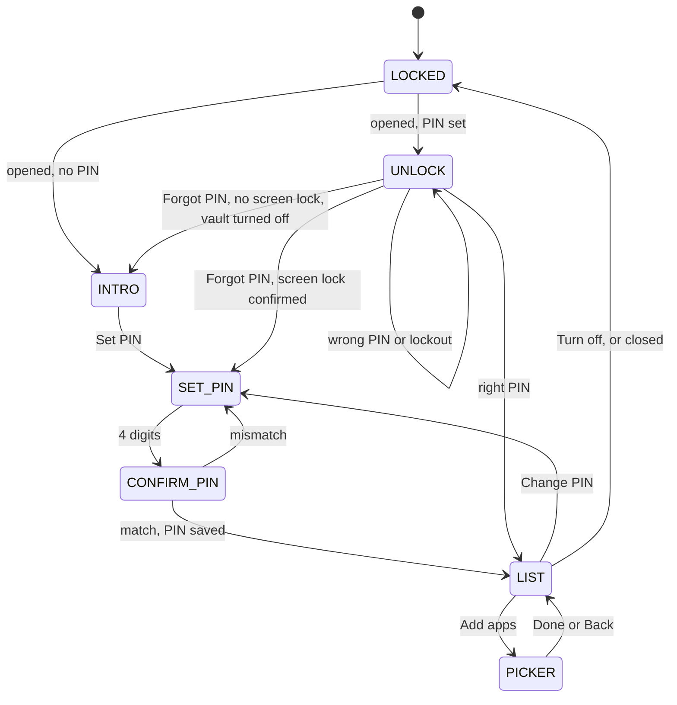

# 23 — Flow: App Vault

The App Vault hides chosen apps from every list in Facet behind a 4-digit PIN. It is one vault for all facets, free, and not part of any backup.

## 1. What is stored

| What | Where | Notes |
|---|---|---|
| The vaulted apps | `facet_vault` DataStore, `vaulted_apps` (a string set of `vaultKey`s, `"package\|userId"`) | A package in one profile, whatever its launcher activities. Uninstalled apps stay in the set, so a reinstall stays hidden; a removed profile drops its keys (`CleanUpUninstalledAppsUseCase`) |
| The PIN | same store: `pin_salt` (16 random bytes) and `pin_hash` (Base64) | `HMAC-SHA256(salt, pin)` with a non-exportable Android Keystore key (`facet_vault_pin`), through `PinHasher` (`KeystorePinHasher`; PBKDF2 with 120,000 rounds if the Keystore is unavailable). Checked with `MessageDigest.isEqual` |
| The lockout | same store: `failed_attempts`, `locked_until` | The 5th wrong PIN in a row locks for 30 s, then 60 s, 2 min, 5 min, and 15 min for every further miss. It survives a restart and is cleared by a right PIN or a new PIN |

The store is not Room, so there is no migration, and it is excluded from backups: `res/xml/data_extraction_rules.xml` (Android 12 and later, cloud backup and device transfer) and `res/xml/backup_rules.xml` (`fullBackupContent`, Android 11). `BackupBundle` has no vault field (`BackupCoverageTest`), so import never touches the phone's vault.

## 2. Hiding

`AppRepository` takes the vault as an optional dependency and filters by `AppInfo.vaultKey` in `observeInstalledApps()` and `getInstalledApps()`. Everything built on them drops vaulted apps with no change of its own: the drawer and search, Recents and Most used, Home hydration, the Favorites/Dock/Folder pickers, and `GetInstalledAppsUseCase`. `getAllInstalledApps()` and `observeVaultedApps()` are the unfiltered views for the vault screen.

Three places read other sources and filter separately: the widget pickers (`List<WidgetProviderOption>.withoutVaulted`), `LaunchHistoryRepository` (a vaulted app's launches and search picks are not recorded), and `ImportBackupUseCase` (after the repair step it removes the restored placements and folder rows of apps vaulted on this phone).

## 3. Moving an app in and out

`MoveToVaultUseCase` writes the vault entry first, then removes the app's Favorites, Dock and folder rows in every facet and its launch history. `placedCount` lets the Add apps flow ask first. Removing an app from the vault only deletes the entry, so it returns to the drawer, not to Home. There is no vault action in the app long-press menu.

## 4. Screens and overlay

`AppVaultViewModel` holds the typed digits in a `StringBuilder` and exposes only their count. `HomeAppVaultOverlay` follows the Private Space overlay: `HomeOverlayState.showAppVault`, opened from the last row of the drawer's 3-dot menu (`DrawerSearchBarConfig.onOpenAppVault`) and closed with the drawer. It sets `FLAG_SECURE` while open, and locks (`lock()`) when the overlay closes, on Home press, and on `ON_STOP`, which is how the vault re-locks when the launcher goes to the background. `ON_STOP` is ignored while `screenLockCheckPending` is set, so the phone's screen-lock prompt does not close the vault.

**Forgot PIN** uses `KeyguardManager.createConfirmDeviceCredentialIntent`, so no new permission is needed. On success `AppVaultRepository.clearPin()` removes the PIN and lockout but keeps the vaulted apps, and a new PIN is chosen. With no screen lock the only way out is Reset, which turns the vault off (`reset()` empties everything).

## 5. Tests

`AppVaultRepositoryTest`, `MoveToVaultUseCaseTest`, `AppVaultViewModelTest`, vault cases in `AppRepositoryTest`, `LaunchHistoryRepositoryTest`, `CleanUpUninstalledAppsUseCaseTest` and `ImportBackupUseCaseTest`, `EntitlementBackupRulesTest` (both exclusion files) and `BackupCoverageTest`; instrumented `AppVaultScreenTest` and the vault-row cases of `AppDrawerScreenTest`.
