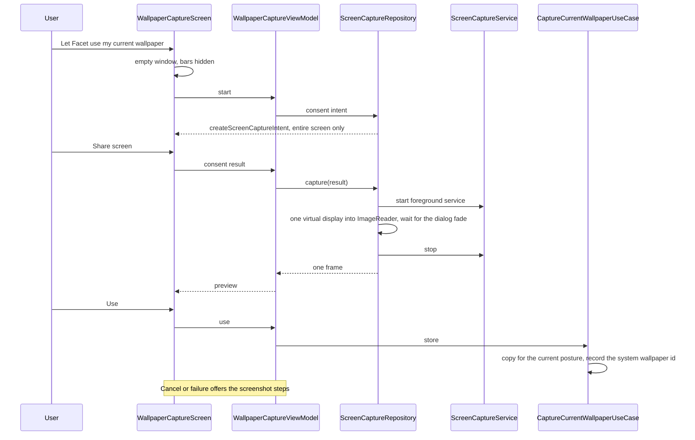

# Proposal: capture the current wallpaper with screen sharing

Status: proposed, not built. Some decisions are still open (§2); confirm them with Rohit before starting. The living docs (`docs/architecture/`) describe
what ships; this file is the plan and its reasoning.

## 1. Goal

Real glass blurs a **wallpaper copy** that Facet stores, because Android won't let a launcher read the system wallpaper (`peekDrawable()` needs storage
access, and on API 33+ only `MANAGE_EXTERNAL_STORAGE`, which Play refuses for launchers). See `21-flow-wallpaper-glass.md`.

- When Facet sets the wallpaper itself (your image, Daily photos, Daily wallpaper), it keeps the copy already.
- For a wallpaper set anywhere else, the user has to take a screenshot today: *Let Facet use my current wallpaper* → dialog → `WallpaperCaptureScreen`
  (an empty window with the bars hidden) → Power + Volume down → *Choose screenshot* → picker → fit step → `UseScreenshotAsWallpaperCopyUseCase`.
- Colours don't need any of this: `WallpaperRepository` and `WallpaperPaletteRepository` already fall back to `getWallpaperColors()`.
- Since PR #61 the wallpaper screen's preview takes the window's shape, and a frame made on a wide screen is stored wide instead of stretched
  (`orientedLike` in `SetWallpaperFromPhotoUseCase.kt`).

Replace the screenshot steps with one tap, Android's *Share your screen* dialog (MediaProjection), and a *Use / Retake* check, as Smart Launcher does.

## 2. Decisions

| Question | Answer | Status |
|---|---|---|
| Live wallpapers | Out of scope: Facet doesn't support them | Decided |
| Folded and unfolded | One copy per posture, so glass lines up on each screen | Decided |
| Portrait and landscape | One copy shared per posture, centre-cropped to cover | Decided; rotation still to check on the emulator |
| Minimum API | Works from API 30 (minSdk). Glass blur itself needs 31, so on 30 a capture only feeds the previews and palette | Decided |
| Build it at all (foreground service, Play declaration, privacy policy line) | Proposed: yes | Open |
| Keep the screenshot flow | Proposed: yes, as the fallback when the dialog is cancelled or capture fails | Open |
| Show the capture before using it | Proposed: a *Use / Retake* preview | Open |
| Free or Pro | Proposed: free, as the screenshot path is | Open |
| Where to offer it | Proposed: the wallpaper screen link, the glass prompt sheet, and the card shown after Android's picker | Open |

## 3. Flow

## 4. Build plan

Names for new classes are suggestions that follow `CLAUDE.md`'s naming and layering. Keep composable → ViewModel → Repository / use case; the service
and `MediaProjection` stay in `data/`.

| Piece | Layer | What it does |
|---|---|---|
| `ScreenCaptureService` (new) | `data/` | A foreground service, `foregroundServiceType="mediaProjection"`, running only for one capture. Started after consent, stopped as soon as the frame is read. |
| `ScreenCaptureRepository` (new) | `data/` | Makes the consent intent (`createScreenCaptureIntent`, with `MediaProjectionConfig.createConfigForDefaultDisplay()` on API 34+). Given the result, starts the service, registers the projection callback, makes one virtual display into an `ImageReader` at the real screen size, waits for the dialog's fade to finish, returns one `Bitmap`, then stops everything. Suspend, off the main thread. |
| `CaptureCurrentWallpaperUseCase` (new) | `domain/` | Capture → store as the copy for the current posture → record the system wallpaper id. Reuses the storing half of `UseScreenshotAsWallpaperCopyUseCase` (no fit step: the frame is already the screen). |
| `WallpaperCopyRepository` | `data/` | One copy per posture instead of one file (§5). |
| `WallpaperCaptureScreen` | `ui/settings/` | Gains a capture mode: no instruction card, bars hidden, launches the consent, then shows the result for *Use* or *Retake*. *Cancel* on the dialog or a failure offers the screenshot steps it shows today. |
| `WallpaperCaptureViewModel` (new, or in `WallpaperViewModel`) | `ui/settings/` | Owns the capture state (idle, waiting for consent, capturing, preview, failed) as a `StateFlow`. |
| `WallpaperBackdropViewModel`, `WallpaperBackdropHost` | `ui/launcher/`, `ui/components/` | Pick the copy for the current posture; drop the portrait-only rule, since landscape shares the posture's copy. |
| `AndroidManifest.xml` | | The service, `FOREGROUND_SERVICE` and `FOREGROUND_SERVICE_MEDIA_PROJECTION`. |

No new dependency and no network: the frame never leaves the device.

## 5. Folded and unfolded copies

A folded and an unfolded screen show different parts of the wallpaper, so each posture gets its own copy. Portrait and landscape share their posture's copy.

- **Key:** the shortest side of `WindowManager.maximumWindowMetrics` in pixels. It differs between a fold's cover and inner screens and doesn't change on
  rotation. A plain phone has one key, so nothing changes there.
- **Storage:** today there's one `wallpaper_copy.png` and one `wallpaperCopySystemId`. Move to one file and one recorded id per key, and migrate the
  existing copy to the key it was made on (for a portrait copy, its width). This touches DataStore keys, so follow `02 §5.6`'s checklist.
- **Glass:** uses the copy for the current key and stays a tint when there is none. It never borrows the other posture's copy, which would not line up.
- **Asking for the second copy:** not at the moment of folding or unfolding, which would interrupt. The first time Home comes to the front on a key with no
  copy, while the other key has a current copy and some glass style is on, Home shows a small card: *Glass on this screen needs your wallpaper*, with
  *Capture* and *Not now*. *Not now* is remembered per key and per wallpaper id, so it returns only after the wallpaper changes. The card must close on
  Home press (`DismissOnHomePress`, `12 §4`).
- **Wallpaper screen:** lists both postures with their state (*Folded: in use*, *Unfolded: capture*), so the user can capture from there at any time.
- **Wallpaper changed elsewhere:** every copy goes stale (the existing id check). Ask again for the posture in use, and for the other one on its first use.
- **Wallpapers Facet sets itself** store a copy only for the current key, for now. Deriving the other posture's copy from the source photo depends on how
  Android crops each screen, which hasn't been checked.

## 6. Platform rules and edge cases

| Rule or case | What to do |
|---|---|
| Consent is needed on every capture; there is no lasting grant | One capture per tap. Never try to refresh a copy in the background. |
| A foreground service of type `mediaProjection` is required before `getMediaProjection` (since targetSdk 29) | Start it right after consent, stop it right after the frame. On API 34+ also declare `FOREGROUND_SERVICE_MEDIA_PROJECTION`. It runs without notification permission. |
| API 34+: the consent result can't be reused, each projection allows one `createVirtualDisplay`, and a callback must be registered first | Matches a one-shot design. *Retake* asks again. |
| API 34+ dialog can offer a single app | Force the entire screen with `MediaProjectionConfig.createConfigForDefaultDisplay()`. A single-app share of Facet would not include the wallpaper, which is a separate window. API 30 to 33 only offer the entire screen. |
| The dialog fades out after *Share screen* | Wait until two frames in a row match, capped at about 1 second, before keeping one. |
| Status bar cast icon, red sharing chip on recent Pixels, OEM toasts (Samsung, Xiaomi) | The capture screen hides the bars. OEM overlays can still land in the frame; the *Use / Retake* preview catches them. |
| Pixel's dim wallpaper in dark theme | It is in the frame. That matches what the user sees, as the screenshot path does today. |
| Dialog cancelled, or the service or capture fails | Offer the screenshot steps, not an error. |
| Device locked or app left during capture | Android stops the projection. Treat it as a failure. |
| A wallpaper set by Facet | No capture needed: Facet already has the copy for the current posture. |

Not confirmed: how Smart Launcher uses the capture (one frame or a running share), and the exact sharing indicator on One UI and HyperOS. Worth a quick test
on a real phone.

## 7. Tests, docs and release tasks

Tests (no feature is done without tests that would fail if it broke):

- JVM: `CaptureCurrentWallpaperUseCaseTest` with a fake capture source (stores for the current key, records the id, stores nothing on failure). Extend
  `WallpaperCopyRepositoryTest` for per-key files and the migration of the old single copy. Unit-test the frame-settling check on fake frames.
- JVM: the Home card's rules (shown only with no copy on this key, a current copy on the other, glass on; *Not now* remembered per key and wallpaper id).
- Emulator: `WallpaperCaptureScreenTest` for the capture mode's states with a fake ViewModel state, and `WallpaperScreenTest` for the two-posture list. The
  consent dialog is system UI; if it is driven with UiAutomator, keep that test narrow, because its labels change between Android versions.

Docs, in the same commit (`CLAUDE.md`'s table): `21-flow-wallpaper-glass.md` (capture flow, per-posture copies, prompts); `07` and `01` for the new
repository, use case and ViewModel; `02 §5` for DataStore keys; `03 §5` if the capture adds a `callbackFlow`; `12 §4` for the Home card; `04` for new
packages; regenerate `TEST_REGISTRY.md`; tick `IMPLEMENTATION_PLAN.md`.

Release tasks for Rohit, outside the code:

- [ ] Play Console: declare the `mediaProjection` foreground service type with a short description and a demo video. Expect a round of review.
- [ ] Privacy policy (site repo, `build.py` template): one line saying Facet captures one frame of the screen when asked, to keep a copy of the wallpaper on
  the device, and sends nothing.
- [ ] Play data safety: no change expected, because nothing is collected or shared. Confirm when filing.

## 8. How to build and check it

Cloud containers have no Android SDK, so build and test on Rohit's Mac through Remote Control, in the approved folder `/Volumes/NVME/repo/lumen-launcher`
(the facet-launcher repo), in a separate worktree such as `../facet-fold-build`. Never touch his main checkout. The default branch is `master`.

| Emulator | Serial | Use |
|---|---|---|
| Medium_Phone_API_36.1 | emulator-5554 | Instrumented tests, always with `ANDROID_SERIAL=emulator-5554`, one test class per run. Tests reset Facet's data on it. |
| Pixel_Fold (API 36) | emulator-5558 when running | Manual checks folded and unfolded. Install with `adb -s emulator-5558 install -r`; never uninstall or clear data. |
| Pixel_5 | emulator-5556 | Leave alone unless asked. |

Manual checks before calling it done:

1. Set a wallpaper with Android's own picker, then capture from the wallpaper screen. Glass should match what is behind it.
2. Cancel the dialog: the screenshot steps should appear.
3. On the Fold, capture folded, then unfold: the Home card should appear once, and glass should line up after capturing there.
4. Rotate in both postures and check that the shared copy still lines up. This was assumed, not tested.
5. Change the wallpaper elsewhere: both copies should go stale.
6. On API 30, if an emulator is available, the capture should work and glass should stay a tint.
